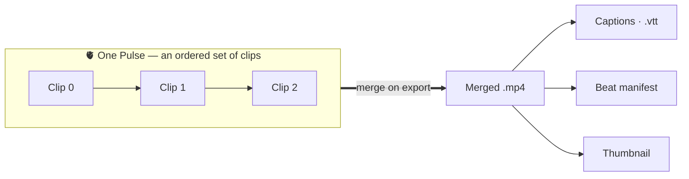
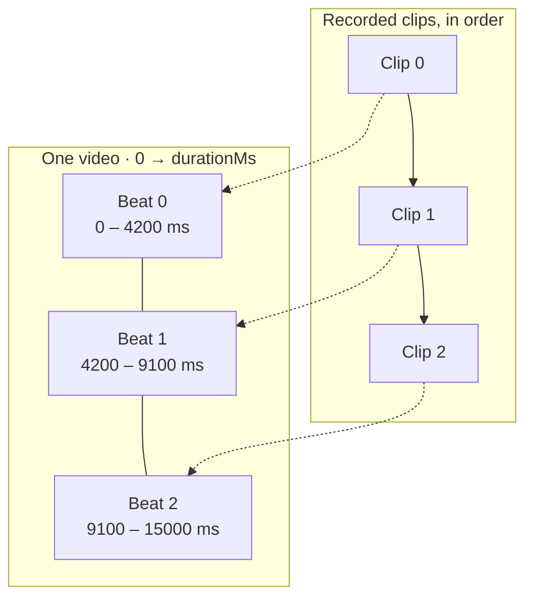

<div align="center">


# Pulse

**Short-form institutional video — record and edit on-device, upload to your own server.**

[](https://reactnative.dev)
[](https://expo.dev)
[](https://www.typescriptlang.org)
[](https://github.com/mybigday/whisper.rn)
[](https://react-native-vision-camera.com)

_Capture knowledge before it walks out the door — training walkthroughs, process demos, handoffs — without sending a single frame to a third-party cloud._

</div>

---

Pulse is a React Native (Expo) app for capturing institutional knowledge as short-form video. Everything happens on the device: segmented recording, trimming, merging, and even speech-to-text captioning run locally. When you're ready to publish, Pulse uploads to a [**PulseVault**](#pulsevault--self-hosted-uploads) server _you_ run — your organization keeps the content on its own infrastructure and owns auth, retention, and quota decisions. No central Pulse service exists.

## Anatomy of a Pulse

Two words show up throughout Pulse — here's what they mean.

### What is a Pulse?

A **Pulse** is a single short-form video, assembled on-device from an ordered set of clips. Record a few, import a few, reorder them — on export they merge (losslessly where formats match) into one `.mp4`. Publishing a Pulse sends a small bundle: the merged video, its captions (WebVTT), a **beat manifest**, and a thumbnail. On-device each Pulse is a _draft_ in your library; drafts move between devices as `.pulse` bundles.



### What is a Beat?

A **Beat** is a timestamp range inside the Pulse's one video: where one recorded clip starts and ends — `{ segmentId, order, startMs, endMs }`. The **beat manifest** records every clip's start/end so any moment in the video can be traced back to the segment it came from (and later deep-linked — e.g. HLS chapter jumps). Beats are **contiguous** — each beat's `endMs` equals the next beat's `startMs` — and sum **exactly** to the Pulse's true duration.



## Highlights

- 🎬 **Segmented recording** — build a walkthrough from multiple clips, reorder them, re-record the ones you fumbled
- ✂️ **Non-compounding edits** — trims, crops, rotations and speed are stored as settings over the pristine original and rendered once at export, so re-editing never stacks generation loss
- 🗣️ **On-device captions** — Whisper (whisper.cpp) transcription with word-level timing, no audio ever leaves the phone
- 📡 **Resumable uploads** — TUS v1 protocol; a two-minute capture survives signal drops, app kills, and relaunches
- 🔐 **Self-hosted by design** — pair with your server via QR / deep link; capability tokens live in the device keychain
- 📦 **Local-first drafts** — SQLite-backed library that works fully offline, shareable device-to-device as `.pulse` bundles

## Features

### Recording & camera

- Multi-clip segmented recording with [VisionCamera](https://react-native-vision-camera.com) v5 — segments append to one draft with a live segment bar and drag-to-reorder
- Front/back flip, torch, mic mute, tap-to-focus, pinch-to-zoom, lens selection, and stabilization levels (off / on / high / auto), all persisted across sessions
- Call-aware capture: a custom native module (audio-interruption detection on iOS, audio-mode detection on Android) gates the microphone when the audio session is interrupted so recordings don't silently freeze
- Import existing videos from Photos instead of recording

### Editing & export

- Per-clip trim and transforms are saved as settings over the untouched source and rendered at export
- The editor has **one sticky + at the right edge of the clip row**, visible in both views and while editing a clip. **Clips (beat list)** inserts at the nearest clip boundary without splitting: before the clip in its first half, after it in its second half, and after it at the midpoint. **Timeline** inserts at the exact playhead. At the end, either view appends a new clip/beat to the existing Pulse.
- In Timeline, adding X inside A produces **A-left → X → A-right**, with both halves sharing the source video. One Undo restores A and removes X; Redo restores the insertion. Canceling or failing before the first new clip commits leaves A unsplit.
- Each split half keeps its own source bounds: trim handles and Reset cannot reveal the sibling's footage. Reset clears that half's transforms and speed without rejoining the clip.
- An image batch registers one history step when its first clip commits and extends it as later images arrive. Edits remain available; Undo/Redo waits until the batch finishes or is canceled. A canceled partial batch keeps its committed clips in that step.
- Undoing an addition can remove the last remaining clips. The editor stays open for Redo, which restores those clips with their edits; export stays disabled while the draft is empty.
- Undo/Redo history lasts for the editor session. Current edits travel in `.pulse` files; persisting the history is tracked separately in [#325](https://github.com/mieweb/pulse/issues/325). See [persistence](docs/persistence.md#editor-operations-and-session-history).
- Smart merge on export: clips with matching formats are concatenated losslessly (passthrough); mixed resolution/fps/codec/orientation drafts conform only the outlier clips, with a full re-encode fallback
- Save to Photos or Files, share anywhere, or upload — with a live progress ring

### Captions & transcription

- Fully on-device speech-to-text with [whisper.rn](https://github.com/mybigday/whisper.rn) — Parakeet for English, or a multilingual Whisper (Large Turbo on iOS, Small on Android), downloaded from the editor's Captions tool
- Each clip is transcribed once, in the background; the draft's captions are composed from the clips through their trims, speed, mutes and order, so an edit never re-runs the model
- Silero VAD pre-gate skips silent clips and suppresses Whisper's hallucinated filler on empty audio
- Word-level timestamps reflowed into broadcast-style cues (line-length, duration, and sentence-boundary aware; Chinese, Japanese and Thai keep their per-character timing), never across a cut
- Captions live in the editor: shown over the preview and on a lane under the clips; tap a word to edit or delete it, split or merge sentences at the playhead, drag the caption to move them all — edits are kept per clip and undoable
- Captions upload as WebVTT with word-level cue timestamps (karaoke-ready) and their position, alongside the video

### Drafts & library

- Local-first draft library on Drizzle ORM + SQLite — create, rename, delete, with live-updating thumbnails
- Device-to-device draft sharing as `.pulse` bundles (zip + manifest, with unpack safety limits)
- First-run onboarding tour

### Upload & pairing

- Pair with a server by scanning a QR / opening a `pulsecam://` deep link — trust-on-first-use confirmation, capability negotiation against the server's `/capabilities` endpoint
- TUS v1 uploads that retry with exponential backoff, resuming from the server's true byte offset; they carry on in the background, and a link is used once — if an upload can't finish (or the app is killed), it's cleaned up and a new link is the retry
- A link can say which place in the host app its upload is for — a ticket, a team's update (protocol 2.7). Pulse then opens the recorder on the draft already started for that place, or on a new one named by the link, preselects the place when you upload, and offers the way back to the host once the video is in. The recorder opens once the server has answered (a toast says it is being asked, a few seconds at most), so a first link needs a connection; a link the place already holds opens its recorder at once. Until a draft uses it, a place has one link on the device: a newer one the server accepted replaces it, an expired one is refused. The link is still one upload — after a failed or cancelled one, a new link for the place comes back to the same draft
- Which place a link is for is read from its token, which Pulse can't verify: only a link the server has accepted replaces the one a place already has. What a link calls the place, the recording and the host app is unsigned text: shown as one clean line, never deciding where a video goes, and always beside the server's host. The way back opens only on a tap, and its button names the host it leads to
- A Pulse uploads as one video, plus its captions (WebVTT), beat manifest and thumbnail — each declaring `relatedTo` the video
- A finished upload's Watch and Copy link live in the draft's ⋯ menu on Home. Copy link shares a read-only view link (servers on protocol 2.2+), never the upload token
- Bearer tokens stored in the secure keychain, never in the database

## Platform support

Pulse runs on **iOS and Android** from a single codebase. iOS is the original platform; Android has been brought to parity and verified end-to-end on device — recording, editing, merge/export, on-device captions, `.pulse` sharing, pairing, and resumable uploads (including upload survival through backgrounding and Doze via a foreground service).

Platform notes:

- **High (cinematic) stabilization** is iOS-only (VisionCamera exposes it via AVFoundation); Android offers off / on / auto
- **Whisper transcription** uses Metal GPU acceleration on iOS; Android runs on CPU, so larger models are noticeably slower — Base (en) is the recommended starting point
- **Call-aware capture** uses AVAudioSession interruptions on iOS (no CallKit — it must stay out of the binary for China App Store distribution) and an audio-mode heuristic on Android (no extra permissions), so both platforms pause the mic when the session is interrupted
- On Android, merged exports save through MediaStore into `DCIM/`, and uploads run as a `dataSync` foreground service with a progress notification

## How it works

```
┌─────────────────────────── on device ───────────────────────────┐
│                                                                  │
│  Record (VisionCamera) ─▶ Trim/Merge (FFmpeg) ─▶ Draft (SQLite)  │
│                                │                                 │
│                    Whisper + VAD ─▶ captions (VTT)               │
│                                                                  │
└──────────────────────────────┬───────────────────────────────────┘
                               │  pair via pulsecam:// QR / deep link
                               ▼
                 TUS v1 resumable upload (video + VTT)
                               │
                               ▼
                ┌──────────────────────────────┐
                │   PulseVault (self-hosted)   │
                │  your auth · your storage    │
                └──────────────────────────────┘
```

### PulseVault — self-hosted uploads

The server side lives in [`pulsevault-mieweb/`](pulsevault-mieweb/): a Fastify plugin (with a framework-agnostic core for Express, Meteor, or plain Node `http`) that receives Pulse uploads into filesystem-first storage, with `authorize` / `validatePayload` / `onUploadComplete` hooks for wiring in your SSO, audit trail, transcoding, or AI pipeline. The wire contract is documented in [PROTOCOL.md](pulsevault-mieweb/PROTOCOL.md) — an implementation-independent spec (capability discovery, artifact kinds, tokens, TUS) so anyone can build a compatible server.

## Getting started

> **Git LFS required.** The dev-seed video fixtures in `assets/dev/*.mp4` are stored in [Git LFS](https://git-lfs.com). Install it before cloning (or pull after), otherwise those files arrive as tiny pointer stubs and the dev `+ seed` button breaks:
>
> ```bash
> brew install git-lfs && git lfs install   # one-time
> git lfs pull                              # if you cloned before installing
> ```
>
> The ~400 MB fixture-regen master (`fixtures/bbb_master.mov`) is intentionally excluded from normal clones (see `.lfsconfig`); fetch it only when regenerating fixtures: `git lfs pull --include "fixtures/*.mov"`.

Requires **Node.js ≥ 24.3.0** (the `engines` field in `package.json`; CI uses Node 24).

```bash
# 1. Clone with the PulseVault submodule (or, in an existing clone: git submodule update --init)
git clone --recurse-submodules https://github.com/mieweb/pulse.git && cd pulse

# 2. Install dependencies
npm install

# 3. Run a development build (native modules — Expo Go won't work)
npm run ios       # or: npm run android
```

Pulse uses native modules (VisionCamera, Whisper, FFmpeg), so it needs a **dev build**, not Expo Go.

For Xcode 27 builds, `plugins/with-ios-scene-lifecycle.js` enables Expo's existing scene
delegate during prebuild. iOS 27 requires this lifecycle for apps built with its SDK;
the plugin preserves the startup fix when regenerating `ios/` with a clean prebuild.

The [iOS release workflow](.github/workflows/build-ios-from-expo.yml) uses GitHub's
`xcode-27` runner and selects `/Applications/Xcode_27.2.app`. Before prebuild,
`node scripts/check-ios-sdk.mjs` verifies that the selected Xcode and iPhoneOS SDK
are both version 27 or later; an older fallback stops the build. This addresses
Apple's ITMS-90725 SDK warning and the April 2027 upload requirement. Run the workflow
with `upload_to_testflight=false` to validate an archive, then enable upload on `main`
for the next TestFlight build. Signing continues to use the existing read-only match profiles.

The [`pulsevault-mieweb/`](pulsevault-mieweb/) submodule pins the server this app is built against. It holds the protocol JSON Schemas that `src/features/upload/core/protocol.gen.ts` is generated from, and it is the server used by the integration suite (see [Testing](#testing)).

**No camera? No problem.** In a dev build, the Home screen has `+ seed` / `clear` buttons that create a "Dev sample" draft from the bundled `assets/dev/` clips — including deliberately mismatched resolution/fps/codec/orientation clips that exercise the export-normalization path — so the full editor is drivable on a simulator. See [assets/dev/README.md](assets/dev/README.md).

## Pulse inside another app

PulseKit is Pulse packaged for other apps: a Capacitor or Cordova app opens Pulse full screen to
record, edit or export one video, and gets one result back. Pulse then uploads the video to the
app's own server through PulseVault, carrying on after Pulse closes and with the phone locked, or
hands the app the finished MP4 instead. The app's own screens list each signed-in person's drafts
and their upload states without opening Pulse. It runs on iPhone with iOS 16.4 or later, and, in a
Capacitor app, on Android phones with Android 7.0 or later ([Android setup](docs/embedding/android.md)).
The Cordova plugin's Android side is still a stub: `isAvailable()` is false there, and the app shows
its own fallback.

| Package                                                        | Used by        | What it is                                                         |
| -------------------------------------------------------------- | -------------- | ------------------------------------------------------------------ |
| [`@mieweb/pulse-embed`](embed/packages/pulse-embed/)           | Every host     | The client your page calls, its types, React hooks and a test fake |
| [`@mieweb/capacitor-pulse`](embed/packages/capacitor-pulse/)   | Capacitor 8    | The native plugin: Swift Package Manager on iOS, Maven on Android  |
| [`cordova-plugin-pulse`](embed/packages/cordova-plugin-pulse/) | cordova-ios 8+ | The native plugin, through CocoaPods                               |

The three are published together, at one version, as release candidates (prereleases) on the npm
`rc` tag. In a Capacitor app:

```sh
npm install --save-exact @mieweb/pulse-embed@rc @mieweb/capacitor-pulse@rc
npx cap sync ios
```

```ts
import { contextKey, getPulse } from '@mieweb/pulse-embed';

const pulse = getPulse();
await pulse.configure({ hostName: 'TimeHuddle' }); // Pulse uploads (uploadMode 'pulse')
await pulse.setAccount({ serverOrigin: 'https://timehuddle.mieweb.org', userId: 'u_8Kq2fd' });
pulse.setHostServices(hostServices); // yours: asks your server for an upload target and token

const id = 'TH-482'; // check pulse.isAvailable() before showing a Pulse button
const context = { key: contextKey('ticket', id), kind: 'ticket', id, label: 'Fix login' };
const result = await pulse.record(context); // 'completed' once Send queued the upload
await pulse.acknowledge(result.requestId);

const unsent = await pulse.listDrafts({ contextKey: context.key }); // drafts and their upload states
```

That is the shape, not a complete integration: your app also needs the `Info.plist` purpose
strings, an `AppDelegate` that forwards background upload events, and has to read
`pendingResults()` on every page load, because a reload drops the `record()` promise.
[docs/embedding/](docs/embedding/README.md) has the full step-by-step path for Capacitor and
Cordova, Pulse uploads, the drafts API and accounts, with a checklist to verify each. The reference
hosts are in [`embed/hosts/`](embed/hosts/). How the Pulse app and PulseKit share one codebase is
in [docs/architecture.md](docs/architecture.md), and how PulseKit keeps each account's library, its
upload outbox and receipts in [docs/persistence.md](docs/persistence.md).

## Development

### Commands

| Command                                   | What it does                                                                                                                                          |
| ----------------------------------------- | ----------------------------------------------------------------------------------------------------------------------------------------------------- |
| `npm start`                               | Start the Metro dev server                                                                                                                            |
| `npm run ios` / `npm run android`         | Build & run the dev client                                                                                                                            |
| `npm test`                                | Run the Jest unit-test suite (the app's and `embed/`'s)                                                                                               |
| `npm run lint`                            | ESLint via `expo lint src embed/src`, including the rules that keep shared code out of either shell                                                   |
| `npx tsc --noEmit`                        | Typecheck (also covers `embed/`; `npx tsc --noEmit -p embed` checks it with the embed's own path map)                                                 |
| `npm run format` / `npm run format:check` | Prettier (write / check only)                                                                                                                         |
| `node scripts/gen-protocol-types.mjs`     | Regenerate `src/features/upload/core/protocol.gen.ts` from the submodule's schemas and `package.json` `pulseProtocol` (`--check` fails if it's stale) |
| `npm run check:embed`                     | Check what ships in PulseKit: dependency classification, no SQLite in native code, and PulseKit's iOS and Android JS bundles (no native build)        |
| `npm run embed:package:ios`               | Package an `expo-brownfield` iOS build in `embed/artifacts` into PulseKit release assets (`--help` for options)                                       |
| `npm run embed:package:android`           | Check the fused Android AAR in `embed/artifacts/android-maven` (ABIs, 16 KB pages, permissions, dependencies) and zip it as a release asset           |

CI ([`.github/workflows/ci.yml`](.github/workflows/ci.yml)) runs the typecheck, lint, `gen-protocol-types.mjs --check`, and unit tests on every PR, the embed check (`npm run check:embed`), the Android core's vectors on a JVM (`jvm-vectors`), plus the integration suite against both the pinned PulseVault and the latest npm release. PulseKit releases run from [`release-embed.yml`](.github/workflows/release-embed.yml) on `pulsekit-v*` tags ([releasing](docs/embedding/releasing.md)).

### Project structure

```
src/
├── app/            # the Pulse app shell: thin expo-router routes over the feature screens
├── shell/          # standalone/: navigation helpers only the Pulse app uses
├── features/       # recorder, editor, export, drafts, transcription, upload (core, pairing), onboarding, …
├── core/           # PulseCore provider, focus and status-bar ports, recovery
├── db/             # Drizzle ORM schema + queries (expo-sqlite)
├── utils/          # storage roots, files, media helpers
├── components/     # shared themed UI
├── test-support/   # Node stand-ins for native modules, and the lint-zone tests
└── dev/            # __DEV__-only seed tooling (dead-code-eliminated in release)
embed/              # PulseKit: the embed shell, native facades, release scripts (see embed/README.md)
├── native/ios/     # the Swift facade and its shared vectors
├── native/android/ # the Kotlin facade, PulseActivity, the upload service, and jvm-tests/ (vectors on a JVM)
└── packages/       # what host apps install: @mieweb/pulse-embed and the Capacitor/Cordova plugins
modules/            # custom native modules (expo-call-detector) and the pulse-editor submodule
plugins/            # Expo config plugins
pulsevault-mieweb/  # self-hosted upload server + protocol spec
fixtures/           # fixture-regen sources (Big Buck Bunny, CC-BY)
docs/               # persistence, architecture, embedding guide and research notes
```

The layers and the rules between them are in [docs/architecture.md](docs/architecture.md).

### Testing

Unit tests are co-located with the code and scoped to pure logic — cue reflow, upload/TUS state machines, deep-link parsing, edit history, autosave gating, the embed flow reducer, the upload outbox and its kill-at-every-request matrix, the host client and its contract — so they run in a plain Node environment with no native rendering. The host contract suite runs against both the test fake and Pulse's own embedded JavaScript, so the fake answers as Pulse does wherever the suite can tell. Jest collects `*.test.ts` under both `src/` and `embed/` (not the test hosts or generated native folders). PulseVault ships its own suite covering the HTTP adapters, capability tokens, and checksum handling.

```bash
npm test
```

A heavier suite is opt-in and skips itself in a plain `npm test`:

```bash
# Cross-repo integration: the app's real pairing + upload code against a real PulseVault
# server built from the submodule (set PV_CORE=<path to core.js> to test another build)
(cd pulsevault-mieweb && npm ci && npm run build)
PULSE_INTEGRATION=1 npx jest pv-integration --forceExit
```

PulseKit's facade rules also run on a Mac without an iOS build, as shared vectors: the envelope ([embed/native/ios/vectors/README.md](embed/native/ios/vectors/README.md)), catalog reads ([src/features/drafts/\_\_vectors\_\_/catalog.json](src/features/drafts/__vectors__/catalog.json)) and account namespaces ([embed/native/ios/namespace-vectors.json](embed/native/ios/namespace-vectors.json)). The Android facade's Kotlin core runs the same vectors on a JVM, with no Android build (JDK 17 or 21):

```bash
gradle --offline -q -p embed/native/android/jvm-tests run --args="$PWD"
```

[embed/native/android/README.md](embed/native/android/README.md) has the details, including the upload service's own rules.

## License

See [LICENSE](LICENSE).

---

<div align="center">

Made with ❤️ at [MIE](https://www.mieweb.com) — built on React Native, Expo, whisper.cpp, and FFmpeg.

</div>
