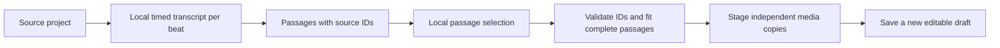

# Developer AI editing preview

Pulse turns speech from one or more video beats into a separate, editable iPhone draft. Pulse uses
whisper.rn to run Parakeet or Whisper and obtain timed words. Apple's on-device
`SystemLanguageModel` ranks passages, and Pulse fits them to one 115-second budget across the
project.
[Speech engine binding and Pulse’s word-timing adapter](../src/features/transcription/whisper.ts#L1-L53)
· [whisper.rn upstream](https://github.com/mybigday/whisper.rn) ·
[Speech and edit pipeline](../src/features/ai-edit/run-ai-edit.ts#L55-L129) ·
[Apple model session](../modules/expo-ai-editor/ios/AiEditorEngine.swift#L165-L203) ·
[Cut duration constant](../src/core/types/ai-edit.ts#L1-L2)

[Project README](../README.md#editing--export) ·
[Native module and API](../modules/expo-ai-editor/README.md) ·
[Speech and caption engines](captions-engines.md) ·
[Draft and media ownership](persistence.md#ai-cut-projects) ·
[iPhone build and test guide](testing/ai-edit-phone-build.md) ·
[Simulator screenshots and results](../screenshots/validation/ai-edit/editable-prompt/README.md)

OmniShotCut detects visual shot boundaries. Issue #341 proposes evaluating it as an additional
signal and generating written summaries in a later experiment. The shipped selector takes transcript
passages. Pulse's separate **Summary** project feature collects existing beats.
[OmniShotCut upstream README](https://github.com/UVA-Computer-Vision-Lab/OmniShotCut) ·
[MVP and research scope](https://github.com/mieweb/pulse/issues/341) ·
[Selector input](../src/features/ai-edit/selection.ts#L64-L70) ·
[Summary collection](../src/db/summaries.ts#L100-L141)

## Enable and test

AI editing defaults on in iOS development sessions. For a local Release build, set
`PULSE_DEVELOPER_BUILD=1`. The config suppresses that opt-in when `GITHUB_SHA` is set in CI. Set
`PULSE_AI_EDIT=0` to disable the preview. Both the editor button and the job check the gate.
[Build configuration](../app.config.ts#L44-L78) · [iOS gate](../src/features/ai-edit/enabled.ts) ·
[Flag logic](../src/features/ai-edit/feature-flag.ts) ·
[Editor action](../src/app/editor.tsx#L48-L54) ·
[Job entry](../src/features/ai-edit/run-ai-edit.ts#L37-L47)

Use Node 24.3 or later and Xcode and iPhoneOS SDK 27 or later to build. Rebuild the iOS app when
changing the Swift module. For a local phone handoff, set
`PULSE_TEST_NOTES_FILE=docs/testing/ai-edit-test-notes.json` before bundling and match the notes to
the app version. For a phone handoff, verify the bundled notes in the simulator, use the shared iOS
testing skill’s device lease, and verify release after installation.
[Node requirement](../package.json#L5-L7) ·
[iOS toolchain check](../scripts/check-ios-sdk.mjs#L14-L31) ·
[Native module registration](../modules/expo-ai-editor/expo-module.config.json) ·
[Build instructions](../README.md#getting-started) ·
[Test-notes validation](../scripts/release-notes.ts#L56-L88) ·
[App-visible test notes](testing/ai-edit-test-notes.json) ·
[Phone handoff](testing/ai-edit-phone-build.md) ·
[Device acceptance procedure](https://github.com/mieweb/pulse/issues/341)

On an eligible iPhone with iOS 26 or later, enable Apple Intelligence and wait for the system model
to be ready. Download a speech model in **On-device AI** before going offline. AI edit checks local
model readiness and disables speech-model downloads while it reads the recording.
[Apple model availability](https://developer.apple.com/documentation/foundationmodels/systemlanguagemodel)
· [Pulse availability check](../modules/expo-ai-editor/ios/AiEditorEngine.swift#L30-L70) ·
[Speech model catalog](../src/features/transcription/models.ts#L39-L79) ·
[Offline run](../src/features/ai-edit/run-ai-edit.ts#L57-L98)

Open a spoken-video project, tap **AI edit** in the editor, review **Editing instructions**, and tap
**Create AI cut**. A successful run opens the new project in Timeline view for review, trimming and
export. [Editor button](../src/features/editor/editor-screen.tsx#L930-L941) ·
[Prompt screen](../src/features/ai-edit/ai-edit-screen.tsx#L221-L336) ·
[Result navigation](../src/app/ai-edit.tsx#L9-L15) · [Editor controls](../README.md#editing--export)

## Editing instructions and styles

On first use the field contains the original editorial prompt. **Default**, **Highlights**, **Work
update** and **Story** each fill the field with editable text. **Reset to default** restores the
original. Tapping **Create AI cut** saves the validated text to local settings before the model
runs, so even an unavailable-model error can leave that prompt saved for next time. Missing or
invalid saved text falls back to Default.
[Preset text and validation](../modules/expo-ai-editor/src/prompt.ts) ·
[Save on Create](../src/features/ai-edit/ai-edit-screen.tsx#L55-L89) ·
[Local preference](../src/features/ai-edit/preferences.ts) ·
[Simulator interaction results](../screenshots/validation/ai-edit/editable-prompt/simulator-report.json)

Pulse trims outer whitespace and accepts 1–2,000 UTF-16 code units. The job captures one copy before
its first asynchronous operation and passes it to every shortlist and final selection. Swift
validates it again and appends fixed rules for returning supplied IDs. With Default selected, those
two parts reproduce the original instructions.
[JS validation](../modules/expo-ai-editor/src/prompt.ts#L1-L14) ·
[Job snapshot and selection calls](../src/features/ai-edit/run-ai-edit.ts#L44-L118) ·
[Swift validation and instructions](../modules/expo-ai-editor/ios/AiEditorEngine.swift#L72-L201) ·
[Original instructions before prompt editing](https://github.com/mieweb/pulse/blob/fe06763ecdc9d27e0985e27d3f7b5f33609b2727/modules/expo-ai-editor/ios/AiEditorEngine.swift#L162-L170)

## Processing and persistence

1. **Read the speech.** Pulse reads playable beats in project order, pauses the background captions
   queue and waits for its active job to settle. For each beat it prefers matching caption
   corrections, then a cached transcript for the selected model and file. Otherwise it transcribes
   the effective source file, which can be longer than its trimmed beat, and caches the words. It
   releases the speech model before language generation.
   [Orchestration](../src/features/ai-edit/run-ai-edit.ts#L68-L114) ·
   [Speech input and decoding](../src/features/transcription/whisper.ts#L110-L148) ·
   [Queue coordination](../src/features/transcription/clip-queue.ts#L71-L94) ·
   [Transcript precedence](../src/features/transcription/compose.ts#L31-L41)
2. **Build passages within each beat.** Pulse converts word times from centiseconds to milliseconds,
   keeps whole words inside the current trim, and groups them at sentence endings, pauses or word
   boundaries. Each ID identifies the source beat and word range.
   [Passage construction](../src/features/ai-edit/planner.ts#L53-L151) ·
   [Timing tests](../src/features/ai-edit/planner.test.ts)
3. **Choose passages across beats.** The model receives text, IDs and durations. When the candidates
   exceed the batch limits, Pulse shortlists each batch and narrows the combined candidates before a
   final selection. A beat can contribute several passages or none. The final request aims for 110
   seconds, leaving room for the planner to fit complete passages and padding within 115 seconds
   total. [Batching and target calculation](../src/features/ai-edit/selection.ts#L8-L89) ·
   [Structured model response](../modules/expo-ai-editor/ios/AiEditorEngine.swift#L179-L203) ·
   [Multi-batch tests](../src/features/ai-edit/selection.test.ts)
4. **Build the timeline.** Pulse checks for unknown or repeated IDs, fits passages by editorial
   priority, then restores their source order. It applies up to 120 ms of padding per side by
   default, bounded by the source trim and neighboring words. It merges touching excerpts from the
   same beat and accounts for playback speed in the duration.
   [Padding defaults](../src/features/ai-edit/planner.ts#L38-L51) ·
   [ID validation, ordering and duration fitting](../src/features/ai-edit/planner.ts#L153-L225)
5. **Save and export.** Pulse stages independent copies of the required source files. Excerpts that
   reference the same file can share its destination copy. A transaction saves the new draft,
   excerpt windows, transforms and matching transcripts. The save checks that the source timeline
   still matches what was analyzed and cleans up staged files on error. Export later passes the
   saved windows to the native merger, which reports the actual rendered duration.
   [Shared-file copy logic](../src/db/drafts.ts#L1497-L1551) ·
   [Staging and excerpt rows](../src/db/ai-edits.ts#L114-L185) ·
   [Transaction and cleanup](../src/db/ai-edits.ts#L186-L234) ·
   [Persistence tests](../src/db/ai-edits.test.ts) ·
   [Export path](../src/features/export/editor-merge.ts#L18-L66)

## Limits and verification

- **Recording and runtime.** The sprint targets English spoken video. Pulse rejects projects whose
  summed effective duration exceeds 20 minutes. Closing the screen, leaving it, or sending the app
  to the background cancels an active edit.
  [Sprint scope](https://github.com/mieweb/pulse/issues/341) ·
  [Duration check](../src/features/ai-edit/run-ai-edit.ts#L68-L76) ·
  [Cancellation handlers](../src/features/ai-edit/ai-edit-screen.tsx#L110-L160)
- **Audio.** Any playable muted source clip, muted project source track, or saved voiceover take
  blocks the edit, including a take on a muted voiceover track. The preview transcribes source-clip
  audio and saves its excerpts with source audio enabled. The guards protect the user's chosen mix.
  Pulse checks the project audio again while saving.
  [Clip check](../src/features/ai-edit/run-ai-edit.ts#L68-L95) ·
  [Project audio check](../src/db/ai-edits.ts#L15-L43) ·
  [Excerpt state and final check](../src/db/ai-edits.ts#L146-L199) ·
  [Narration race test](../src/db/ai-edits.test.ts#L158-L192)
- **Empty beats.** A beat with zero effective duration contributes no playable interval. Pulse skips
  it for analysis and output, but includes it in the original timeline snapshot so a source change
  can invalidate the save. A failed native duration read is one possible cause. When all beats are
  empty, the app asks the user to add spoken video.
  [Filter and empty-project message](../src/features/ai-edit/run-ai-edit.ts#L68-L74) ·
  [Playback rule](../src/utils/segment-window.ts#L314-L326) ·
  [Snapshot regression](../src/features/ai-edit/run-ai-edit.test.ts#L258-L270)
- **Verification.** The simulator exercised the editing controls and the real model-unavailable
  response. The phone handoff verified installation, launch and library preservation. The acceptance
  plan calls for an 8–12 minute recording with 5–8 essential points, a comparison to a human cut,
  and measuring the exported duration, offline completion, latency and thermal behavior on the
  phone.
  [Simulator results](../screenshots/validation/ai-edit/editable-prompt/simulator-report.json) ·
  [Phone results and remaining checks](testing/ai-edit-phone-handoff.json) ·
  [Acceptance criteria](https://github.com/mieweb/pulse/issues/341)

## Audio support follow-up — proposed, not implemented

These are proposed changes to the preview. The links identify the current behavior each change would
extend. [Existing audio guard and rationale](../src/db/ai-edits.ts#L15-L43) ·
[Broader MVP scope](https://github.com/mieweb/pulse/issues/341)

- [ ] **Analyze the audible timeline.** Honor clip and track mutes when selecting speech, report
      when the mix contains no audible speech, and include narration placement and mute settings in
      cache and source-change checks. Align words to the composed clip starts used by
      preview/export.
      [Compatible audio mix](https://github.com/mieweb/pulse/blob/d3a853e46005237a8cfb6c828caa82b8fa75f9e3/src/core/media/voiceover.ts#L6-L32)
      ·
      [Existing audio cache signature](https://github.com/mieweb/pulse/blob/d3a853e46005237a8cfb6c828caa82b8fa75f9e3/src/core/media/merge-signature.ts#L45-L66)
      ·
      [Frame snapping and draft-time narration in the phone’s native engine](https://github.com/morepriyam/pulse-editor/blob/306ff1d999589be6615275c60567ba371f073efd/ios/Merge/Timeline.swift#L20-L77)
      · [Clip-start drift in the caption timeline](../src/features/transcription/compose.ts#L43-L63)
- [ ] **Keep narration aligned through cuts.** Split and trim each intersecting voiceover take, then
      shift its placement from the original draft clock to the shortened draft clock. Preserve mute
      settings and picture under narration. Apply clip speed only to source video/audio. Stage the
      required media and save the editable result with the same ownership, recovery and history
      guarantees.
      [Voiceover placement contract](https://github.com/mieweb/pulse/blob/d3a853e46005237a8cfb6c828caa82b8fa75f9e3/src/core/media/voiceover.ts#L19-L32)
      ·
      [Compatible narration and undo rules](https://github.com/mieweb/pulse/blob/d3a853e46005237a8cfb6c828caa82b8fa75f9e3/docs/persistence.md#voiceover-takes)
      · [Current draft transaction](../src/db/ai-edits.ts#L186-L234)
- [ ] **Verify before widening support.** Exercise clip and track mutes, mixed speech, overlapping
      takes, speed changes and narration crossing a cut. Test cancellation, stale inputs, rollback,
      reopening and undo/redo. Check audio alignment in an offline preview and an exported MP4 under
      120 seconds before removing each guard.
      [Existing storage regressions](../src/db/ai-edits.test.ts) ·
      [Phone acceptance criteria](https://github.com/mieweb/pulse/issues/341)
- [ ] **Explain skipped beats.** Keep the original beat and skip its empty interval. Add a notice,
      distinguish genuinely empty media from a failed duration read, and offer to retry the latter.
      Extend tests for mixed and all-empty projects and for metadata that changes on a skipped beat.
      [Playable-segment rule](../src/utils/segment-window.ts#L314-L326) ·
      [Current snapshot test](../src/features/ai-edit/run-ai-edit.test.ts#L258-L270)
