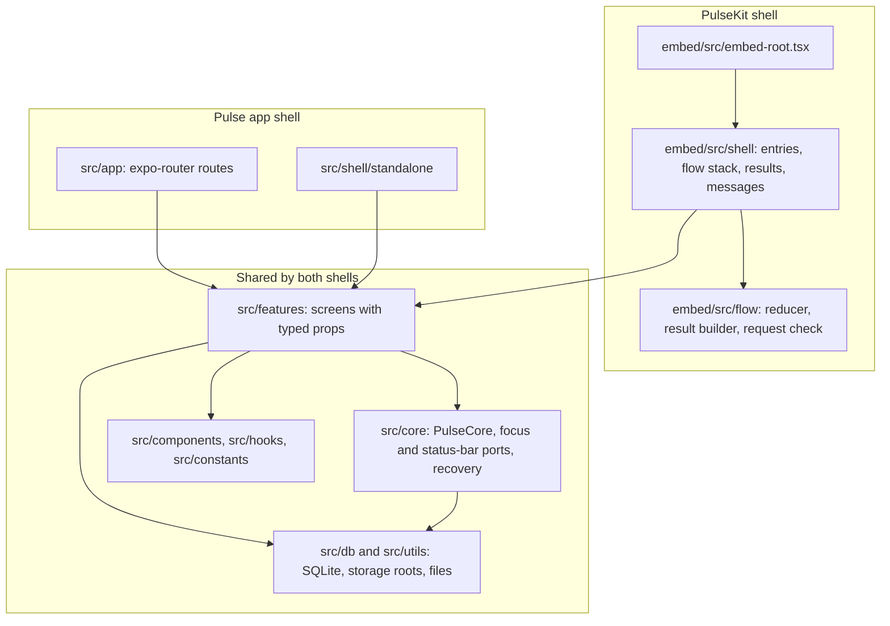
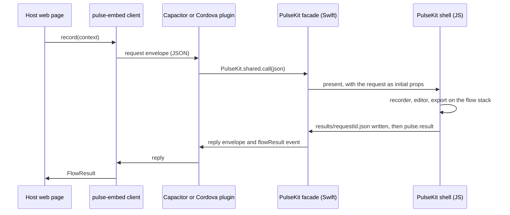

# Architecture

Pulse runs in two shells from one codebase:

- **The Pulse app** (the standalone shell): the App Store and Play Store app, with Home, pairing,
  deep links, onboarding, About and `.pulse` transfers.
- **PulseKit** (the embed shell): Pulse inside another iOS app, opened by a Capacitor or Cordova
  plugin for one task at a time (record, edit or export) and closed with one result.

Both shells run the same feature screens, database and media code. This page describes the layers,
the rules that keep them apart, and the checks that enforce those rules. How data is stored and
recovered is in [persistence.md](persistence.md); how a host app uses PulseKit is in
[embedding/](embedding/README.md).

## Layers

Arrows are allowed imports. Nothing points back up: shared code never imports a shell, and core,
db and utils never import a feature.

| Layer               | Folder                                                               | What it holds                                                                                                                                                                                                                                |
| ------------------- | -------------------------------------------------------------------- | -------------------------------------------------------------------------------------------------------------------------------------------------------------------------------------------------------------------------------------------- |
| Pulse app shell     | `src/app/`, `src/shell/standalone/`                                  | Thin expo-router routes that mount feature screens and pass them callbacks; `closeToHome`; the expo-status-bar side of the status-bar port.                                                                                                  |
| PulseKit shell      | `embed/src/`                                                         | The entry (`embed-root.tsx`), the entry registry, the router-free flow stack, the results inbox writer, the command channel to the native facade, the theme bridge and the status-bar port over `pulse.ui`. Stubs for modules it leaves out. |
| Feature modules     | `src/features/<name>/`                                               | `<Name>Screen` plus a `contract.ts` with its props: recorder, editor, export, drafts, transcription, upload, tips, toast, logs. Standalone-only: onboarding, about, draft-transfer.                                                          |
| Core                | `src/core/`                                                          | `PulseCore` (gesture root, safe area, theme, status-bar port, migrations with the shell's recovery screen), the focus port, recovery, `resetSession`, types the database shares with features.                                               |
| Data and files      | `src/db/`, `src/utils/`                                              | SQLite through Drizzle, migrations, snapshots, `.pulse` documents; `storage-root.ts`, through which every path goes.                                                                                                                         |
| Native facade (iOS) | `embed/native/ios/`                                                  | `PulseKit*.swift`: the JSON transport, presentation in a container view controller, the results inbox, `info()`. It never opens SQLite.                                                                                                      |
| Host packages       | `embed/packages/`                                                    | `@mieweb/pulse-embed` (types, client, React hooks, test fake), `@mieweb/capacitor-pulse` and `cordova-plugin-pulse` (transport only).                                                                                                        |
| Build and release   | `embed/scripts/`, `embed/plugins/`, `scripts/check-embed-bundle.mjs` | Packaging, release generators, the prebuild plugin that adds the facade to the PulseKit target, and the embed bundle check.                                                                                                                  |
| Test hosts          | `embed/hosts/`                                                       | `cap-host` and `cordova-host`, small apps for trying the plugins on a Simulator or phone. Nothing in them ships.                                                                                                                             |

`embed/` is an Expo project of its own (`embed/app.json`, `embed/package.json`). It bundles `src/`
with the root `node_modules`, so both shells always run the same dependency versions;
`embed/package.json` only says which native modules PulseKit links.

## How a host call reaches Pulse

- The plugins move JSON and nothing else. A new contract method needs no plugin change unless the
  facade itself has to answer it.
- The facade answers `info`, `configure`, `isOpen`, `pendingResults`, `acknowledge` and `logFile`
  from memory and files, without starting Pulse's JavaScript.
- The result file is written before the facade is told, so a killed process or a reloaded page
  loses nothing: the host drains it with `pendingResults()`.

The wire format is in [embedding/contract.md](embedding/contract.md).

## Two shells, one set of screens

Feature screens take everything shell-specific as props or through a core port:

- **Navigation.** A screen reports what the person asked for (`onClose`, `onEdit`, `onExport`,
  `onAddClips`) and the shell decides where that goes. The Pulse app maps it to routes; PulseKit
  maps it to its flow reducer.
- **Focus.** `src/core/navigation/focus.ts` tells a screen whether it is on top. Under expo-router
  the route feeds it; in PulseKit the flow stack does.
- **Status bar.** `src/core/status-bar/` is a stack of requests. The Pulse app applies it with
  expo-status-bar; PulseKit sends it to the native container with `pulse.ui`, because only the
  container view controller may change the status bar inside a host app.
- **Recovery.** `PulseCore` takes the shell's recovery screen. The Pulse app offers a restore from
  a backup. PulseKit shows a short message and ends the flow `failed` with `storage.full` or
  `storage.damaged`; it never reloads, because a reload would restart the host's runtime.
- **Storage roots.** PulseKit stores everything under `Library/PulseKit/<namespace>/`. The roots
  must be set before the database opens, and `@/db/client` opens on import, so
  `embed/src/embed-root.tsx` sets them from the facade's initial props and only then requires the
  rest of the app.

The PulseKit shell has no Home and no Drafts screen. An entry starts on its first screen (`record` →
recorder, `edit` → editor, `export` → Export), and the flow ends with exactly one result.

## Boundary rules and what enforces them

| Rule                                                                                                                                            | Enforced by                                                                                |
| ----------------------------------------------------------------------------------------------------------------------------------------------- | ------------------------------------------------------------------------------------------ |
| Shared code (`src/features`, `core`, `db`, `utils`, `components`, `hooks`, `constants`) never imports `src/app` or `embed/`.                    | ESLint `import/no-restricted-paths`, by resolved path, so relative imports are caught too. |
| `src/core`, `src/db` and `src/utils` never import a feature.                                                                                    | ESLint `import/no-restricted-paths`.                                                       |
| Features PulseKit runs never import a standalone-only feature (onboarding, about, draft-transfer).                                              | ESLint `import/no-restricted-paths`.                                                       |
| Shared code doesn't use `expo-router`, `expo-status-bar` or `expo-linking`, whether imported, `require()`d or `import()`ed.                     | ESLint `no-restricted-imports` and `no-restricted-syntax`.                                 |
| Only pairing listens for incoming links (`Linking.getInitialURL`, `addEventListener`, `useURL`, `useLinkingURL`).                               | ESLint `no-restricted-syntax`. Opening a URL or Settings is allowed everywhere.            |
| `embed/src/embed-root.tsx` statically imports only `@/utils/storage-root`.                                                                      | ESLint `no-restricted-imports`.                                                            |
| Every native dependency in the root `package.json` is classified in `embed/deps.json`, and the list agrees with `embed/package.json`.           | `npm run check:embed`.                                                                     |
| The facade, plugins and prebuild plugin never open SQLite (`sqlite3_open`, `SQLiteDatabase`).                                                   | `npm run check:embed`.                                                                     |
| The facade keeps the Objective-C names hosts call by selector (`PulseKit`, `shared`, `handleEventsForBackgroundURLSession:completionHandler:`). | `npm run check:embed`.                                                                     |
| PulseKit's iOS and Android release bundles contain no excluded package and no standalone-only path.                                             | `npm run check:embed`, from the bundles' source maps.                                      |

A few pairing and onboarding files still use expo-router and link listeners from inside
`src/features`. `eslint.config.js` lists them by name with the reason, until pairing moves behind
the Pulse app shell.

### Where the checks run

- **`npm run lint`** (`expo lint src embed/src`) applies the ESLint rules. CI runs it in the `test`
  job.
- **`npm test`** runs `src/test-support/lint-zones.test.ts`, which lints seeded files at real paths
  with the same config, so a rule that stops catching its case fails the tests. It also runs the
  pure checks behind `check:embed` (`embed/scripts/bundle-check/lib.test.ts`).
- **`npm run check:embed`** (`scripts/check-embed-bundle.mjs`) makes PulseKit's JS bundles with
  `expo export:embed` (JS only, no native build) and checks them and the files above. CI runs it in
  the `embed-check` job on every PR.

### What PulseKit leaves out

`embed/deps.json` lists each native module as included or excluded. The excluded ones are not in
`embed/package.json`, so PulseKit doesn't link them, and `embed/metro.config.js` resolves the few
that shared code still reaches to a no-op stub in `embed/src/stubs/`:

- The host app owns notifications, background work and incoming links: expo-notifications,
  react-native-background-actions, expo-router, expo-linking.
- The status bar belongs to the container view controller: expo-status-bar.
- Pulse-app only: expo-clipboard (pairing, About, upload links), expo-document-picker (`.pulse`
  import, library restore), @react-native-async-storage/async-storage (the old library's one-time
  move), expo-splash-screen and expo-web-browser.

To add a native dependency, classify it in `embed/deps.json` (and add it to `embed/package.json`
if PulseKit needs it), then run `npm run check:embed`.
