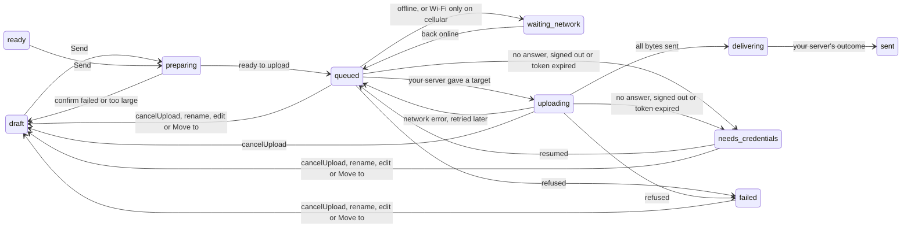

# Let Pulse upload the video (`uploadMode: 'pulse'`)

In pulse mode, Export's primary action is Send. The person taps it, Pulse queues the video and
closes, and your page gets a `completed` result at once. Pulse then asks your page for an upload
target, sends the video and its captions, beat manifest and thumbnail to your PulseVault server
over TUS, and waits for your server to say what it did with the video. Uploads go on after Pulse
closes, while your app is in the background and with the phone locked. A killed app resumes from
the bytes the server already has.

**Before you start:**

- The steps in [README.md](README.md#add-pulse-step-by-step), including `setAccount()`.
- A PulseVault server, and a route on your own server that reserves an upload for a signed-in
  person and mints a capability token for it. TimeHuddle's is `pulseUploads.begin`.
- Your server records an outcome for each video once it has filed it (`done`, or `kept` in the
  person's library when its place is gone). PulseVault's status route reports that outcome to
  Pulse, and only then does Pulse delete its copy.

## Register your host services on every page load

Pulse can't reach your server itself: it asks your page. Call `setHostServices()` after
`configure()` and `setAccount()`, on every page load.

```ts
import { getPulse, type HostServices } from '@mieweb/pulse-embed';

// api is your app's own server client.
const pulse = getPulse();

const services: HostServices = {
  async getUploadTarget(r) {
    const t = await api.beginPulseUpload({
      clientKey: r.clientKey,
      draftKey: r.draftKey,
      type: r.context.uploadType?.id,
      target: r.context.data,
      name: r.name,
      sentAt: r.sentAt,
      durationMs: r.durationMs,
      bytes: r.bytes,
      renewArtifact: r.renewArtifact,
    });
    return {
      uploadId: t.uploadId,
      endpoint: t.endpoint, // 'https://timehuddle.mieweb.org/pulsevault', no trailing slash
      artifactId: t.artifactId,
      token: t.token,
      expiresAt: t.expiresAt,
      clientKey: t.clientKey, // must echo r.clientKey
      state: t.state,
    };
  },
  refreshUploadToken: ({ uploadId }) => api.pulseUploadToken({ uploadId }),
  releaseUploadTarget: ({ uploadId, reason }) => api.cancelPulseUpload({ uploadId, reason }),
};

pulse.setHostServices(services);
```

| Request               | When Pulse asks                                                                                                    | You answer                                                                                     |
| --------------------- | ------------------------------------------------------------------------------------------------------------------ | ---------------------------------------------------------------------------------------------- |
| `getUploadTarget`     | A Send was queued, a failed upload is retried, or PulseVault no longer knows the artifact (`renewArtifact: true`). | An `UploadTarget`. Echo `clientKey`; return the existing upload for a `clientKey` you've seen. |
| `refreshUploadToken`  | The token expired, or after a relaunch (tokens are never written to disk).                                         | `{ token, expiresAt }` for the same upload.                                                    |
| `releaseUploadTarget` | The person canceled the upload, edited the video or deleted it. Optional.                                          | Nothing. Cancel the reserved upload on your server.                                            |
| `confirmSend`         | At Send, for an upload type with `confirmSend: true`. See [Upload types](#upload-types).                           | `{ confirmedAt }` once your server did what the type stands for.                               |

- **Answer within 20 seconds.** A request nobody answers in 20 s pauses the upload
  (`needs_credentials`). Requests that arrive before `setHostServices()` wait in the client, so
  register early in the page load.
- **Refuse with a code** to tell Pulse what happened. Throw an object (or an `Error`) with `code`
  set to one of these; anything else counts as `host.unavailable`:

  | `code`             | Pulse                                                                      |
  | ------------------ | -------------------------------------------------------------------------- |
  | `destination.gone` | Fails the upload: the place is gone or the person lost access.             |
  | `upload.refused`   | Fails the upload for good (a permanent refusal from your server).          |
  | `upload.too_large` | Fails the upload: the video is over your server's size limit.              |
  | `no_account`       | Pauses the upload until someone is signed in.                              |
  | `host.unavailable` | Retries later, waiting longer each time (5 s, doubling, up to 15 minutes). |

- **Idempotency is yours too.** A relaunch can ask `getUploadTarget` again for a `clientKey` your
  server already reserved. Return that upload (with its `state`), not a new one. When the server
  already has the outcome, Pulse skips straight to retiring the draft.
- `draftKey` stays the same for every Send of one draft; `clientKey` changes when the video is
  edited. When a new `clientKey` arrives for a `draftKey`, cancel the older upload.

## Upload types

`context.uploadType` says what Send means for that place. Pulse reads only these fields; `id` is
yours:

| Field           | What Pulse does                                                                                 |
| --------------- | ----------------------------------------------------------------------------------------------- |
| `title`         | The kind on the recorder's banner: "Ticket", "Wrap-up".                                         |
| `sendLabel`     | Export's primary action. Default "Send to <label>".                                             |
| `prompt`        | One line on the recorder's banner: "Say what you finished today".                               |
| `requireName`   | Send stays disabled until the draft has a name; Export shows a name field.                      |
| `requireOnline` | Send is disabled offline ("Needs a connection") and checked again at the tap.                   |
| `maxBytes`      | Over it, Export says "Too large to send" and offers Trim, and Send doesn't start.               |
| `confirmSend`   | At Send, Pulse calls your `confirmSend` and waits for it before it queues the upload or closes. |

### Types with `confirmSend`

Use `confirmSend` when Send also changes something on your server that has to happen at the tap,
like clocking out. Pulse calls it after the video is ready and before it queues the upload, with
the draft's `sentAt`, so your server stamps the time the person tapped.

- **Success:** the upload is queued and Pulse closes. The draft can't be moved to another place
  after this (`setDraftContext` rejects with `draft.locked`, reason `clock_bound`), and a later
  Send of the same draft after an edit doesn't ask again.
- **Failure** (your handler throws, or doesn't answer in 20 s): nothing is queued, the draft stays
  a draft, and Export stays open with [Try again] and [Keep draft].
- **No `confirmSend` handler** on your page: the client answers `host.unavailable`, so every Send
  of such a type fails as above.
- **Too large:** a video over `maxBytes` is refused before Pulse asks you, with the too-large text
  and no [Try again].

Export's wording around the confirm comes from the type's `id`:

| `id`           | While your handler runs | When it fails                              | X before Send offers                    |
| -------------- | ----------------------- | ------------------------------------------ | --------------------------------------- |
| `clock.wrapup` | "Clocking out…"         | "Couldn't clock out. Your video is saved." | "Keep draft (you're still clocked in)"  |
| `clock.plan`   | "Clocking in…"          | "Couldn't clock in. Your video is saved."  | "Keep draft (you're still clocked out)" |
| any other      | "Sending…"              | "Couldn't send. Your video is saved."      | "Keep draft"                            |

If your page closes Pulse with `close()` while Send is running, Pulse finishes the Send first. If
it hasn't ended within 5 seconds, PulseKit ends the flow itself, as for any `close()`.

## What your list shows

Each draft's `state` in [`listDrafts()`](drafts.md) follows its upload:



| `state`             | Suggested text                                         | What the person can do                                 |
| ------------------- | ------------------------------------------------------ | ------------------------------------------------------ |
| `draft`, `ready`    | "Draft", "Ready to send"                               | Edit, Send, Move to…, Rename, Delete                   |
| `preparing`         | "Preparing…"                                           | Nothing: the draft is locked                           |
| `queued`            | "Waiting to send"                                      | Cancel sending, Edit                                   |
| `waiting_network`   | "Waiting for network"                                  | Cancel sending, Edit                                   |
| `uploading`         | "Uploading 37%" (`upload.progress`)                    | Cancel sending                                         |
| `delivering`        | "Processing"                                           | Nothing: your server has the bytes                     |
| `needs_credentials` | See [Paused uploads](#paused-uploads)                  | Resume, Cancel sending, Edit                           |
| `failed`            | "Didn't send", with `upload.error.code`                | Retry (`upload`), Move to…, Edit, Delete               |
| `sent`              | `sent.outcome`: "Attached", or "Saved to your library" | `kept`: Move to… on your server, then `dismissReceipt` |

- **Locked states.** While a draft is `preparing`, `uploading` or `delivering`, `renameDraft`,
  `setDraftContext`, `deleteDraft` and `edit` reject with `draft.locked`. In `queued`,
  `needs_credentials` and `failed`, a rename, an edit, Move to… or Delete first cancels the
  upload: the row is a draft again and needs another Send.
- **Sent rows** are receipts: no video, kept for 7 days after your server's outcome, then gone.
  `listDrafts()` leaves them out unless `states` includes `'sent'`.
- `uploadProgress` events carry the progress between list reads, at most 4 a second.

## Paused uploads

An upload is `needs_credentials` when your page didn't answer in 20 s, nobody was signed in, or its
token ran out and couldn't be refreshed. Pulse also needs its runtime running to upload: after your
app launches, nothing moves until Pulse runs.

`resumeOutbox()` starts it and runs Pulse's launch rule: paused uploads are tried again, uploads a
kill interrupted resume from the server's offset, and drafts your server has finished with are
retired. How you call it depends on the build, which `getInfo()` tells you:

```ts
const headless = (await pulse.getInfo()).capabilities.includes('headless');
```

- **With `headless`:** Pulse runs with nothing on screen. Call `resumeOutbox()` after
  `setHostServices()` on every page load and whenever your app returns to the foreground. Show
  paused rows as "Paused · resumes automatically".
- **Without `headless`:** each start of Pulse's runtime shows a brief "Preparing…" screen over your
  app. Don't call `resumeOutbox()` on launch or resume. After your app launches, show rows in
  `queued`, `uploading` and `needs_credentials` as "Paused · Tap to resume" until Pulse has run in
  this app session (an `open`, or any drafts write), and call `resumeOutbox()` from that tap. Once
  Pulse has run, its uploads continue on their own until the app is terminated.

The same applies to every drafts write (`upload`, `renameDraft`, …) when Pulse isn't running: with
`headless` it runs unseen, without it "Preparing…" shows until the write is answered.

## Forward background upload events

Each upload's bytes go in one iOS background task in a session named
`com.mieweb.pulsekit.upload.<namespace>`. iOS finishes it without your app running, and relaunches
your app in the background to deliver the session's events. Forward them to PulseKit from your
`AppDelegate`. Looking PulseKit up by name keeps your app building with or without the plugin:

```swift
func application(_ application: UIApplication,
                 handleEventsForBackgroundURLSession identifier: String,
                 completionHandler: @escaping () -> Void) {
  if PulseKitBackgroundSessions.forward(identifier, completionHandler: completionHandler) { return }
  completionHandler()
}

enum PulseKitBackgroundSessions {
  private typealias ForwardIMP = @convention(c) (
    AnyObject, Selector, NSString, @escaping @convention(block) () -> Void
  ) -> ObjCBool

  /// True when PulseKit owns the session and will call the handler itself.
  static func forward(_ identifier: String, completionHandler: @escaping () -> Void) -> Bool {
    guard let cls = NSClassFromString("PulseKit") as? NSObject.Type,
          cls.responds(to: NSSelectorFromString("shared")),
          let shared = cls.perform(NSSelectorFromString("shared"))?.takeUnretainedValue() as? NSObject
    else { return false }
    let selector = NSSelectorFromString("handleEventsForBackgroundURLSession:completionHandler:")
    guard shared.responds(to: selector) else { return false }
    let forward = unsafeBitCast(shared.method(for: selector), to: ForwardIMP.self)
    let handler: @convention(block) () -> Void = { completionHandler() }
    return forward(shared, selector, identifier as NSString, handler).boolValue
  }
}
```

PulseKit answers `true` for its own sessions and calls the completion handler once their events are
delivered; any other session is yours. TimeHuddle's `ios/App/App/AppDelegate.swift` has this code.

Optionally, also call the class method `prepareBackgroundUploads` (by selector, like `shared`) from
`application(_:didFinishLaunchingWithOptions:)`. It reattaches uploads iOS kept running even in a
launch where your page never calls Pulse. The first `PulseKit.shared` access does the same.

## What Pulse doesn't do

- **It never uploads without your page.** Every target and token comes from your host services. A
  page that never calls `setHostServices()` leaves every Send paused.
- **It doesn't tell your server the video arrived.** PulseVault's hooks on your server do that; Pulse
  only polls the status route for the outcome.
- **It doesn't keep a sent video.** After your server's outcome the draft's files are deleted. Share
  and Save to Photos are on Export, before Send.
- **Tokens never touch the disk** or Pulse's log; `logFile()` has them redacted.

## Done when

- [ ] `configure()` doesn't set `uploadMode`, or sets `'pulse'`.
- [ ] `setHostServices()` runs on every page load, after `setAccount()`, and every handler resolves
      or throws within 20 s.
- [ ] `getUploadTarget` returns the same upload for a `clientKey` it has seen, and echoes
      `clientKey`.
- [ ] Each upload type with `confirmSend` has a `confirmSend` handler that is idempotent per
      `draftKey`.
- [ ] Your `AppDelegate` forwards `handleEventsForBackgroundURLSession` to PulseKit.
- [ ] `resumeOutbox()` is called on launch and resume with `headless`, or from "Tap to resume"
      without it.
- [ ] Your list shows every `state` in the table above, including `failed` with a way out and
      `sent` with `kept`.
- [ ] On an iPhone: Send, then lock the phone; the video arrives on your server and the row turns
      `sent`.
