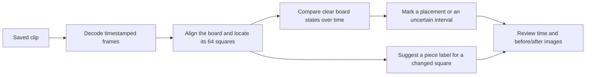

# Finding visual beats in a saved iPhone video

[Pulse AI editing guide](ai-editing.md) · [Project README](../README.md#editing--export)

For a chessboard setup, use one rule. **Mark each time a piece is placed
on a previously empty square and stays there after the hand clears.** A person can do this 32
times in one silent, uninterrupted shot. The proposal below uses the visible change to find the
moment. A separate model can suggest the name of the piece. The same recorded frames can also
support less exact questions such as “where do we see the board?” and “what is in this scene?”
[Chess recognition pipeline](https://georg.woelflein.eu/chesscog/) ·
[Apple’s image prompting guide](https://developer.apple.com/documentation/foundationmodels/analyzing-images-with-multimodal-prompting)

## What Pulse can use today

Pulse’s native editor already takes a local video file and a list of source times and returns
upright JPEG frames with their times. The batch API shows the original picture, before the user’s
crop, flip or rotation edits. It can skip undecodable frames and can substitute the requested time
when the decoder omits its actual time. For precise beat boundaries, verify the surrounding frames
with presentation timestamps. [Pinned iOS frame extractor](https://github.com/morepriyam/pulse-editor/blob/306ff1d999589be6615275c60567ba371f073efd/ios/FrameGrab.swift#L73-L132)
· [Apple’s saved-video frame API](https://developer.apple.com/documentation/avfoundation/creating-images-from-a-video-asset)

The current **AI edit** button sends the editable prompt and timed **transcript passages** to
Apple’s on-device `SystemLanguageModel.default`. The model returns passage IDs. Changing that
prompt cannot give it frames. OmniShotCut is a separate research model for locating existing
shot transitions. A cut between camera angles can be a useful place to locate the board again,
while all the placements within each angle still need a visual detector.
[Selector inputs](../src/features/ai-edit/selection.ts#L36-L78) ·
[Exact model request and response](../modules/expo-ai-editor/ios/AiEditorEngine.swift#L165-L203) ·
[OmniShotCut](https://github.com/UVA-Computer-Vision-Lab/OmniShotCut)

## On-device options by editing task

| What you want from the recording                        | Model or API and what it returns                                                                                                                                                                                                                                                                                      | iPhone path and evidence                                                                                                                                                                                                                                                                                                                                                                                                                                                                                                                                                                                                                               |
| ------------------------------------------------------- | --------------------------------------------------------------------------------------------------------------------------------------------------------------------------------------------------------------------------------------------------------------------------------------------------------------------- | ------------------------------------------------------------------------------------------------------------------------------------------------------------------------------------------------------------------------------------------------------------------------------------------------------------------------------------------------------------------------------------------------------------------------------------------------------------------------------------------------------------------------------------------------------------------------------------------------------------------------------------------------------ |
| **Find distinct or representative images**              | Apple Vision compares image feature prints for visual similarity and scores image aesthetics. Group near-duplicates or show a few distinct frames for review. The search input can be an example image.                                                                                                               | Apple provides a saved-video sample. Vision’s `VideoProcessor` accepts a local file, a time range and a request cadence. [Thumbnail sample](https://developer.apple.com/documentation/vision/generating-thumbnails-from-videos) · [VideoProcessor](https://developer.apple.com/documentation/vision/videoprocessor)                                                                                                                                                                                                                                                                                                                                    |
| **Find visible evidence**                               | Vision supplies category labels, recognized text, hand landmarks and tracking. Read a slide title, locate a hand over the board or follow a previously identified region. Each request has a specific output.                                                                                                         | Built-in Vision requests can run on decoded frames. Choose the request for the observation you want. [Vision tasks](https://developer.apple.com/documentation/vision) · [Hand landmarks](https://developer.apple.com/documentation/vision/vndetecthumanhandposerequest)                                                                                                                                                                                                                                                                                                                                                                                |
| **Find a picture using words**                          | An image–text encoder ranks frames against phrases such as “chessboard on a table.” Cache an embedding per frame, rank matches for the query, then show thumbnails with source times. This answers _where to look_.                                                                                                   | Apple’s MobileCLIP has a Core ML iOS demo. Its current weights license limits use to non-commercial research and excludes product development. Google’s SigLIP 2 Base lists Apache-2.0 weights and image–text retrieval. An iPhone port and timing for that checkpoint would need validation. [MobileCLIP](https://github.com/apple-aiml-research/ml-mobileclip) · [Weight terms](https://github.com/apple-aiml-research/ml-mobileclip/blob/main/LICENSE_MODELS) · [SigLIP 2 model card](https://huggingface.co/google/siglip2-base-patch16-224)                                                                                                       |
| **Ask what is happening in selected images**            | Apple’s on-device Foundation Models API on **iOS 27** accepts image attachments and text. Give it a frame or a before/after pair and ask a question. It can return a description or a structured label.                                                                                                               | Use `SystemLanguageModel`, check availability and the `.vision` capability, and prepare Apple Intelligence locally before going offline. The iOS 26 API takes text. For a saved movie, the app selects and timestamps the images. [Image prompting](https://developer.apple.com/documentation/foundationmodels/analyzing-images-with-multimodal-prompting) · [Vision capability](https://developer.apple.com/documentation/foundationmodels/languagemodelcapabilities/capability/vision) · [Apple’s video-input Q&A](https://developer.apple.com/videos/play/wwdc2026/8011/?time=1058) · [Device requirements](https://support.apple.com/en-us/121115) |
| **Describe a short sequence with downloadable weights** | SmolVLM2-500M-Video-Instruct accepts images or sampled video and a question. For example, show several frames around an interaction and ask what the hands did. Its answer is generated text.                                                                                                                         | Hugging Face demonstrates iPhone inference with MLX Swift. The checkpoint lists Apache-2.0. The demo fetches runtime configuration on launch. For offline cold starts, keep the configuration, tokenizer, processor and weights on the phone. [Model card](https://huggingface.co/HuggingFaceTB/SmolVLM2-500M-Video-Instruct) · [iPhone demo](https://huggingface.co/blog/smolvlm2#iphone-video-understanding) · [Demo loader](https://github.com/huggingface/HuggingSnap/blob/88aafba3354775ffac174bc44535f8908b8a679a/HuggingSnap/Views/VLMEvaluator.swift#L74-L110)                                                                                 |
| **Locate objects in a scene**                           | A detector such as YOLO11n returns bounding boxes, class labels and scores. For a tutorial you could find frames containing scissors, or crop a detected object for a closer look. Recognizing a new class requires suitable weights.                                                                                 | Ultralytics publishes a Swift SDK and bundled Core ML models. It lists AGPL-3.0 and commercial licensing options. [iOS app, models and license](https://github.com/ultralytics/yolo-ios-app) · [Swift image API](https://github.com/ultralytics/yolo-ios-app/tree/main/Sources/UltralyticsYOLO)                                                                                                                                                                                                                                                                                                                                                        |
| **Identify a known object or action repeatedly**        | Use a domain classifier for fixed labels. The downloadable CrispChess MobileNetV3 pair returns empty/occupied from a square crop, then one of 12 piece/color labels from a taller crop. For other tasks, Create ML supports training image classifiers, or action classifiers for movements from body-pose sequences. | The chess models ship as ONNX with MIT listed on the model card. ONNX Runtime supports iOS. Reproduce the model’s crop geometry before judging results. A custom Core ML classifier can also run through Vision. [Chess models and inputs](https://huggingface.co/cstr/chess-board-photo-onnx) · [iOS runtime](https://onnxruntime.ai/docs/build/ios.html) · [Vision and Core ML](https://developer.apple.com/documentation/coreml/classifying-images-with-vision-and-core-ml) · [Create ML action classifiers](https://developer.apple.com/documentation/createml/creating-an-action-classifier-model)                                                |

## Proposed first experiment — mark chess placements

I would evaluate the two CrispChess classifiers first. Together their downloads are about 12 MB,
and the occupancy output lets us evaluate beat timing before evaluating names. ChessQ Lite V4
is another published option with a Core ML package targeting iOS 17+. Its author lists
noncommercial terms and reports a synthetic validation on an M3 Pro Mac. Both still need to be
tested on a real iPhone recording of the tester’s board.
[CrispChess model files](https://huggingface.co/cstr/chess-board-photo-onnx/tree/main) ·
[ChessQ Lite model card](https://huggingface.co/joelseytre/chessq-lite) ·
[Core ML validation scope](https://huggingface.co/joelseytre/chessq-lite/blob/main/COREML.md)

1. **Start with one fixed camera and an empty board.** Let the tester tap the four corners in a known order so the overlay and labels agree on which square is g1. Analyze chronological batches at a resolution that preserves each piece’s silhouette. Use the training model’s perspective and crop geometry. Disable the recognizer’s legal-position corrections so it can report a half-set board. [Board localization and crops](https://georg.woelflein.eu/chesscog/) · [CrispChess recognizer options](https://github.com/CrispStrobe/CrispChess/blob/main/lib/vision/photo/board_photo_recognizer.dart)
2. **Compare clear views of each square.** Mark a placement when it changes from confidently empty to confidently occupied across successive clear frames. Keep the last clear “before” frame and the first confirmed “after” frame. Use hand landmarks as a hint to wait and inspect motion intervals more densely. If two pieces appear while the view is blocked, show the shared interval for review. A lift, adjustment, camera shift or move between squares also deserves review. [Vision hand detection](https://developer.apple.com/documentation/vision/vndetecthumanhandposerequest) · [Occupancy model](https://huggingface.co/cstr/chess-board-photo-onnx)
3. **Suggest the name independently.** Run the piece classifier on the clear crop. A plausible review item is **00:24.6–00:26.0 · g1 became occupied · suggested white knight**, with the two frames to inspect. If the name is uncertain, keep the beat as **piece placed on g1**. The author reports 85% correct square labels on one unfamiliar wooden set, with the errors in piece type or color. That is a photo result. The example times above are illustrative. [Classifier evaluation](https://huggingface.co/cstr/chess-board-photo-onnx)
4. **Turn reviewed markers into beats.** For a project with several clips, keep the source clip ID and time for every marker. Start a new baseline across cuts, apply the visible trim and account for playback speed when placing it on the project timeline. If the camera changes angle, calibrate the new view. Let the tester choose how much approach and release to keep around a marker. The user’s two-minute target can guide that later montage without discarding detected placements. [Pulse’s existing source-to-timeline mapping](../src/features/transcription/compose.ts#L43-L95) · [Current speech selection budget](../src/features/ai-edit/selection.ts#L57-L78)

**Where a prompt belongs.** For the proposed **Describe frame** action, the editable question
and explicitly selected images would go to Apple’s on-device model on a supported iPhone. For
**Mark chess placements**, the scan would take the video, board corners and fixed placement rule.
It would run without speech or a prompt. Its review screen should show which squares changed,
the time interval and the visual evidence. [Apple’s image request](https://developer.apple.com/documentation/foundationmodels/analyzing-images-with-multimodal-prompting) ·
[Occupancy and piece outputs](https://huggingface.co/cstr/chess-board-photo-onnx)

**Proposed acceptance test.** Film one full setup and mark the square and release time of each of
the 32 placements by hand. Compare those annotations one-to-one against the detected events.
For the clean take, aim for 32 matched squares, no duplicates or extra beats, and a confirmed
timestamp within half a second of each visible release. Score piece names separately. Then try a
take with an adjustment and two placements under one hand. Count misses, false beats and events
sent for review. Cold-launch in airplane mode with local assets, recording wall time and peak
memory on the target phone. These are proposed test conditions. Pulse has no measured chess-video
result yet.
