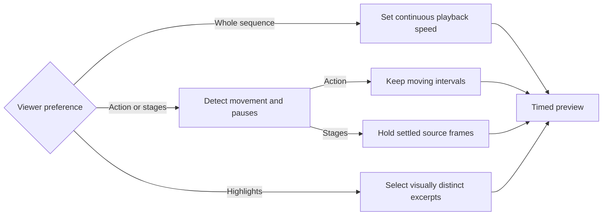

# Beatlapse — choosing cuts from the pictures

[Pulse AI editing guide](ai-editing.md) · [Project README](../README.md#editing--export)

A beatlapse can show the passage of time, the work as it happens, or the result after each step.
The same drawing supports all three. For Pulse, we propose letting the person choose what they
want to watch and set a maximum duration. The Mac prototype below implements the choices. The
current phone button still edits from speech. [Mac runner](../scripts/experiments/beatlapse/preview.py)
· [Current phone workflow](ai-editing.md)

## Choose what the viewer sees

| Viewer preference                                          | What determines the edit                                                                                                                                                                                                                                                                         | Example with an eight-second budget                                                                                                                                                                                                                                                                                                                                                                             |
| ---------------------------------------------------------- | ------------------------------------------------------------------------------------------------------------------------------------------------------------------------------------------------------------------------------------------------------------------------------------------------ | --------------------------------------------------------------------------------------------------------------------------------------------------------------------------------------------------------------------------------------------------------------------------------------------------------------------------------------------------------------------------------------------------------------- |
| **Keep the whole sequence** (`continuous`)                 | Keep the entire source time range. Speed it up evenly to fit, or use the chosen speed. No frame comparison or prompt is needed.                                                                                                                                                                  | The 54.67-second NASA flyover plays in eight seconds at 6.83×, preserving the journey to sunrise. [Play the flyover](../screenshots/validation/ai-edit/beatlapse/styles/flyover-continuous.mp4) · [Edit decisions](../screenshots/validation/ai-edit/beatlapse/styles/flyover-continuous.json) · [NASA footage and credit](https://svs.gsfc.nasa.gov/30180/)                                                    |
| **Watch the work happen** (`action`)                       | Compare adjacent images. Join nearby periods of visible change, retain brief context at each edge and skip long pauses. Play the kept ranges at the chosen speed or fit them to the budget.                                                                                                      | The drawing has four retained ranges totaling 16.6 seconds. They play at 1× in 16.6 seconds or at about 2.08× in eight. The lines forming the sails and hull are visible. [Watch alongside stages](../screenshots/validation/ai-edit/beatlapse/styles/drawing-comparison.mp4) · [Source intervals](../screenshots/validation/ai-edit/beatlapse/styles/drawing-action.json)                                      |
| **Show completed stages** (`stages`)                       | After a change, wait for the view to settle for a second. Pick a real color frame from the middle of that pause. Skip the initial baseline and repeated views. When the viewer requests fewer cards, spread them across the detected stages, including the first and last when at least two fit. | Four stages qualified. A three-card limit kept the mountain at 7.5 s, the scene with the sun at 23.5 s and the boat at 30 s. Hold each for 2⅔ seconds. A fourth card would include the foothills and water at 17 s. [Watch alongside action](../screenshots/validation/ai-edit/beatlapse/styles/drawing-comparison.mp4) · [Held frames](../screenshots/validation/ai-edit/beatlapse/styles/drawing-stages.json) |
| **Pick a few highlights** (`highlights`, original default) | Use Apple Vision feature prints to select short moving excerpts that add distinct views. Play them at original speed.                                                                                                                                                                            | The original drawing edit includes the finished boat. It spent some of its budget on other scenes while the sails were being drawn. [Original comparison and decisions](#how-the-original-highlights-style-chooses-excerpts)                                                                                                                                                                                    |

**What the footage can tell Pulse.** A continuously moving view is a reason to suggest **Keep the
whole sequence**. Repeated bouts of activity followed by quiet views are a reason to preview
**Watch the work happen** and **Show completed stages** alongside each other. The visual evidence
can support both edits equally well. In a future phone picker, the user should be able to choose
either preview, plus pace for motion or the number of cards for stages. The Mac runner takes an
explicit style. It reports when it cannot find a settled stage. [Shared change and stage rules](../scripts/experiments/beatlapse/activity.py)
· [Selection and speed policy](../scripts/experiments/beatlapse/preview.py)

The action and stage modes compare downscaled grayscale frames twice per second by default. Camera
shake, exposure changes or a stationary hand can affect the result. Subtle color-only changes and
actions between samples can be missed. “Completed” here means the changed picture stayed still
long enough to choose a representative frame. The selector never had the words _mountain_, _sun_
or _boat_. [Activity thresholds and hold selection](../scripts/experiments/beatlapse/activity.py)
· [Moving excerpts and freeze-frame rendering](../scripts/experiments/beatlapse/style_render.py)



## How the original highlights style chooses excerpts

We ran the frame analysis and rendering locally on a Mac with an eight-second budget. The prototype
sampled twice per second, computed Apple Vision revision 2 feature prints, and reserved short
excerpts at the beginning and end. For
each remaining two-second window it asked **how much better would the whole recording be represented
if we kept these pictures too?** It added the nonoverlapping window that most reduced the total
distance from every sampled frame to its closest retained frame, then repeated until the budget
was spent or adding a window stopped helping. The renderer joined those source ranges in order at
original speed, with audio off. This small desktop experiment compared every frame print with every
other one. Memory and distance computation grow quadratically with sample count, so the phone
design needs a bounded comparison strategy for long inputs.
[Apple's feature-print comparison](https://developer.apple.com/documentation/vision/analyzing-image-similarity-with-feature-print)

| Recording                                                                                            | What the cut actually kept                                                                                                                                                                                                                                                                                                                                                                                                                                |
| ---------------------------------------------------------------------------------------------------- | --------------------------------------------------------------------------------------------------------------------------------------------------------------------------------------------------------------------------------------------------------------------------------------------------------------------------------------------------------------------------------------------------------------------------------------------------------- |
| **ISS flyover, 54.67 s → 7.67 s.** Earth Science and Remote Sensing Unit, NASA Johnson Space Center. | Four excerpts of the cloud-covered opening, the lit coastline, a darker expanse of ocean and the sunrise. Source times in seconds were 0–2, 16–18, 30.5–32.5 and 53–54.67. [Play the edit](../screenshots/validation/ai-edit/beatlapse/flyover-cut.mp4) · [Cut list](../screenshots/validation/ai-edit/beatlapse/flyover-cuts.json) · [Original and credit](https://svs.gsfc.nasa.gov/30180/)                                                             |
| **Generated continuous drawing, 32 s → 8 s.** Lines appear on a fixed canvas with pauses.            | The same rule kept 0–2, 10–12, 19–21 and 30–32 seconds. It showed the hills and sun being drawn. The sail appeared in the final image, but its drawing action was skipped. The blank opening also cost two seconds. [Play the edit](../screenshots/validation/ai-edit/beatlapse/drawing-cut.mp4) · [Cut list](../screenshots/validation/ai-edit/beatlapse/drawing-cuts.json) · [Original](../screenshots/validation/ai-edit/beatlapse/drawing-source.mp4) |

These runs show the difference between **covering the stages** and **showing the action that
produced each stage**. For the next iteration, use visual coverage to decide which parts of the
recording deserve time, then move each excerpt's start back to catch the change in progress.
The action style above demonstrates an alternative using the moving intervals directly. Boundary refinement for highlights and the iPhone integration are proposals.

### Try it on a local recording

The Mac experiment takes a video file and a maximum output duration in seconds. On macOS 14 or
later with Python 3.10+, the Swift compiler and FFmpeg (including ffprobe and libx264), run from
the repository root. Use a new output directory.

```sh
python3 scripts/experiments/beatlapse/preview.py recording.mov highlights --budget 115
python3 scripts/experiments/beatlapse/preview.py recording.mov continuous --style continuous --budget 8
python3 scripts/experiments/beatlapse/preview.py recording.mov action --style action --speed 1
python3 scripts/experiments/beatlapse/preview.py recording.mov stages --style stages --max-stages 3 --budget 8
```

Each run writes a silent MP4. Highlights also writes `cuts.json`. The new styles write `edit.json`
with the source intervals and playback rate, or the source timestamps and hold length. For motion
you can specify a fixed speed or let the budget determine the speed. When you set both, a
combination that cannot fit reports how much time the requested speed needs. Stage holds last up
to three seconds each and shorten to fit the budget. The default sampling interval produces 1,200
samples per ten minutes. Sampled styles accept up to 1,500 samples per run. Continuous playback
can skip this scan entirely.
[Preview runner](../scripts/experiments/beatlapse/preview.py) ·
[Visual scoring and window selection](../scripts/experiments/beatlapse/distances.swift)

To repeat the style checks from the repository root, run
`python3 -B scripts/experiments/beatlapse/test_styles.py`. The checks compare retained action
intervals and decoded frame holds against the drawing fixture, and verify the length of a
continuous speed-up. [Style regressions](../scripts/experiments/beatlapse/test_styles.py)

To check the highlights duration budget we looped the drawing to 10:00 at 320 × 180 and 4 fps. With a 115-second
budget the runner selected 57 two-second excerpts. The ordered source ranges totaled 114 seconds,
matching the 1:54 MP4 reported by ffprobe. The repeated, low-resolution input tests the budget.
Editorial quality on ten minutes of original footage and iPhone processing time are still open.
[Drawing used for the loop](../screenshots/validation/ai-edit/beatlapse/drawing-source.mp4) ·
[Ten-minute trial cut list](../screenshots/validation/ai-edit/beatlapse/ten-minute-cuts.json)

## Further cut refinements to evaluate

Apple Vision can read a saved video and generate a timestamped **feature print** for each sampled
image. Comparing two prints gives a visual distance. Apple's sample uses this to select distinct
thumbnails. Pulse would add the editing decisions below to produce **moving excerpts with source
in/out times**. Research on generic video summarization also uses visual differences and consistency
to select representative frames. How well those ideas transfer to Apple's features and Pulse footage
needs measurement. [Apple's runnable Vision sample](https://developer.apple.com/documentation/vision/generating-thumbnails-from-videos)
· [Pang et al., frame scoring for video summarization](https://arxiv.org/abs/2211.10056)

| Proposed cut decision                                                                                                                                                                                                                                  | What the viewer would see                                                                                                                                                        |
| ------------------------------------------------------------------------------------------------------------------------------------------------------------------------------------------------------------------------------------------------------ | -------------------------------------------------------------------------------------------------------------------------------------------------------------------------------- |
| Compare several frames before and after each candidate. Prefer a change that persists over an isolated flash. Recheck around brief bursts of motion for a readable action.                                                                             | In a workshop recording, show the tool in use and enough of the result for the viewer to understand the cut. A passing shadow should rarely earn an excerpt.                     |
| Also compare the current view with the last retained view. Accumulated small changes can warrant a cut even when consecutive frames look alike.                                                                                                        | A sunset or a drawing can yield several distinct stages during a single uninterrupted shot.                                                                                      |
| Reserve context for the beginning and ending when they add information. Favor moments that cover previously unrepresented parts of the recording. Penalize repeated views and merge overlapping excerpts.                                              | A flurry of motion should leave room for a distinct later stage. A nearly static recording can produce a very short result.                                                      |
| Choose the **in** point just before the useful change and the **out** point after the viewer can see it. Clamp to clip boundaries. If candidates exceed the budget, drop the least informative or most redundant ones and keep the rest in time order. | A ten-minute input becomes playable excerpts with real cuts. With a two-minute limit, Pulse could reuse its existing 115-second cap and spend less when the footage warrants it. |

Those are proposed selection rules. Similarity supplies a signal, and the duration budget controls
how many changes can survive. They cannot guarantee a beat for every small action. For a camera
move, a twitch that returns to the same view has different editing value from a pan that reveals a
new scene. The first test should include both. [Visual temporal segmentation research](https://arxiv.org/abs/2309.11569)
· [Diversity and representativeness in video summaries](https://arxiv.org/abs/1801.00054)
· [Pulse's duration cap](../src/core/types/ai-edit.ts#L1-L2)

## Which on-device model decides what?

- **Highlights uses Apple Vision feature prints.** The vision model describes the
  sampled images numerically. Pulse's selection rules compare them and choose the in/out times.
  Its only inputs are frames, their times and the edit budget. Apple's
  video processor supports a configurable cadence. A first pass can sample coarsely and revisit
  candidate intervals at a finer cadence. [Saved-video analysis](https://developer.apple.com/documentation/vision/videoprocessor)
  · [Feature prints in Apple's sample](https://developer.apple.com/documentation/vision/generating-thumbnails-from-videos)
- **If we later want a meaning-based preference**, such as “favor the moments that show progress,”
  an eligible iOS 27 phone can pass that instruction and a few time-labeled candidate images to
  Apple's on-device Foundation Models API. Its ranking would be a separate, visible choice. Another
  candidate for short sampled sequences is SmolVLM2-500M, which Hugging Face demonstrated on iPhone.
  Its reference app fetches runtime configuration, so an offline build would also need that locally.
  [Apple image prompting](https://developer.apple.com/documentation/foundationmodels/analyzing-images-with-multimodal-prompting)
  · [SmolVLM2 iPhone demo](https://huggingface.co/blog/smolvlm2#iphone-video-understanding)
  · [Demo loader](https://github.com/huggingface/HuggingSnap/blob/88aafba3354775ffac174bc44535f8908b8a679a/HuggingSnap/Views/VLMEvaluator.swift#L74-L110)
- **OmniShotCut detects transitions already present in the source.** Such a boundary could stop a
  proposed excerpt from straddling an existing edit. A continuous take can contain many useful
  beatlapse cuts without producing any internal shot boundaries. [OmniShotCut's documented task](https://github.com/UVA-Computer-Vision-Lab/OmniShotCut)

Other on-device options from the model inventory serve different editing requests. Vision can read
visible text or detect hands, a Core ML object detector can locate known items, and an image–text
encoder can rank frames for a search phrase. These are optional ways to find particular content.
The general cut workflow needs only timestamps and visual comparisons.
[Apple Vision](https://developer.apple.com/documentation/vision) ·
[YOLO on iOS](https://github.com/ultralytics/yolo-ios-app) ·
[MobileCLIP iOS demo](https://github.com/apple-aiml-research/ml-mobileclip/tree/main/ios_app) ·
[MobileCLIP research weight terms](https://github.com/apple-aiml-research/ml-mobileclip/blob/main/LICENSE_MODELS)

## What is already in Pulse

The current **AI edit** on the phone sends an editable prompt and **transcript passages** to
Apple's on-device language model and receives passage IDs. Beatlapse would be a separate visual
mode. The speech editor's prompt and model-download checks do not supply video frames.
[Current job](../src/features/ai-edit/run-ai-edit.ts#L57-L129) ·
[Exact model request](../modules/expo-ai-editor/ios/AiEditorEngine.swift#L165-L203)

Pulse's native batch extractor already returns upright source JPEGs and source times. It can
skip undecodable frames, and its reported time falls back to the request when the decoder omits
the actual time. Analyze the picture that will appear in the edit, including any crop, and use
decoded presentation timestamps when refining cuts. In a multi-clip project, keep the source ID
and local time for every excerpt, restart frame comparisons across clip boundaries, and fit one
project-wide playback budget using each clip's trim and speed.
[Pinned frame extractor](https://github.com/morepriyam/pulse-editor/blob/306ff1d999589be6615275c60567ba371f073efd/ios/FrameGrab.swift#L73-L132)
· [Pulse clip timing and layout](../src/features/transcription/compose.ts#L43-L95)

Pulse's excerpt writer already creates a separate editable draft and verifies source order, trims,
overlap and playback duration. The current speech writer rejects muted clips and separate narration
and sets the excerpt's mute flag to false. A visual mode needs to preserve mute and define how
narration follows the retained ranges before it can save these projects. A silent file can still be
analyzed entirely from its frames. [Writer validation](../src/db/ai-edits.ts#L20-L75)
· [Draft creation and audio settings](../src/db/ai-edits.ts#L93-L159)

## How to judge the first phone build

Use the same settings for a slow continuous change, a stop-and-start activity, a moving camera,
and a mostly static recording. Compare the proposed cut with evenly spaced excerpts at the same
running time. Have a reviewer mark missed stages, repetitive excerpts and bad cut points. Showing
the two results without naming the algorithms lets the viewer judge which one conveys the
progression better. Record the source ranges and show the frames around each decision so a bad
cut is reproducible. For the phone run, check offline cold launch, progress during scanning,
elapsed time, peak memory and the exported duration. These are proposed acceptance checks.
