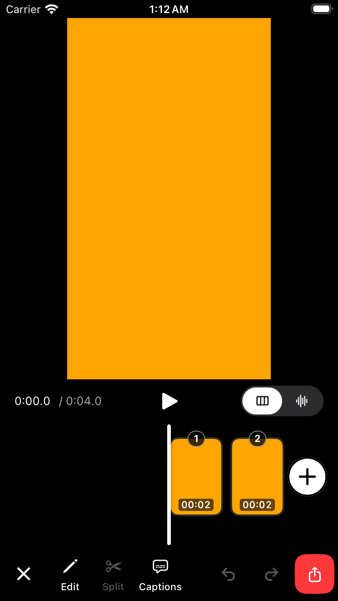
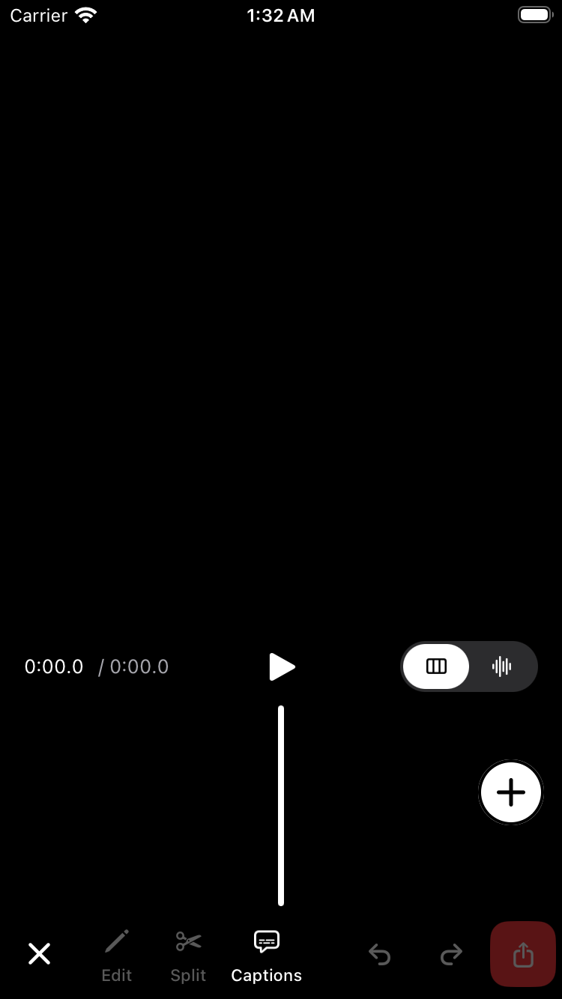
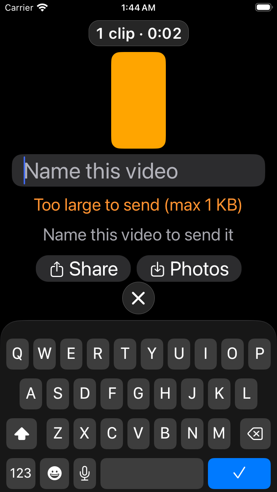
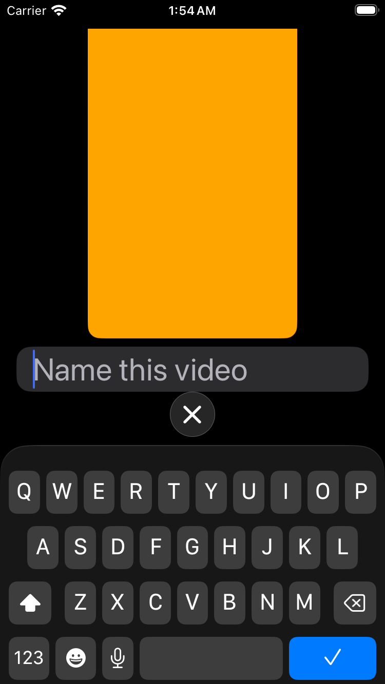
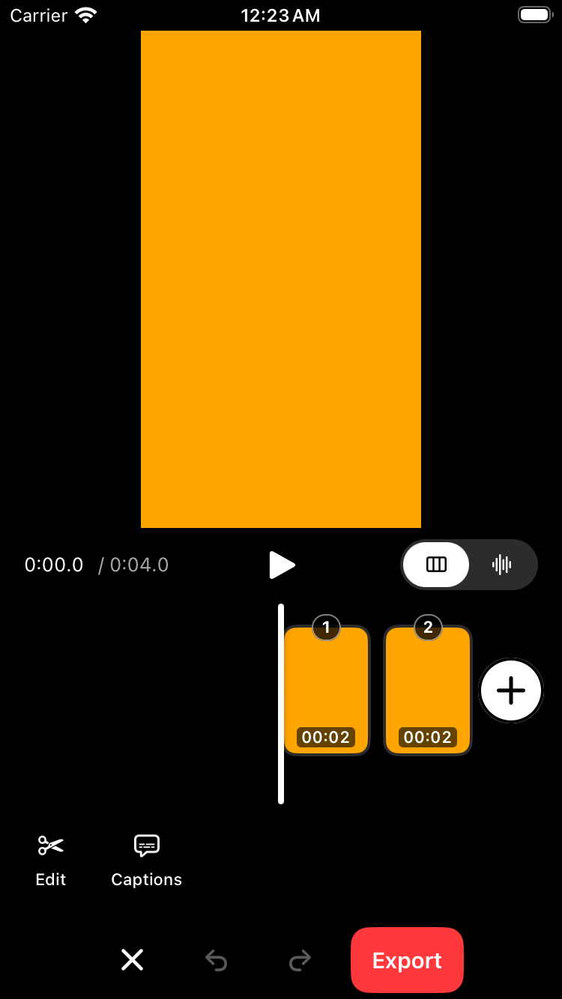
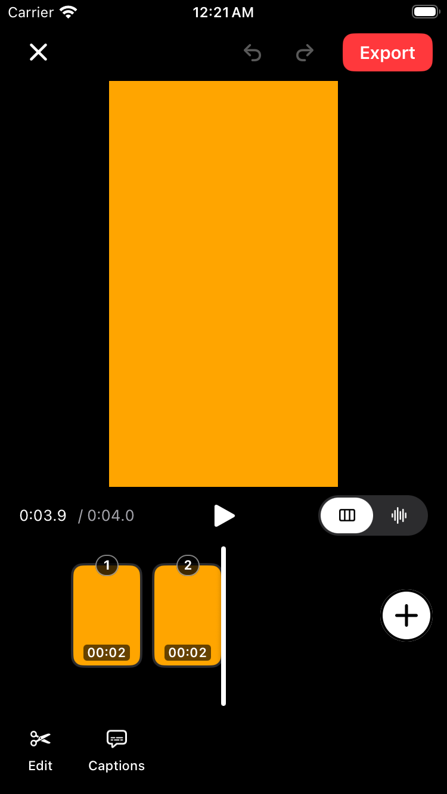

# One-handed navigation

[Issue #310](https://github.com/mieweb/pulse/issues/310) tracks the goal: complete a mobile flow
with the thumb of the hand holding the phone, including returning or dismissing each screen.
Required app-owned actions belong in the lower half, with a usable path for either hand. A bottom
row alone does not establish that its opposite edge is reachable. The development rule is in
[AGENTS.md](../AGENTS.md#one-handed-phone-use); the [PR template](../.github/pull_request_template.md)
requires applicability, flow evidence and reviewed exceptions.

## First implementation scope

The first PR is one cohesive change with guidance, implementation and verification checkpoints:

1. Establish the repository and PR review rule before changing UI.
2. Move recorder Close/Export, editor Close/Undo/Redo/Export, export Close and app-owned permission
   actions into lower control areas. Editor commands and contextual tools share one toolbar;
   caption typing replaces it with Cancel, text entry and Done. Move app-owned screen-recording
   Stop lower. Expose recorder camera tools in an expandable inline lower row that leaves Record
   available. Preserve the existing callbacks and operation guards; Export has at least a
   44-point target, including the editor's compact icon. This PR does not introduce a shared
   footer architecture or redesign destination logic.
3. Open an existing library draft in the editor; New recording opens the camera. Recording more
   from the editor remains part of the same draft. Preserve explicit host/deep-link recording
   requests instead of treating every existing identifier as a library-open request.
4. Record source findings, exceptions and remaining validation below.

This is the first improvement toward #310, not a claim that every operation is now reachable.
Crop manipulation, gesture alternatives, library commands, secondary sheets and a complete
swipe-return redesign remain follow-ups. Validation in the PR must distinguish implemented
behavior, simulator layout/accessibility evidence and actual physical thumb reach.

## Audit baseline and inventory

The original source audit used main at
[`cf6771c0a6b27a4e8dbbdf8105ae4d91a27c4403`](https://github.com/mieweb/pulse/tree/cf6771c0a6b27a4e8dbbdf8105ae4d91a27c4403),
reviewed on 2026-11-25. That remains the historical baseline for the before findings below, not
the current PR base. File links point to the maintained implementation. This inventory is source
evidence, not a device usability result.

PR #327 is rebased onto main
[`2aad841`](https://github.com/mieweb/pulse/commit/2aad841f137755965160d8acda00096261d1a0c1).
The final application revision is `87c600a`, including the empty-project, keyboard and contrast corrections below.
Toolbar validation began at `9710463` on main `2467627`; the subsequent scene-lifecycle rebuild
used `b7ab422` / `4e8abc1` on the current base. Current-base additions are recorded after the
original inventory. The earlier `dce8303` and `3c52200` builds, phone installations and captures
predate that rebase and must not be counted as validation of the rebased application.

| Screen/state                        | Baseline finding and source                                                                                                                                                                                                                                                                                                                                                 | Decision / priority                                                                                                                                                                                                                                 |
| ----------------------------------- | --------------------------------------------------------------------------------------------------------------------------------------------------------------------------------------------------------------------------------------------------------------------------------------------------------------------------------------------------------------------------- | --------------------------------------------------------------------------------------------------------------------------------------------------------------------------------------------------------------------------------------------------- |
| New recording and existing drafts   | [Home route](../src/app/index.tsx) sends both New and a tapped draft to the recorder. [Recorder permissions](../src/features/recorder/use-recorder-permissions.ts) requests camera/mic when recorder mounts.                                                                                                                                                                | First PR: existing library draft → editor; New → recorder. Avoid a camera/permission detour when editing. Keep explicit recording entry points distinct.                                                                                            |
| Recorder commands                   | [RecorderScreen](../src/features/recorder/recorder-screen.tsx) places Close and Export in `topBar`. Record, Edit, Add, lens chips and clip strip are already lower.                                                                                                                                                                                                         | First PR: lower Close/Export without covering or moving the shutter's gestures. Test single and multiple clips.                                                                                                                                     |
| Editor commands                     | [EditorScreen](../src/features/editor/editor-screen.tsx) places Close, Undo, Redo and Export in its header. Main/clip/caption tools, transport and Add are lower. The editor can remain empty for Redo.                                                                                                                                                                     | First PR: lower normal commands; keep history disabled states, empty-draft Redo and Export availability intact.                                                                                                                                     |
| Export, merge, send and errors      | [ExportScreen](../src/features/export/export-screen.tsx) keeps Close above a non-scrolling content column. Destination chips and send/upload/share/Photos actions sit below preview; Retry can be centered. A required-name field opens the keyboard.                                                                                                                       | First PR: lower return/dismiss command and preserve the primary flow. P1: audit every compact/large-text/keyboard/progress/error combination against [#104](https://github.com/mieweb/pulse/issues/104); scrolling and stable footer may be needed. |
| Export preview/captions             | Export's `MergedPreview` uses native playback controls; `CaptionsNote` places a retry at the preview's top. Embedded captions switch and size-warning Trim are separate actions.                                                                                                                                                                                            | P1: reachable playback, retry and Trim alternatives. Native player chrome is an exception to verify, not evidence that app-owned actions are fixed.                                                                                                 |
| Library global commands             | [DraftsScreen](../src/features/drafts/drafts-screen.tsx) has top Import, Export drafts, Appearance and About, plus embedded Close. New/share FAB and [DestinationsFloat](../src/features/upload/pairing/destinations-float.tsx) are lower.                                                                                                                                  | P1: lower library Actions surface; retain New as a clear primary action. Do not compress all header actions into one narrow row.                                                                                                                    |
| Library selection/rename/uploading  | Multi-select keeps Cancel and Select all at top, Share below. [DraftCard](../src/features/drafts/draft-card.tsx) renames inline after long press or menu choice. [Draft actions](../src/features/drafts/draft-menu-actions.ts) include Duplicate/Delete/Watch; uploading locks editing and offers Cancel upload.                                                            | P1: lower selection and project actions, keyboard-aware rename completion. Preserve upload locks and cancellation. Long press remains optional.                                                                                                     |
| Camera tool rail                    | [CameraControls](../src/features/recorder/camera-controls.tsx) centers Flip/Flash/Stabilization/Mic on the right, nudged upward. Flash stays live during capture; other controls have deliberate capture/call locks.                                                                                                                                                        | First PR: expandable inline lower tools with visible state/reason for locks. Preserve Record and live Flash access without a modal over the shutter.                                                                                                |
| Camera zoom/focus                   | [Recorder gestures](../src/features/recorder/use-recorder-gestures.ts) already offer shutter hold-drag zoom, tap recording, pinch and tap-to-focus. [LensSelector](../src/features/recorder/lens-selector.tsx) stays live while recording.                                                                                                                                  | P1: evaluate travel/discoverability before replacing existing thumb zoom. Add lower alternatives for required precision operations; arbitrary preview focus remains a reach gap.                                                                    |
| Recorder clip strip/insertion       | [SegmentBar](../src/features/recorder/segment-bar.tsx) requires hold/drag to reorder and drag-to-trash to delete. [InsertCursor](../src/features/recorder/insert-cursor.tsx) supports dragging, gap taps and screen-reader increment/decrement.                                                                                                                             | P1: selected-clip Move earlier/later/Delete and insertion-point step buttons. Keep drag shortcuts. Screen-reader actions alone do not replace a visible touch alternative.                                                                          |
| Embedded notices and screen capture | Recorder mic/model Download/Not now/Settings/Retry notices sit under the top bar. Screen-recording Stop is near the top in recorder and editor. [ContextBanner](../src/features/recorder/context-banner.tsx) can contain a host link.                                                                                                                                       | First PR: distinct lower Stop screen recording. P1: lower notice decisions and host-link actions. Do not confuse screen Stop with camera Stop.                                                                                                      |
| Permissions                         | [PermissionGate](../src/features/recorder/permission-gate.tsx) has top Close and centered Allow/Open Settings. Recorder-only permission requests are separate from library/editor entry.                                                                                                                                                                                    | First PR: lower app-owned Close/request actions; preserve permission denial and optional-mic behavior. System prompts/Settings remain OS-owned.                                                                                                     |
| Crop and clip/caption tools         | [CropEditor](../src/features/editor/crop-editor.tsx) uses preview pan/pinch. [ClipToolbar](../src/features/editor/clip-toolbar.tsx) and [CaptionTools](../src/features/editor/caption-tools.tsx) are lower horizontal tool rows; caption placement drags on preview.                                                                                                        | P1: lower crop return/confirm controls and button alternatives to geometry changes; test horizontal access to all tools, caption typing and expanded text. Deferred from first PR.                                                                  |
| Add from another Pulse              | [FromAnotherPulse](../src/features/recorder/from-another-pulse.tsx) has top Back/Close/Select all, a scrollable list/grid and a lower Add footer. Copying temporarily blocks dismissal.                                                                                                                                                                                     | P1: reuse the footer for lower Back/Cancel/selection actions; retain copying and partial-import rules.                                                                                                                                              |
| Pairing/destinations                | [PairingSheet](../src/features/upload/pairing/pairing-sheet.tsx) has lower Cancel/Connect or Paste/Cancel. [DestinationsSheet](../src/features/upload/pairing/destinations-sheet.tsx) has top-right Close and row trash; Remove all is below the list.                                                                                                                      | P1: stable lower dismissal/action footer when sheets expand; preserve server identity, selection and trust decisions.                                                                                                                               |
| About/appearance/model settings     | [About](../src/app/about.tsx) and [OnDeviceAiSheet](../src/features/transcription/on-device-ai-sheet.tsx) have top-right Close; copy/logs/backup/trust/model/license actions occupy varying content heights.                                                                                                                                                                | P1: lower Done and reachable actions, preserving model confirmation/removal and server-trust behavior.                                                                                                                                              |
| Onboarding                          | [OnboardingScreen](../src/features/onboarding/onboarding-screen.tsx) already separates scrollable content from a safe-area-aware Continue footer. Android Back completes onboarding without opening recorder.                                                                                                                                                               | Preserve this useful footer pattern. P2: decide whether iOS needs a visible lower View projects/skip equivalent.                                                                                                                                    |
| Storage recovery                    | [RecoveryScreen](../src/core/recovery/screen.tsx) centers messages and actions. Standalone Restore and embedded Close use that layout.                                                                                                                                                                                                                                      | P1: lower action footer with readable recovery guidance; retain backup/failed-flow semantics.                                                                                                                                                       |
| Generic menus/tips/toasts           | [ActionMenu](../src/components/action-menu.tsx) is an anchored Android popover; iOS [DraftMenu](../src/features/drafts/draft-menu.ios.tsx) and [PlusMenu](../src/features/recorder/plus-menu.ios.tsx) use native menus. [Tip callouts](../src/features/tips/tip-callout.tsx) dismiss beside their anchors; [Toast](../src/components/toast.tsx) has its own actions/escape. | P1: inventory action reach as menus grow and overlays appear. A lower trigger can open an upper menu. Recheck toast/control overlap under #104.                                                                                                     |

The existing [SheetBody](../src/components/sheet-body.tsx) and
[sheet-fit policy](../src/utils/sheet-fit.ts) handle content-sized versus full-height scrolling;
they do not guarantee a lower fixed action footer. Reuse the onboarding and Add-from-another-Pulse
footer patterns where appropriate. Existing effective touch areas and accessibility labels must
survive repositioning; controls that already have sufficient target size can still be too high.

### Additions inherited from the refreshed main

- [PR #326](https://github.com/mieweb/pulse/pull/326) adds direct **Split at playhead** to both
  [MainToolbar and ClipToolbar](../src/features/editor/clip-toolbar.tsx), with availability and
  busy guards in the [editor](../src/features/editor/editor-screen.tsx). The integrated lower
  toolbar preserves those actions, callbacks and the accessibility name. Rebased validation must
  cover Split in the main and clip modes, Clips and Timeline views, boundary/disabled states,
  fractional-speed cases, Undo/Redo and horizontal access on narrow phones. Earlier captures with
  fewer main tools do not establish that this row still fits.
- [PR #330](https://github.com/mieweb/pulse/pull/330) adds build release notes to
  [About](../src/app/about.tsx) and a [Release history](../src/app/release-history.tsx) screen.
  [Both routes](../src/app/_layout.tsx) now always use full-height scrolling form sheets. About's
  Release history action is near its upper sections; both screens retain top-right Close.
  **P1 under #310:** provide lower dismissal and reachable action alternatives, and verify
  scroll-versus-swipe dismissal at supported text sizes. These inherited screens remain deferred
  rather than silently treated as covered by the core-navigation change. The original audit's
  content-sized About description applies only to its historical baseline.
- [PR #329](https://github.com/mieweb/pulse/pull/329) adds the Expo scene-lifecycle prebuild plugin
  and requires Xcode/iPhoneOS SDK 27 or later for TestFlight archives. Regenerate the native project
  before rebuilding this base; see [the build instructions](../README.md#getting-started).
- Release notes are generated from Git by [app.config.ts](../app.config.ts) and
  [the generator](../scripts/release-notes.ts). A rebuilt application needs complete history and
  `app-v*` tags; the notes describe that build's checkout. The pre-rebase phone builds do not
  contain these inherited release-note screens.

## Swipe return and gesture conflicts

Gestures should invoke the same logical operation as a reachable Back/Close button. A gesture
must preserve drafts, respect active operations and avoid changing edits before returning.

| Surface / source                                         | Existing behavior or conflict                                                                                                                                                                   | Follow-up decision / acceptance                                                                                                                                                        |
| -------------------------------------------------------- | ----------------------------------------------------------------------------------------------------------------------------------------------------------------------------------------------- | -------------------------------------------------------------------------------------------------------------------------------------------------------------------------------------- |
| Standalone [navigation](../src/app/_layout.tsx)          | Recorder/export use full-screen modal presentation. Editor and onboarding explicitly disable navigation gestures. There is no explicit common swipe-to-return implementation.                   | P1: verify actual native behavior before claiming swipe support. Add a reserved gesture region only where it can invoke the existing close path safely. Keep lower button alternative. |
| [Embedded flow stack](../embed/src/shell/flow-stack.tsx) | Flow screens disable gestures; back/escape and native host dismissal have flow-specific behavior.                                                                                               | P1: review JS back together with native host dismissal and send/recording guards; never equate closing a sheet with canceling a host request.                                          |
| Recorder preview/shutter                                 | Preview tap focuses and pinch zooms; shutter tap toggles, hold records and vertical drag zooms.                                                                                                 | Never make a global vertical dismiss gesture compete with hold/drag recording. Test release/cancel and tap-started takes.                                                              |
| Recorder strip/cursor                                    | Horizontal scroll, hold-to-reorder, drag-to-trash and insertion-cursor drag share the lower region.                                                                                             | Reorder/insertion/button operations must not accidentally dismiss or start recording. Test long projects and edge scrolling.                                                           |
| Editor timeline/clips                                    | [TimelineStrip](../src/features/editor/timeline-strip.tsx) scrolls/seeks, pinches, trims and moves captions; [ClipRow](../src/features/editor/clip-row.tsx) scrolls/seeks and holds to reorder. | Reserve navigation gestures away from editing surfaces. Provide explicit lower return and later precision/zoom/reorder alternatives.                                                   |
| Crop/caption preview                                     | Crop pan/pinch and [caption pan/tap](../src/features/transcription/skia-caption.tsx) act directly on media.                                                                                     | No blanket swipe-dismiss over the preview. Cover Cancel/Done and caption keyboard states separately.                                                                                   |
| Secondary route sheets                                   | About, AI, Pair and Destinations use system form sheets with grabbers; some expand to full height for large text or long lists.                                                                 | Test drag-dismiss versus content scrolling, server trust/model confirmation state, and full-height lower Close/Cancel. Do not rely on a grabber alone.                                 |
| Add-from-another-Pulse modal                             | iOS allows swipe-dismiss except while copying. Android Back steps to source list; accessibility escape also steps back.                                                                         | Preserve copying guard and source-list semantics; add lower touch return path and test cancel during selection.                                                                        |
| Menus and native dialogs                                 | Android popover supports backdrop/back dismissal; SwiftUI menus and system pickers/share prompts own their gestures.                                                                            | Test actual system return/cancel routes and document constraints. Do not count backdrop-only dismissal as the required accessible button alternative.                                  |

## Related work and priorities

- **P0 / this PR:** guidance and PR review rule, lower normal core header commands and screen Stop,
  inline lower recorder tools and permission actions, library-open → editor behavior, focused
  regressions and honest validation evidence for the #310 primary flow. New remains camera;
  explicit Record more, place links and embedded record requests retain their recording intent.
- **P1 / follow-ups under #310:** crop/gesture alternatives; full library and secondary-sheet
  action relocation; remaining notices/recovery/error states; and safe swipe
  return with explicit button alternatives. Create focused tickets as these scopes are agreed;
  this document does not imply that they have shipped.
- [#231](https://github.com/mieweb/pulse/issues/231) and
  [PR #246](https://github.com/mieweb/pulse/pull/246) address the different posture where a phone's
  base rests against a laptop and the thumb lies higher. At this audit, #246 is open/unmerged and
  says a moved shutter may cover other controls and still needs iOS/Android device validation.
  Review placement bounds, reset reach, overlap and gesture ownership together before adopting it;
  movable controls are not a substitute for a usable default.
- [#104](https://github.com/mieweb/pulse/issues/104) owns export overflow, sheet sizing and
  pill/FAB/toast overlap. Its older paths predate feature extraction. Recheck against the current
  components instead of assuming every historical finding remains or is resolved. Link repairs
  there rather than opening duplicate overflow tickets.

## Acceptance mapping

These are review gates, not completed test results. The PR records actual commands, captures and
remaining gaps. Source inspection and unit tests cannot establish physical thumb reach.

| #310 requirement                                | Required checks for the affected change                                                                                                                                            | Remaining broader work                                                                                |
| ----------------------------------------------- | ---------------------------------------------------------------------------------------------------------------------------------------------------------------------------------- | ----------------------------------------------------------------------------------------------------- |
| New → Record → Stop → Export → destination/send | Single- and multi-clip recordings; lower app-owned controls; no upper Export detour; return retains draft; busy/progress/retry/cancel works.                                       | Verify OS picker/share completion separately and record placement constraints.                        |
| Existing project opens edit                     | Tap library draft → editor without camera/mic prompt; Record more uses same draft; return to project list; explicit host/deep-link recording routes preserved.                     | Additional entry paths only change when their intended operation is editing.                          |
| History and edit preservation                   | Undo/Redo and empty-draft restoration, disabled Export when empty, return/dismiss autosave, keyboard/caption state.                                                                | Persistent cross-session history remains its separately tracked feature.                              |
| Either hand and supported phone layouts         | Small and large iOS/Android layouts, safe-area/home indicator, supported text sizes, RTL, labels/focus/disabled states. Actual left/right grip reach must be recorded on hardware. | Full secondary-screen and alternate-posture audit, including #231/#246.                               |
| Swipe return/dismiss                            | Report supported, blocked and unverified surfaces; verify each enabled gesture uses the existing logical close path.                                                               | Gesture-conflict inventory above remains open until each affected surface is implemented and checked. |
| Exceptions and overlap                          | Separate OS-owned dialogs/native chrome from app-owned controls. Record rationale, reachable fallback and linked follow-up for app exceptions.                                     | #104 export/keyboard/long-destination/toast combinations and all deferred sheets.                     |
| Rule carried forward                            | AGENTS rule and PR template apply before UI implementation; every future PR declares applicability or N/A.                                                                         | Review evidence stays with each future UI change.                                                     |

## Compact editor toolbar revision

Feedback on the initial `dce8303` build identified wasted vertical space: contextual tools and
global commands occupied separate bottom rows. The revised editor combines them in one
60-point toolbar, with the safe-area inset applied once:

**Close · contextual tools · Undo · Redo · Export**

This replaces the initial 76-point tools area plus 52-point commands area, recovering 68 points
for the preview and timeline. Contextual tools scroll horizontally in their available space;
the four global commands retain fixed places and at least 44-point targets. Export uses a compact
icon with the same accessibility label. Caption typing replaces the entire toolbar with
Cancel/text/Done above the keyboard. History and navigation callbacks, recorder controls and the
export screen's behavior are unchanged by this revision.

**Remaining horizontal-tool exception:** tools that do not fit require a horizontal swipe in the
lower contextual region. This preserves media space and touch-target size without adding another
row, but there is no visible tap-only alternative for revealing offscreen tools yet. That remains
an exception for review under #310, alongside precision gesture alternatives; a lower menu or
step controls are possible follow-ups. Verify access to every tool, including Done, at narrow
widths, supported text sizes and in RTL, without a scroll activating an adjacent command.

### Rebased validation

All seven source checks passed at application revision `87c600a`, based on main `2aad841`.
The correction includes four regressions covering reopened empty projects, parent-query
loading/failure/missing states, parent deletion and default embedded/history behavior.

The same seven checks passed at earlier checkpoints: `9710463` / `b7ab422` had 150 suites /
2,146 tests; `800d16e` had 150 suites / 2,150 tests. The final correction adds export-preview
boundary cases alongside the empty-project navigation regressions.

All seven source checks use Node 24.9.0:

| Command                                          | Result                                                                                                               |
| ------------------------------------------------ | -------------------------------------------------------------------------------------------------------------------- |
| `npx tsc --noEmit`                               | Passed.                                                                                                              |
| `npm run lint`                                   | Passed full lint.                                                                                                    |
| `npm test -- --runInBand`                        | 151 suites / 2,161 tests passed; one opt-in PulseVault integration suite / eight tests skipped locally. No failures. |
| `node scripts/gen-protocol-types.mjs --check`    | Generated protocol types are current.                                                                                |
| `npx tsc --noEmit -p embed`                      | Passed.                                                                                                              |
| `npx tsc --noEmit -p embed/packages/pulse-embed` | Passed.                                                                                                              |
| `npm run check:embed`                            | Passed dependency/facade checks and iOS/Android bundle checks (4,236 / 4,145 sources).                               |

The full Jest run includes main's Split/fractional-boundary and release-note tests plus the new
empty-project regressions. Focused Split/history/anchor/import regressions also passed during the
rebase. Changed-file formatting, local documentation links and whitespace checks pass.

Native iOS Release checks at the first rebase checkpoint `9710463` used task-owned iOS 26
simulators with synthetic local clips. The toolbar geometry and Split/history paths remain
unchanged by the later empty-project correction.

- **375 × 667:** Close, Undo, Redo and Export remain 44 × 44 at `y = 615`, with fixed x positions
  4 / 231 / 279 / 327 at normal and maximum text. Main's Edit, Split and Captions fit at normal
  text. At maximum text, an element-based horizontal swipe revealed the remaining 13 points of
  Captions; its native button opened the model sheet without starting a download.
- **440 × 956:** all four commands remain 44 × 44 at `y = 870`, with fixed x positions
  4 / 296 / 344 / 392. All three Main tools fit at normal and maximum text. Main and Clip Split,
  Undo and Redo restored clip IDs, source windows, ordering and settings. Initial-position Split
  was disabled. Fractional repeat-Split behavior failed as described below.
- Text settings and original synthetic fixtures were restored; owned WDA sessions/runners ended,
  ports were clear and the simulators returned to Shutdown. No physical device was used.

After rebasing onto `2aad841`, Xcode/iPhoneOS SDK 27.2 passed the new SDK guard. Expo prebuild
applied the inherited scene plugin: the generated scene manifest uses `EXExpoAppSceneDelegate`,
multiple scenes are disabled and AppDelegate provides the React Native factory without the legacy
startup block. The scene-lifecycle Release build at `b7ab422` / embedded metadata `4e8abc1`
passed cold launch, Home and Editor background/foreground with the same process, project opening
and lower Close. Its copied EXConstants resource initially retained stale metadata; refreshing
that generated bundle produced the correct `4e8abc1` About metadata with unchanged app sources.
The subsequent empty-project build and check are recorded below.

These checks establish native layout and accessible activation, not actual either-hand grip reach.

**Known inherited Split defect:** at a fractional playhead position, Split can remain enabled
after committing even without a user seek. Repeating it created a roughly 8–9 ms extra fragment
on both simulators, in Main and Clip modes. Undo/Redo restored the exact ordered clip windows.
The Split, timeline-layout and preview-transport logic is unchanged from main `2aad841`. Source analysis indicates a mismatch between the frame-quantized
native timeline boundary and the preserved exact playhead. The source tests pass but do not cover
this native rebuild interaction. A separate Split/preview timing repair and native retest are
needed. The native boundary-state check failed.

The capture below is the first rebase checkpoint `9710463`; its toolbar layout is retained in
the final application.

The earlier phone handoffs and captures below continue to describe their named pre-rebase builds.
The phone has not been updated or exercised during this rebase; real camera/Record/Stop, either-hand
reach, RTL, Android and the broader audit acceptance work remain unverified.

### Empty-project review correction (`800d16e`)

Direct library → Edit entry exposed an empty-project regression: deleting the only clip and
closing left a project card whose editor immediately exited on reopening. Standalone Edit now
keeps a valid persisted empty project open with lower Add/Close and disabled Export. It waits
for a successful parent-project read before treating it as missing; loading or an initial read
error does not imply deletion. Confirmed missing projects exit, and permission to edit an empty
project does not enter the history-retention latch. Default embedded behavior, active additions
and Undo/Redo holds remain intact. Anchored empty entry also exposes Add while waiting for the
first clips to arrive.

The Release build from `800d16e` (clean embedded metadata, unchanged source hashes) passed native
checks on the 375 × 667 iOS 26 simulator: Delete the only clip → empty Editor, Close → Home →
reopen empty Editor, anchored/deleted-clip entry with visible Add, donor-project copy → one clip,
Undo → empty with Redo enabled, Redo → one clip and reopen the restored project. A nonexistent
project returned to Home. Export was disabled while empty. Fixtures/text were restored, the owned
session and runners ended, the port was clear and the simulator returned to Shutdown.

### Keyboard and screen-recording status corrections (`87c600a`)

Export content now scrolls above its separate lower return footer when the keyboard or expanded
text exhausts the available height. The preview retains its normal space when room is available;
its 9:16 geometry includes the metadata budget and hides the metadata/video when no positive card
can fit. Eleven sizing regressions cover exhausted, negative, invalid and constrained viewports.
Export/send/upload callbacks and guards are unchanged.

A Release build from `87c600a` passed native checks on the 375 × 667 iOS 26 simulator with an
offline synthetic draft requiring a name and exceeding its size limit. At normal and maximum
text, the real on-screen keyboard appeared, typed names were accepted and lower Close returned
Home while the keyboard stayed open. Its native rectangle (165, 382, 45 × 44, including AX rounding)
remained above the keyboard at `y = 451`. A native content swipe dismissed the keyboard and exposed
Share/Photos. The normal 9:16 preview remained visibly positive. This standalone fixture has no
Trim callback; embedded Trim/captions/error combinations remain unverified under #104.

Build metadata names `87c600a` with `dirty: true` from concurrent documentation edits; app-source
hashes were unchanged. The before capture is `800d16e` using the same common keyboard fixture,
which fits in that revision too; it is a layout comparison, not a pictured negative-dimension
failure. Unit boundary cases establish that exhausted preview space is rejected. A settled after capture
was independently repeated through WDA and simctl; their decoded RGB pixels matched exactly,
including the visible keyboard and lower Close. The return action passed again.

| Before (`800d16e`)                                                                                    | After (`87c600a`)                                                                                                     |
| ----------------------------------------------------------------------------------------------------- | --------------------------------------------------------------------------------------------------------------------- |
|  |  |

The editor's relocated screen-recording status uses an opaque themed surface and text. Calculated
status-text contrast is 18.82:1 in light mode and 13.94:1 in dark mode; the recorder retains its
over-video glass appearance. Starting, busy and Stop callbacks/labels/targets are unchanged. Color
calculation, type checks and existing regressions cover this variant; live screen recording on
Android/older iOS remains an explicit manual acceptance check.

### Revision validation (`3c52200`)

This section records the **pre-rebase** compact-toolbar build. Its source-check counts, native
measurements and phone installation are historical evidence; they are not results for `9710463`
or its inherited Split and release-note changes.

All seven source checks passed again: root/embed/client TypeScript, full lint, protocol generation,
the embed bundle/dependency check, and Jest (147 suites / 2,100 tests passed; the same opt-in
integration suite's eight tests skipped locally).

Native iOS 26 accessibility checks measured the same 68-point gain on both phone layouts:

- **375 × 667:** preview height increased from 333 to 401 points. Close, Undo, Redo and Export
  share `y = 615`, each an actual 44 × 44 target. Rotate → Undo → Redo → Undo and two-clip native
  export completed through the integrated controls.
- **440 × 956:** preview height increased from 546 to 614 points. The same commands remain at
  `y = 870` in Main, Clip, Captions and Speed modes, including maximum accessibility text. A
  native swipe on the contextual toolbar exposed later tools; a speed change and Undo passed.
- Caption entry still replaces the whole toolbar in source, but its native keyboard state
  remains unverified: selecting the rendered caption word has no native accessibility node.
  Track native caption selection and its keyboard retest under #310. No coordinate fallback
  was used. The existing transport time display also overflows at maximum text; this remains
  a separate open layout finding, while the integrated toolbar fits.

The signed Release from application commit `3c52200` was installed in place and launched on the
requested iPhone, its process verified, and the global device lease returned `released` before
handoff. No physical test/capture runner or debugger was started. Build metadata's dirty flag
reflects concurrent documentation edits; application source hashes stayed unchanged through
both builds. Physical grip/Record/Stop and the broader acceptance work remain user/device checks.

| Initial stacked toolbar                                                                    | Compact toolbar                                                                 |
| ------------------------------------------------------------------------------------------ | ------------------------------------------------------------------------------- |
|  |  |

## Initial test build (`dce8303`): observed validation

The initial, pre-rebase test build uses application source at `dce8303` on
[PR #327](https://github.com/mieweb/pulse/pull/327). The signed Release build was installed in
place on the requested iPhone, launched without a debugger, and its running process verified.
No drafts were removed and no physical test/capture runner was started. The shared device guard
returned `released` before handoff. This establishes installation and launch, not physical
left/right thumb reach or camera recording correctness. The coordinates and results in this
section describe that initial stacked-row layout, not the compact toolbar revision above.

Source checks passed: root, embed and embed-client TypeScript; full lint; protocol generation;
and the embed dependency/bundle check. Jest passed 147 suites and 2,100 tests, with the opt-in
PulseVault suite's eight tests skipped locally. Both pinned/latest PulseVault integration jobs
passed in GitHub, along with all nine PR checks at the application-source commit.

Native accessibility checks used task-owned iOS 26 simulators and artificial local clips:

- On the 375 × 667 phone, a library card opened Edit directly. Close, Undo, Redo and Export were
  accessible at `y = 619` with 44-point height. Disabled history commands retained their places.
- Rotate → Undo → Redo → Undo worked through those lower buttons. A two-clip native export
  completed; the lower Share action opened the system sheet, whose down-swipe dismissal returned
  to Export. Lower return controls returned to the editor and library.
- New recording opened an empty recorder. Expanded camera tools were at `y = 531`, the shutter
  at `y = 439`, and Close/Tools at `y = 607`. The shutter was disabled because the simulator has
  no camera; this is not a Record/Stop hardware test.
- On the 440 × 956 phone, editor commands remained at `y = 874` in main/edit modes and at the
  largest accessibility text setting. Recording more opened the same project and returned to
  its existing editor. Expanded recorder tools and shutter stayed in the lower half at normal
  and maximum text sizes, and a single-clip native export completed.
- The large phone's denied-camera gate kept Close and Open Settings at the bottom and returned
  to Home through Close. Simulator camera/microphone permissions and text size were restored
  after this check. The large system share sheet also opened and dismissed through its named
  system dismissal region; its lack of a Close/Cancel button remains an OS-owned limitation.

Before is the cached previous #318 simulator build; after is the initial `dce8303` build with
separate lower tool and command rows. Both captures use the same synthetic two-clip draft on the
small phone. These captures are retained as initial-build evidence, separately from the compact
toolbar above.

| Before                                                                        | After                                                                              |
| ----------------------------------------------------------------------------- | ---------------------------------------------------------------------------------- |
|  |  |

[Expanded lower recorder tools](images/one-handed-navigation/recorder-tools.png) are captured
separately. Android, physical grip/Record/Stop, live screen-recording combinations, caption
keyboard states, real destination sending and the deferred audit surfaces remain acceptance
work. OS-owned share controls retain system placement and dismissal behavior.
