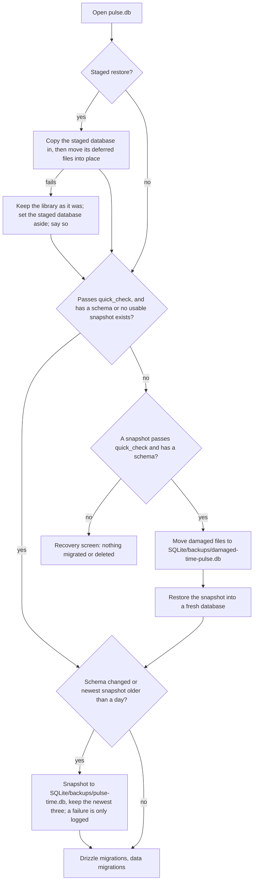

# Persistence

Pulse keeps its library in one place: the SQLite database `pulse.db`, plus the media files its
rows point to under `Documents/drafts/`. A `.pulse` file is a complete copy of drafts or of the
whole library, made on demand to share, back up or restore. The app never runs on that copy.

## Saves

`src/db/durability.ts` sets these pragmas when the database opens:

| Pragma | Value | Why |
|---|---|---|
| `journal_mode` | `WAL` | readers don't block the writer; a crash leaves the last committed state |
| `synchronous` | `FULL` | a commit is on disk before it returns |
| `fullfsync`, `checkpoint_fullfsync` | `ON` (iOS) | Apple's `fsync` doesn't flush the drive cache; `F_FULLFSYNC` does |
| `foreign_keys` | `ON` | cascade deletes |

The app logs the values it reads back as `[db] durability`.

## Launch and recovery

`openLibrary` (`src/db/snapshots.ts`) runs as `src/db/client.ts` loads, before migrations. Nothing
in it may stop the app from starting: every step that can fail is caught, and an unexpected
failure shows the recovery screen over an in-memory database without touching the files.

- **Snapshots** use expo-sqlite's `backupDatabaseSync` (SQLite's online backup API). Each is written
  as `pulse-<time>.db.part` and renamed when complete.
- **An empty database** passes `quick_check`. That's what an interrupted recovery leaves, so an
  empty database counts as damaged while a usable snapshot exists. A new install has none.

## Media

`referencedMediaPaths` (`src/db/media-refs.ts`) is the one list of files the library needs: stored
paths, derived ones (thumbnails, edited thumbnails, covers, `export.mp4`; see
`src/utils/media-paths.ts`), and the clip files that transcripts and caption edits were timed against.
It decides what goes into a `.pulse` file, and protects referenced files from the RNVT leftover
sweep. Media is only deleted with its draft. Nothing deletes a file for lacking a row, because a
damaged, empty or restored database would then delete videos.

## `.pulse` files

| | Draft transfer | Library backup |
|---|---|---|
| Contents | `project.json`: every row and column of the chosen drafts, built from `schema.ts` (`src/db/project.ts`), plus their media | `pulse.db` (via the backup API), `manifest.json` (every file the database references, with its size and MD5), and the whole `drafts/` folder |
| Import | copy with new ids (`unpack-project.ts`); v1 bundles still go to the v1 importer | exact restore, staged for the next launch, then migrated (`library-backup.ts`) |
| Zip | streamed in JS (`zip-stream.ts`), limited to 4 GB (no ZIP64 in fflate) | native (`react-native-zip-archive`); only files the manifest lists are restored |

**Coverage:** the export refuses a database column that `schema.ts` doesn't define, and a test fails
if a schema column is missing from the export.

**Integrity and safety**, checked before anything in the library is touched:
- Each file's MD5 is computed natively (`File.info({ md5: true })`) and checked on import.
- A draft file's child rows must have their parent in the file.
- A backup's manifest paths must stay under `drafts/`, be unique, and not collide with `pulse.db`.
- The restored database's draft and clip ids and its stored paths must stay under `drafts/` too
  (`assertSafeLibrary`).

**Restore order:**
1. The current library is snapshotted.
2. Files new to the phone move into place.
3. Files that differ from one already here wait in `Documents/.pulse-restore-media/`.
4. On the next launch, they are applied together with the database (only once a marker shows the
   database went in), so old rows never point at a restored file.

**Free space and versions:**
- Export, import and restore check `Paths.availableDiskSpace` and refuse before writing anything.
  A backup counts the whole `drafts/` folder.
- A backup from a newer schema is refused; an older one is migrated after the swap.
