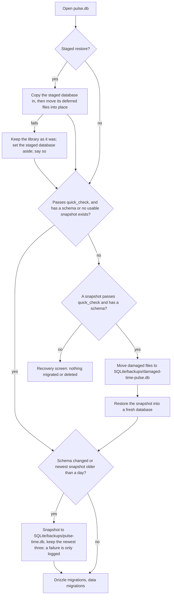
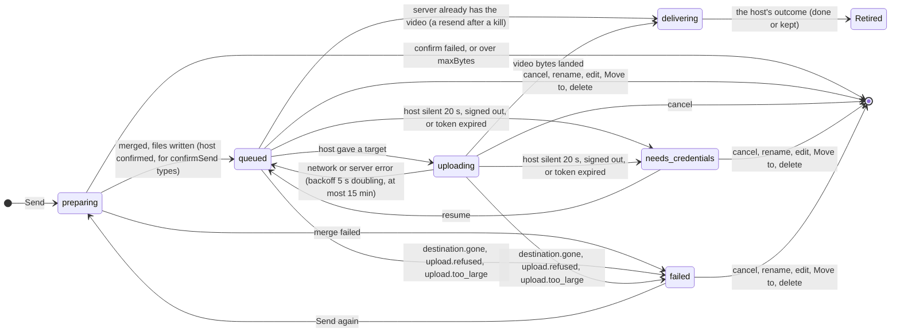
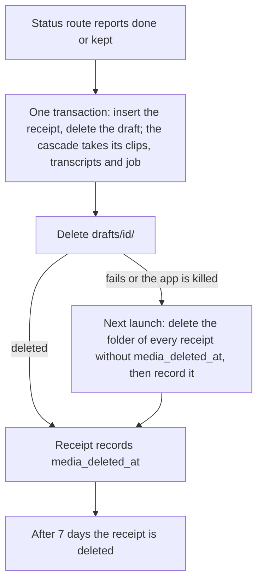

# Persistence

Pulse keeps its library in one place: the SQLite database `pulse.db`, plus the media files its
rows point to under `Documents/drafts/`. A `.pulse` file is a complete copy of drafts or of the
whole library, made on demand to share, back up or restore. The app never runs on that copy.

PulseKit, Pulse inside another app, keeps one such library per signed-in person, each in a folder
of its own (a namespace), and adds three tables that never leave the phone: the upload outbox, the
receipts of sent videos and this install's own settings. Those are covered from
[Namespaces](#namespaces-pulsekit) on; everything before them applies to both shells.

## Saves

`src/db/durability.ts` sets these pragmas when the database opens:

| Pragma | Value | Why |
|---|---|---|
| `journal_mode` | `WAL` | readers don't block the writer; a crash leaves the last committed state |
| `synchronous` | `FULL` | a commit is on disk before it returns |
| `fullfsync`, `checkpoint_fullfsync` | `ON` (iOS) | Apple's `fsync` doesn't flush the drive cache; `F_FULLFSYNC` does |
| `foreign_keys` | `ON` | cascade deletes |

The app logs the values it reads back as `[db] durability`.

## Editor operations and session history

The editor has **one sticky + at the right edge of the clip row**, visible in both editor views
and while a clip is selected. Its target is captured when an action is chosen and depends on the
current view:

- **Clips (beat list):** use the nearest clip boundary without splitting. A playhead in the first
  half of a clip inserts before it; the second half inserts after it. An exact midpoint inserts
  after the clip.
- **Timeline:** use the exact playhead position. Inside clip A, a successful addition of X commits
  **A-left → X → A-right** in one SQLite transaction.

At an existing boundary, either view inserts there; at the end it appends a new clip/beat to the
existing Pulse. In Timeline, A stays unsplit until the first new clip commits, so canceling or
rejecting media before that leaves it unchanged. If A's source or edits change before that commit,
the insertion is rejected instead of moving to another position. A canceled batch keeps clips
already committed. The recorder retains its explicit insert cursor; opening it from the editor
passes the chosen position through.

Splitting changes rows and edit settings, with no source-video rewrite or re-encode. The halves
share the effective source file and retain their trim, speed, transforms, crop, mute and captions.
Their `editState` includes a `baseWindow` source interval: trim handles and Reset stay inside that
half. Reset clears transforms and speed while preserving this interval. Splitting a legacy baked
clip uses its effective baked file as the halves' source; the original row is retained for Undo.

One session history step owns a Timeline split and insertion together. Undo takes the inserted clips and
halves out and restores the unsplit original in one transaction; Redo restores the applied rows,
including their edits, captions and transcripts. Media needed by either form stays held until the
history step is discarded or the editor closes. A batch uses one split and keeps its additions in
order. Removing the last added clips through Undo keeps the editor open for Redo, with export
disabled while empty.

The main toolbar's **Split** tool commits just the two halves at the exact playhead in either
view, without inserting media or entering Edit. It is also available in the selected clip's toolbar.
It is unavailable at existing clip boundaries or the end. This uses
the same metadata transaction and retained original as split-and-insert: one Undo rejoins the
original and one Redo restores the halves, including their captions, transcripts and settings.

Split availability, captured insertion anchors and storage share a 1 ms timeline tolerance at
both clip edges, after applying speed. Positions within that tolerance use the existing boundary;
direct storage splits reject them. This prevents floating-point reconstruction of a fractional
boundary from producing a fragment whose stored duration rounds to zero.

An image batch creates its history step with the first committed clip and extends that same step
beneath any intervening edits. Undo and Redo remain unavailable until the batch finishes or is
canceled. A canceled partial batch keeps one history step for the clips already committed. The
active step stays retained even if intervening edits exceed the normal 100-step history limit;
the limit applies again when the batch closes. Addition Undo checks every recorded clip ID against
storage, so a delayed live-query update cannot discard or partly undo the operation.

The Undo/Redo stacks are in memory for the editor session. The saved current rows, including split
bounds, travel in `.pulse` files; the session stacks and media held only for Redo do not. Persistent
history and its transfer are deferred to [#325](https://github.com/mieweb/pulse/issues/325).

## Launch and recovery

`openLibrary` (`src/db/snapshots.ts`) runs as `src/db/client.ts` loads, before migrations. Nothing
in it may stop the app from starting: every step that can fail is caught, and an unexpected
failure shows the recovery screen over an in-memory database without touching the files.



- **Snapshots** use expo-sqlite's `backupDatabaseSync` (SQLite's online backup API). Each is written
  as `pulse-<time>.db.part` and renamed when complete.
- **An empty database** passes `quick_check`. That's what an interrupted recovery leaves, so an
  empty database counts as damaged while a usable snapshot exists. A new install has none.

## Media

`referencedMediaPaths` (`src/db/media-refs.ts`) is the one list of files the library needs: stored
paths, derived ones (thumbnails, edited thumbnails, covers, `export.mp4`; see
`src/utils/media-paths.ts`), and the clip files that transcripts and caption edits were timed against.
It decides what goes into a `.pulse` file, and protects referenced files from the RNVT leftover
sweep. Explicit clip edits/deletions and discarded session history remove obsolete media only
after checking the live rows and active history holds; split siblings can share a file. Files
held for an abandoned session are recorded for cleanup on a later launch. Draft deletion and,
in PulseKit, [retirement](#retirement-receipt-driven-deletion) remove the draft's media. There is
no general deletion sweep for files lacking a row: a damaged, empty or restored database must not
cause videos to be deleted.

## `.pulse` files

| | Draft transfer | Library backup |
|---|---|---|
| Contents | `project.json`: every row and column of the chosen drafts, built from `schema.ts` (`src/db/project.ts`), plus their media, each listed with its archive entry, size and MD5 | `pulse.db` (via the backup API), `manifest.json` (each file's library path, archive entry, size and MD5), and exactly the files the database references, except each draft's `export.mp4` |
| Import | copy with new ids (`unpack-project.ts`); a file two copies share is moved once and copied for the other; v1 bundles still go to the v1 importer | exact restore, staged for the next launch, then migrated (`library-backup.ts`) |
| Zip | native both ways (`react-native-zip-archive`; `native-zip.ts` writes): flat, each file under its base name; a second file with a taken name (a duplicated draft keeps a shared original's) goes in as a renamed copy. Import unzips beside `drafts/`, checks sizes and MD5s, then moves each file into place. Draft files from before entry names (`media/<path>`) still import | (same) |

**Coverage:** the export refuses a database column that `schema.ts` doesn't define, and a test fails
if a schema column is missing from the export.

**Integrity and safety**, checked before anything in the library is touched:
- Each file's MD5 is computed natively (`File.info({ md5: true })`) and checked on import.
- A draft file's child rows must have their parent in the file.
- A backup's manifest paths must stay under `drafts/` and be unique, and each entry must be a plain, unique name in the archive.
- The restored database's draft and clip ids and its stored paths must stay under `drafts/` too
  (`assertSafeLibrary`).
- A throwaway copy of the restored database is migrated, and must then hold this build's whole
  schema (`assertCurrentSchema`).
- Upload destinations are never restored: their tokens stay in this phone's secure store, keyed by
  id, so a backup must not pair one with another server.
- Only one restore waits at a time.

**Exports:** a draft's `export.mp4` is the one file rewritten in place, so:
- library backups leave it out and clear the copy's export signatures, so a restored draft merges
  its export again;
- going back to a snapshot also clears the signatures, since a newer export may be on disk.

**Restore order:**
1. The current library is snapshotted. From the recovery screen, where there's no sound library,
   it isn't; the damaged database is set aside at the next launch instead.
2. Files new to the phone move into place.
3. Files that differ from one already here wait in `Documents/.pulse-pending-media/`.
4. On the next launch, they are applied together with the database (only once a marker shows the
   database went in), so old rows never point at a restored file.
5. If a file can't be moved after the database went in, the library is held behind a message until
   a later launch finishes the move. The restore is never half undone.

**Free space and versions:**
- Export, import and restore check `Paths.availableDiskSpace` and refuse before writing anything.
- Each export builds its file in its own folder under `Caches/pulse-exports/`
  (`workspace.ts`), so a backup and a draft export never clear each other's files.
- A backup from a newer schema is refused; an older one is migrated after the swap.

## Namespaces (PulseKit)

Each signed-in person in a host app gets a namespace: `<hostId>-<16 hex>`, where the hex is the
start of SHA-256 over the server origin and the user id (`PulseKitAccounts.swift`; Node computes the
same values in `embed/native/ios/namespace-vectors.json`). The host's `setAccount` picks it; the
facade creates the folders before Pulse's JavaScript starts, and hands their paths to
`setStorageRoots` (`src/utils/storage-root.ts`) as the runtime's initial props.

```
Library/PulseKit/<ns>/            documents root: SQLite/pulse.db, drafts/, results/,
                                  catalog.json, account.json, logs/pulse.log
Library/Caches/PulseKit/<ns>/     caches root
Library/PulseKit/.shared/models/  captions models, shared by every namespace
```

- **One namespace per runtime.** The storage roots and the open database are fixed for the life of
  Pulse's React Native runtime. `setAccount` for another person after the runtime started answers
  `restart_required`; the facade's own reads switch to the new namespace at once, so a shared phone
  never shows the last person's drafts.
- **Backups and file protection.** `Library/PulseKit` is excluded from iCloud and device backups.
  Every folder and file in it is `NSFileProtectionCompleteUntilFirstUserAuthentication`, whatever
  the host's default, so a background upload can read a video with the phone locked.
- **The facade never opens SQLite.** It reads `catalog.json`, `results/` and `account.json`, which
  Pulse's JavaScript writes, and `npm run check:embed` fails on `sqlite3_open` in native code.
- **Purge** (`purge({ namespace })`) deletes a namespace's two folders. If the runtime has that
  library open, the facade first asks Pulse's JavaScript to close it (`releaseLibrary`) and starts a
  fresh runtime for whatever comes next. The shared models go only with the last namespace.
- **PR1's `<hostId>-local`** (the single namespace before accounts) is never adopted into an
  account. It is deleted when empty, and otherwise listed by `listNamespaces` for the host to purge.

### `catalog.json`

The facade answers `listDrafts`, `getDraft`, `countDrafts` and `usage` from `catalog.json`, without
starting Pulse. Pulse's embedded runtime writes it (`src/features/drafts/catalog-writer.ts`) at boot
and 250 ms after a change to a table it is projected from: drafts, clips, transcripts, jobs,
receipts and the settings that decide `ready` and `hasCaptions`. Only the embedded runtime writes
it; the Pulse app has none.

Each write goes to `catalog.json.part` and is then moved over `catalog.json`. expo-file-system's
move deletes the target first, so in that gap, or after a kill inside it, the `.part` is the only
whole catalog: the reader takes `catalog.json`, else the `.part`, and the next write moves a whole
`.part` back into place before it starts. The rule is `readCatalogFile` in
`src/features/drafts/catalog-filter.ts`, and the Swift reader passes the same vectors
(`src/features/drafts/__vectors__/catalog.json`).

## Host context on drafts

Migration 0020 gives each draft the host place it was recorded for: `context_key` (indexed),
`context_label`, `context_json` and `upload_type_json`, plus `created_via` (`app` or `host`),
`host_confirmed_at` and `sent_at`. `src/db/host-context.ts` checks a context before it is stored:
the key at most 128 characters, the label at most 120, each JSON column at most 8 KB.

- A `.pulse` draft file carries `created_via` but not the place, the confirm or the Send time:
  a draft opened on another phone, or duplicated, is a plain draft again.
- A draft whose Send was confirmed by the host (a clock type, `host_confirmed_at` set) can't be
  moved to another place: `setDraftContext` answers `draft.locked` with reason `clock_bound`.

## Local tables

`upload_jobs`, `upload_receipts` and `local_settings` belong to this phone (`LOCAL_TABLES` in
`src/db/project.ts`):

| Table             | Holds                                                                            | Restore                         |
| ----------------- | -------------------------------------------------------------------------------- | ------------------------------- |
| `upload_jobs`     | One row per sent draft that hasn't retired: the outbox. Cascades with its draft. | Goes with the replaced drafts.  |
| `upload_receipts` | A retired draft's name, place, outcome and dates, for 7 days. No media.          | Kept.                           |
| `local_settings`  | The installation id (made on first use) and the Wi-Fi-only choice.               | Kept.                           |

- No `.pulse` file or library backup carries them, and an import that names one is refused as
  damaged. A backup restored on another phone must not give two phones one installation id, or
  send the first phone's uploads again.
- The export coverage check still covers their columns, so a new column needs a scope like any
  other.

## Upload outbox (PulseKit)

An embedded draft's upload state is its `upload_jobs` row and nothing else (the Pulse app keeps
using `drafts.upload_status`). Every change is an event decided by the pure `nextJobState` and
written with the draft's `sent_at` / `host_confirmed_at` in one synchronous transaction
(`src/features/upload/core/outbox.ts`). The job loop (`runner.ts`) and the host's commands send the
events.



- **Keys.** `draftKey` is `<installationId>:<draftId>`, the same for every Send of the draft.
  `clientKey` adds the first 16 hex of SHA-256 over the merged signature, so an edit makes a new
  one. The server cancels an older `clientKey` with the same `draftKey`.
- **The lock.** While a job is `preparing`, `uploading` or `delivering`, a rename, an edit, Move to
  and Delete refuse with `draft.locked` (`cancelUpload` still works while `uploading`). On a
  `queued`, `needs_credentials` or `failed` job they first take the job out (`cancelJob`): the
  host's target is released and the job's TUS uploads are deleted.
- **What a Send freezes.** The merged signature, and the send files under `drafts/<id>/send/`
  (captions, beat manifest, thumbnail), so a resumed upload sends the bytes the person sent.
- **Tokens stay in memory.** A job stores the token's expiry, never the token. After a relaunch the
  loop asks the host again (`refreshUploadToken`).
- **The launch rule** runs at boot and on `resumeOutbox`: a Send stopped while `preparing` never
  happened (its job is removed); unfinished retirements are finished; background PATCHes iOS kept
  running are waited for; then each job asks PulseVault's status route before it HEADs and resumes.
  A job whose namespace isn't the signed-in one doesn't run.

## Retirement: receipt-driven deletion

A sent draft's media is deleted only after PulseVault's status route reports the host's outcome
(`done`, or `kept` in the person's library). The draft then becomes a receipt
(`src/features/upload/core/retire.ts`):



- Nothing deletes a folder that no receipt names, and nothing retires a draft before the host has
  the video. A kill between the transaction and the folder is finished at the next launch.
- In `uploadMode: 'file'`, the host's `retireDraft` retires the draft the same way, with outcome
  `done`, as soon as it asks; in `'pulse'` mode it is only a hint, and the status route decides.
- `dismissReceipt` stops a `kept` receipt counting for attention; it doesn't shorten its 7 days.

## A library a newer PulseKit migrated

PulseKit may meet a library that a newer PulseKit already migrated (a host downgraded its
plugin). In the embed, Pulse then runs no migrations and no housekeeping on it
(`guardNewerSchema`, `src/db/client.ts`): it still lists, sends and deletes, while every write that
creates or edits a draft rejects with `storage.newer_schema`. The catalog says `readOnly`. The Pulse
app is unchanged: it refuses a newer backup and migrates an older one.
