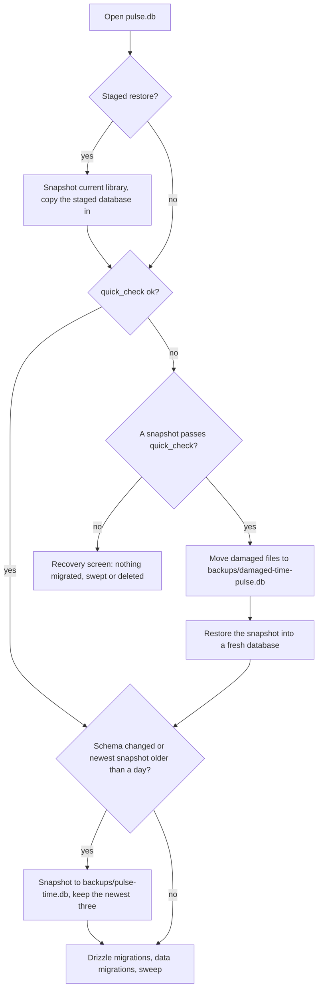

# Persistence

Pulse keeps its library in one place: the SQLite database `pulse.db`, plus the media files its
rows point to under `Documents/drafts/`. A `.pulse` file is a complete copy of drafts or of the
whole library, made on demand to share, back up or restore. The app never runs on that copy.

## Saves

`src/db/durability.ts` sets these pragmas when the database opens:

| Pragma | Value | Why |
|---|---|---|
| `journal_mode` | `WAL` | readers don't block the writer; a crash leaves the last committed state |
| `synchronous` | `FULL` | a commit is on disk before it returns |
| `fullfsync`, `checkpoint_fullfsync` | `ON` (iOS) | Apple's `fsync` doesn't flush the drive cache; `F_FULLFSYNC` does |
| `foreign_keys` | `ON` | cascade deletes |

The app logs the values it reads back as `[db] durability`.

## Launch and recovery

`openLibrary` (`src/db/snapshots.ts`) runs before migrations:

Snapshots use expo-sqlite's `backupDatabaseSync` (SQLite's online backup API). A recovery or restore
can leave media newer than the rows that point to it, so the sweep is paused for a week afterwards
(`backups/sweep-hold`).

## Media

`referencedMediaPaths` (`src/db/media-refs.ts`) is the one list of files the library needs: stored
paths, derived ones (thumbnails, edited thumbnails, covers, `export.mp4`; see
`src/utils/media-paths.ts`), and the clip files that transcripts and caption edits were timed against. The sweep deletes only files under `drafts/` that the list
doesn't contain, and does nothing if any stored path isn't a plain relative path.

## `.pulse` files

| | Draft transfer | Library backup |
|---|---|---|
| Contents | `project.json`: every row and column of the chosen drafts, built from `schema.ts` (`src/db/project.ts`), plus their media | `pulse.db` (via the backup API), `manifest.json`, and the `drafts/` files the database references |
| Import | copy with new ids (`unpack-project.ts`); v1 bundles still go to the v1 importer | exact restore: staged, swapped in on the next launch, then migrated (`library-backup.ts`) |
| Zip | streamed in JS (`zip-stream.ts`) | native (`react-native-zip-archive`) |

- **Coverage:** the export refuses a database column that `schema.ts` doesn't define, and a test fails
  if a schema column is missing from the export.
- **Integrity:** each file's MD5 is computed natively (`File.info({ md5: true })`) and checked on import.
- **Free space:** export, import and restore check `Paths.availableDiskSpace` and refuse before
  writing anything.
- **Versions:** a backup from a newer schema is refused; an older one is migrated after the swap.
- **Size limit:** draft transfers are limited to 4 GB (no ZIP64 in fflate).
