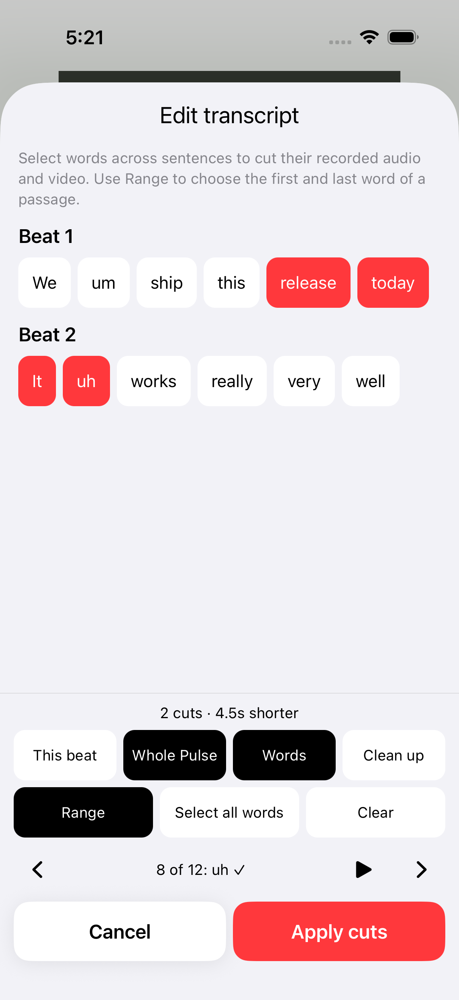
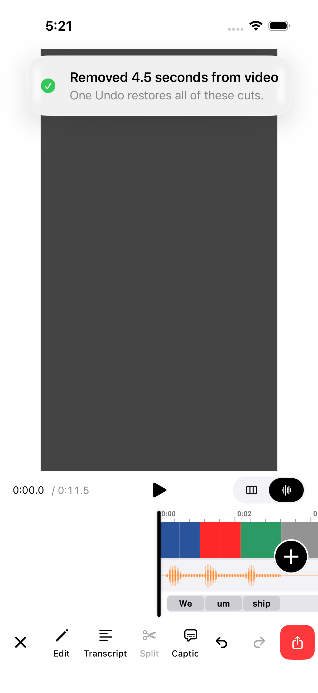
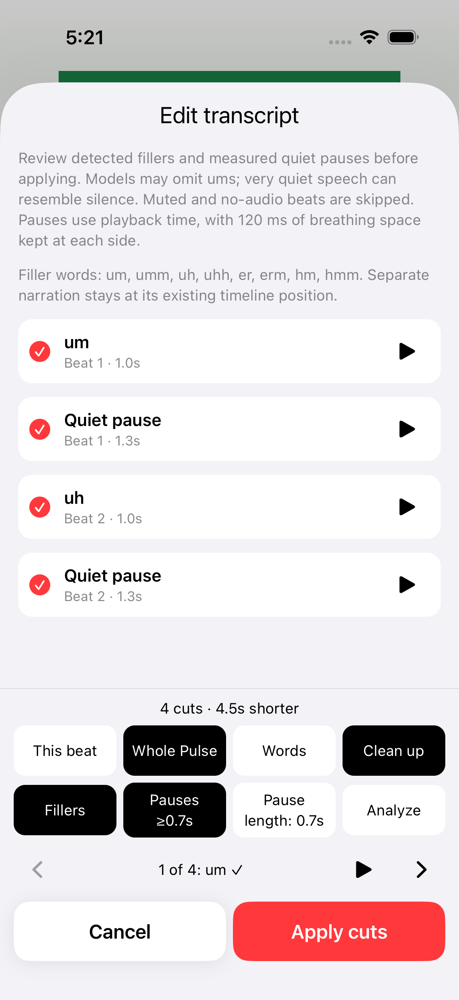
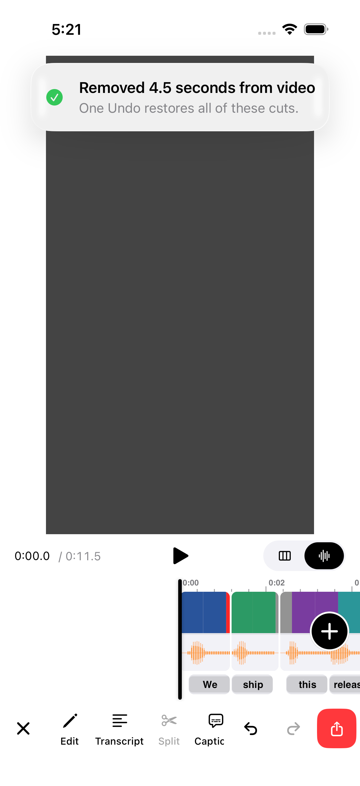
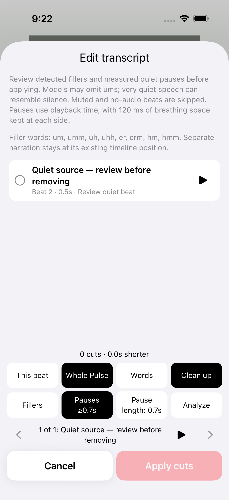
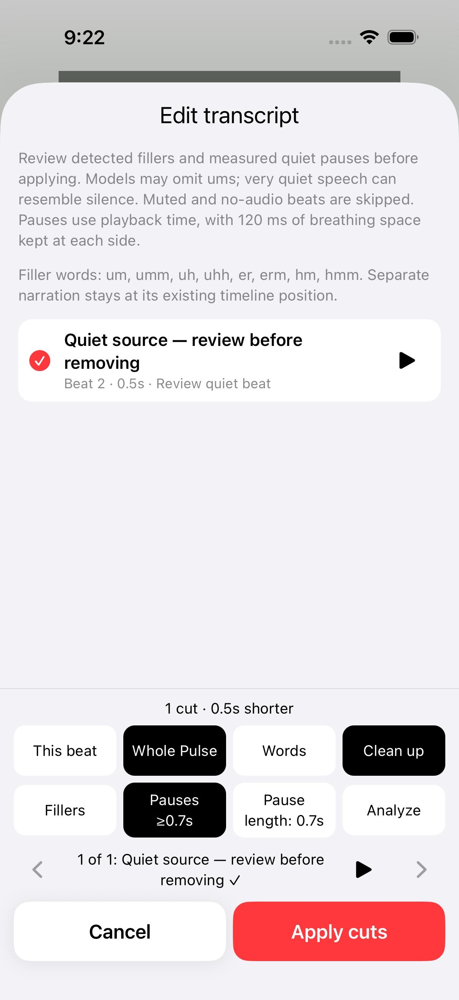

# Bulk transcript editing and speech cleanup

Verified 2026-11-25 with Pulse 2.8.0, based on main `6e74151` and native
`pulse-editor` `306ff1d`. The feature changes application JavaScript and reuses the existing
native audio extractor, timeline composer and export engine. No dependency or schema changed.

## Try it

Open a project in **Edit → Transcript**. Choose **This beat** or **Whole Pulse**:

- **Words:** select individual words, or enable **Range** and choose the first and last word
  of a passage. A passage includes pauses and can cross beat boundaries. Changing selection
  mode clears the previous selection.
- **Clean up → Analyze:** review transcribed fillers and measured quiet pauses. Change
  **Pause length**, uncheck proposals to keep, and use **Listen** before applying.
- **Apply cuts:** removes the selected source picture and sound together. One **Undo** restores
  the complete batch; **Redo** reapplies it. The history survives closing/restarting Pulse.

Quiet-pause analysis works without a transcript or downloaded speech model. It measures audio
energy rather than inferring silence from transcript gaps. The default minimum pause is 700 ms
of playback time; 120 ms of breathing space is retained at each edge. Entirely quiet material
requires explicit selection, and muted/no-audio material is skipped.

Filler matching finds `um`, `umm`, `uh`, `uhh`, `er`, `erm`, `hm` and `hmm` when present in the
transcript. A speech model may omit these words. Meaningful words such as “like” and “so” are
kept by default. Very quiet speech can resemble silence, and background sound can hide pauses;
review the proposals. Separate narration retains its existing draft-clock placement.

## Native simulator demonstration

The isolated iPhone 17 Pro / iOS 26 Simulator used a compatible Release native shell with the
current JavaScript and app-visible test notes. Native accessibility elements operated the
complete flow without coordinate taps. Supplied source-timed words isolate editing from ASR
accuracy and model downloads.

Two eight-second, 30 fps source beats say “We um ship this release today” and “It uh works
really very well”. The filler slots have unique red/magenta pictures; each source also contains
one measured 1.5-second quiet pause. A low audible tone underneath the spoken slots makes the
intended quiet intervals deterministic.

The passage **release → uh** spans both beats and removes 4.5 seconds, including the intervening
pause/beat edges. The result is 11.5 seconds with two kept ranges. One Undo and Redo restore
the complete passage operation.

Cleanup finds two fillers and two quiet pauses. Excluding one pause changes the preview from
four cuts / 4.5 seconds shorter to three cuts / 3.2 seconds shorter. Listen leaves the saved
timeline unchanged. Applying all four creates six retained source ranges and an 11.532-second
timeline. One Undo and Redo work both before and after a process restart.

The actual native MP4 export contains 346 video frames, matching every retained source frame in
order, with zero red/magenta filler frames. Audio correlation against the committed source
sequence is 0.99242 with zero measured alignment offset. Both original media hashes are
unchanged. The export duration agrees with the stored timeline to native timestamp precision.

| Review | Applied |
| --- | --- |
|  |  |
|  |  |

The durable evidence includes [source beat 1](../../screenshots/validation/bulk-transcript-cut/source-beat-1.mp4),
[source beat 2](../../screenshots/validation/bulk-transcript-cut/source-beat-2.mp4),
the [actual native export](../../screenshots/validation/bulk-transcript-cut/edited.mp4),
[app-visible test notes](../../screenshots/validation/bulk-transcript-cut/test-notes.png), and
the [source fingerprints, checks and measurements](../../screenshots/validation/bulk-transcript-cut/report.json).

## Durability and source checks

The transaction validates source, caption and transcript snapshots before writing and commits
all cuts with one durable history checkpoint. Removing every beat retains the original media
and empty draft for Undo; if the history budget cannot retain the newest operation, the whole
transaction rolls back.

Using Node 24.18.0:

- `npm test -- --runInBand`: 167 suites / 2,434 tests passed; one integration suite / eight tests
  skipped locally.
- Root and embed TypeScript checks, full lint, protocol generation check and changed-file
  formatting passed.
- `npm run check:embed`: iOS/Android JavaScript bundles and dependency/boundary checks passed.
- The final Range-toggle fix additionally passed TypeScript, lint, formatting and a native
  selection regression.

CI passed on runtime source `cd4ce77`, including the full test job, embed checks, JVM vectors,
CodeQL, and both pinned/npm-latest PulseVault server integrations. The simulator completed
25 native checks, including a positive quiet-pause proposal without a model or transcript and
playback-time threshold behavior at 2× speed. Its owned automation session and runners were
stopped and the temporary model setting/draft were restored.

Regression tests cover nonadjacent/consecutive word selection, passages across beats without
words, overlapping/frame-rounded cuts, speed/trim effects, compact caption/transcript rows,
stale-input rollback, fully removed beats, history-budget rejection, restart/Undo/Redo and
empty-draft `.pulse` transfer. Audio tests cover RMS/peak thresholds, edge padding, clipped
windows, whole-quiet review, punctuation, filler phrases and analysis cancellation.

## Remaining user verification

Simulator evidence establishes the default-text native layout and accessibility controls.
Physical thumb reach in both hands, small-screen/large-text/RTL layout, full VoiceOver
announcements, Android native UI, variable-frame-rate footage and naturally spoken boundary
quality still need verification. The phone handoff is an installation/launch check, not a
physical replay of the synthetic simulator tests.

## Review regressions

The merge review identified additional cases beyond the original native fixture:

- A delayed cleanup-cover job must yield to a newer user edit. The regression holds the first
  cover, starts a speed/rotation save on a later clip, advances the cover queue past that clip,
  and verifies the user's save persists. It reproduced lost edits before the fix.
- Android Back must remain consumed during a cut even if a toolbar interaction returns the
  editor to main mode. Event/focus tests cover busy transitions, dismissal priority and cleanup;
  this is source-level coverage, not an Android device test.
- Single-word and bulk cuts must retain both durable Undo and Redo. Oversized originals are
  rejected atomically when either form exceeds history limits, including caption data duplicated
  in the restored checkpoint. A later transcription result that overflows replay also causes
  the actual Undo/Redo transaction to roll back, preserving current rows and recovery history.
  No retention budget or schema is expanded.
- Quiet analysis qualifies and pads raw spans separately inside every played window. A full-file
  pause cannot authorize a shorter trimmed overlap, and wholly quiet trimmed beats require an
  explicit selection at 2× speed as well as normal speed.

On the final review-fix source, `npm test -- --runInBand` passed **168 suites / 2,453 tests**;
one integration suite / eight tests were skipped locally. Root/embed TypeScript, full lint,
protocol generation, changed-file formatting, `git diff --check` and `npm run check:embed`
also passed. Independent review found no remaining blocker in these fixes. The earlier native
fixture and phone installation retain their recorded runtime fingerprints.

The final review-fix runtime passed **19 focused native checks** on the same iOS Simulator.
Two beats share one audible eight-second source: the first plays a 500 ms quiet trim at 2× and
produces no proposal; the second plays a 750 ms quiet trim and produces one unchecked proposal.
Explicit selection enables Apply, and cancelling leaves the stored trims unchanged.

| Quiet trim requires review | Explicit selection enables Apply |
| --- | --- |
|  |  |

The original two-beat cleanup was repeated on this runtime, including exclusion/reselection,
Listen, Apply, Undo/Redo, process restart, persistent Undo/Redo and actual native export.
The [new export](../../screenshots/validation/bulk-transcript-review/edited.mp4) again contains
346 correctly ordered frames, no filler-color frames and aligned audio (0.99242 correlation).
The [review report](../../screenshots/validation/bulk-transcript-review/report.json) records the
runtime/config fingerprints, source hashes, checks and verified simulator-runner cleanup.
No physical device was attached for the review fixes.

## Phone installation

The matching signed Pulse **2.8.0 (1)** build was installed in place, with a private library
backup taken first. iOS blocked the launch because the phone was locked, so the post-launch
library comparison could not complete. The global device guard verified release; no physical
automation or capture runner was started. Unlock the phone and open Pulse to begin testing.
The updated test notes are in **About**.
