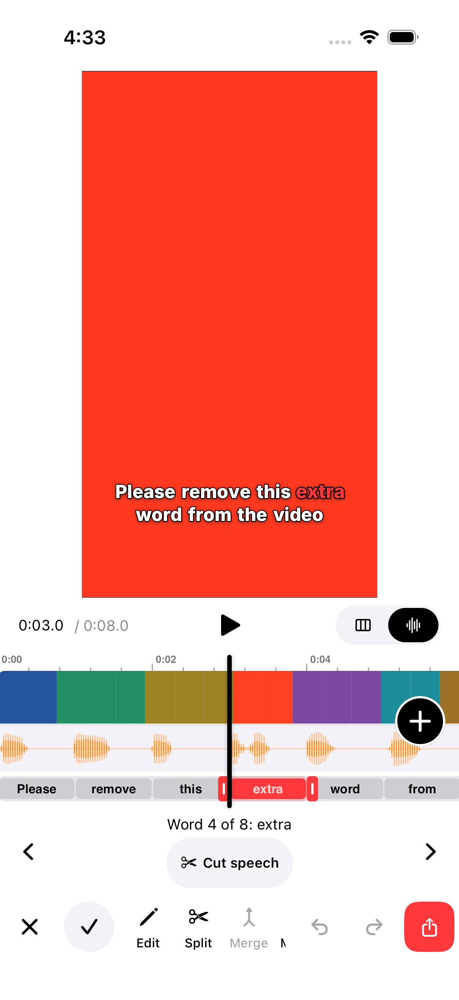
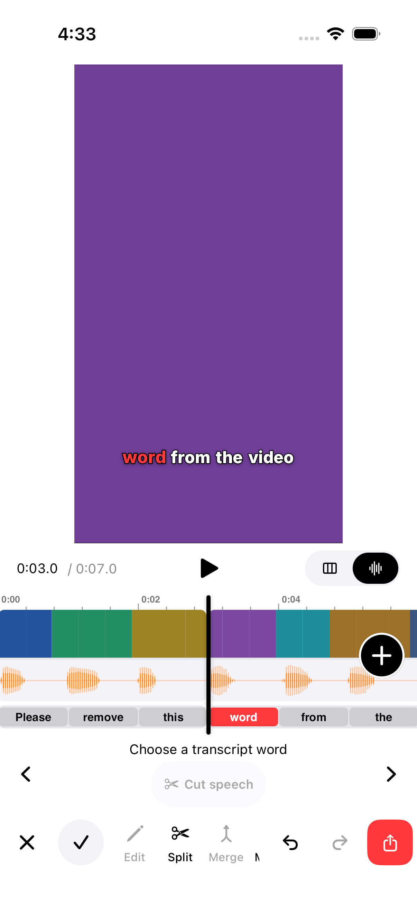

# Transcript-driven video cut: first pass

This records the original single-word baseline. The editor now also provides **Transcript** for
multiple-word/range selection and reviewed filler/quiet-pause cleanup; see
[the bulk validation](bulk-transcript-validation.md) and
[the current behavior](../persistence.md#editor-operations-and-undo).

Verified 2026-11-25 on application source `a46cfce`, including main `2cfe6fb` and native
`pulse-editor` `306ff1d`. The test used an isolated iPhone 17 Pro / iOS 26 Simulator, with a
compatible Release native shell and the freshly bundled application JavaScript. No native
implementation or dependency changed in this feature. No physical device was attached.

## Try it

Open an existing project in **Edit → Captions**. Use the lower **Previous word** and **Next word**
buttons, or tap a caption word, then choose **Cut speech**. Its recorded picture and sound are
removed together. **Undo** rejoins the original beat; **Redo** reapplies the cut. **Edit** corrects
caption text and **Hide word** removes only the caption.

This first pass handles one timed word strictly inside one source beat, with a playable frame
remaining on each side. It creates two ranges sharing the original media. Whole-beat/edge cuts,
passage moves and automatic audio crossfades are deferred. Separate draft narration keeps its
existing draft-clock placement, matching other video edits.

## Native demonstration

The deterministic source says “Please remove this extra word from the video.” Each word occupies
one second of an eight-second, 30 fps clip; “extra” has a unique red picture at source 3–4 seconds.
The transcript uses source centiseconds, with `extra: {t0: 300, t1: 400}`. Supplied word timings
avoid testing transcription/model downloads as part of this cut demonstration.

All word selection and command activation used native accessibility elements, without coordinate
taps. The app-visible test notes were checked in About. Boundary words had Cut speech disabled;
the middle word was enabled. Cutting “extra” changed the displayed duration from 8.0 to 7.0 seconds
and saved source windows `[0, 3000]` and `[4000, 8000]`. One Undo restored the original eight-second
beat, and one Redo restored the cut. Both operations were repeated after a process restart.

| Before cutting “extra”                                                                                     | After the cut                                                                                           |
| ---------------------------------------------------------------------------------------------------------- | ------------------------------------------------------------------------------------------------------- |
|  |  |

The actual native export, rather than a synthetic substitute, is included alongside the source:

- [Original eight-second MP4](../../screenshots/validation/transcript-cut/source.mp4)
- [Edited seven-second MP4](../../screenshots/validation/transcript-cut/edited.mp4)
- [Hashes, fixture and measurements](../../screenshots/validation/transcript-cut/report.json)

`ffprobe` reports 7.000 seconds for the exported video, audio and container. Video changes from
240 to 210 frames: all retained color frames remain in source order, and none of the removed
30 red frames remain. Decoded audio correlates at 0.9995568 with source `[0,3] + [4,8]` seconds,
with zero measured alignment offset. The source SHA-256 remains unchanged.

The isolated simulator initially contained an earlier development voiceover migration from a
provisional shell. Its synthetic install/data were reset before testing the canonical current
migrations; no production/user library was touched.

## Source checks

Using Node 24.18.0 on the integrated source:

- `npm test -- --runInBand`: 163 suites / 2,394 tests passed; one integration suite / eight tests
  skipped locally. CI separately runs the real-server integration jobs.
- `npx tsc --noEmit`, `npx tsc --noEmit -p embed`, `npm run lint` and
  `node scripts/gen-protocol-types.mjs --check` passed.
- `npm run check:embed`: iOS and Android JavaScript bundles and dependency/boundary checks passed.
- Changed-file formatting and `git diff --check` passed.

Focused regressions cover frame rounding, invalid/edge/sliver cuts, trimmed/speed-adjusted clips,
preserved effects and caption corrections, legacy baked sources, stale-source rejection, actual
SQLite mutations, caption projection, export ranges and serialized-history Undo/Redo.

## Remaining verification

Simulator layout/accessibility evidence does not establish physical thumb reach in either hand,
full VoiceOver announcements, small-screen/large-text/RTL layout or Android UI behavior. Precise
variable-frame-rate cuts, naturally spoken word boundaries and native `.pulse` transfer of this
specific edit remain unverified. Existing generic history/transfer regressions pass. Native
recording and voiceover behavior were outside this check; narration remains anchored as above.
