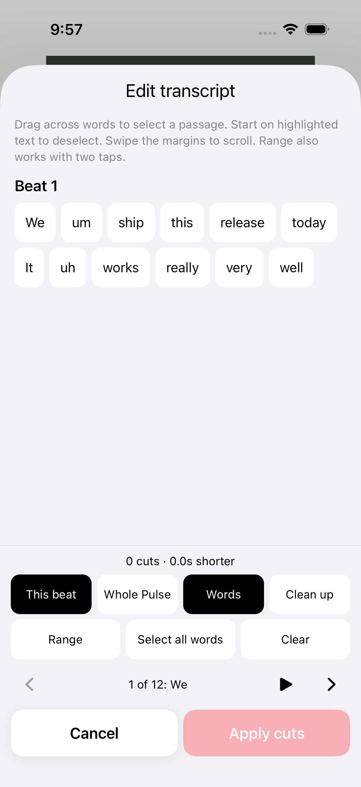
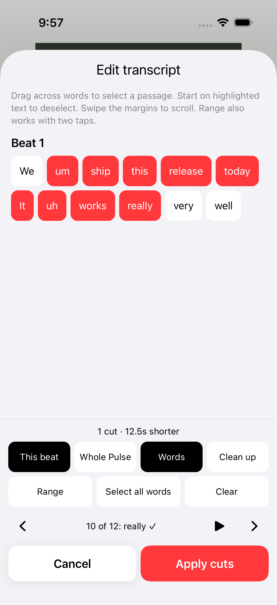
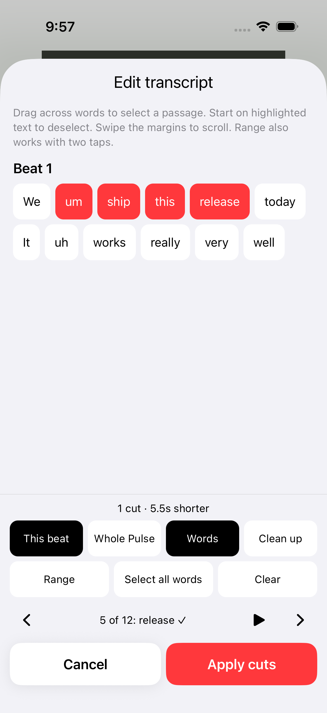
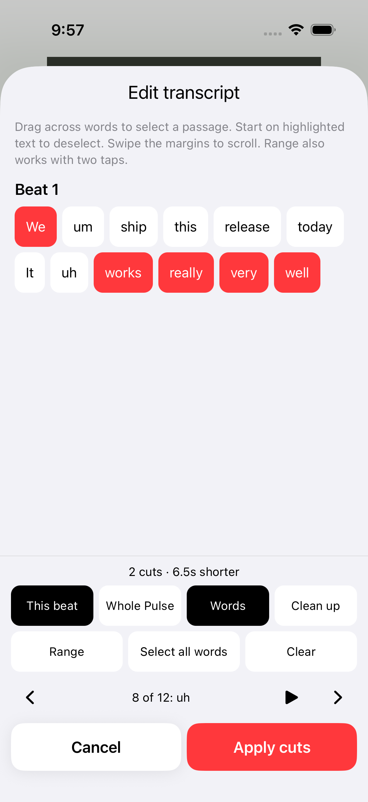

# Dragging across transcript words

Open **Edit → Transcript → Words** in an existing project. Drag from one word to another to
select the inclusive span in transcript order, including down wrapped lines and across beat
headings. Start on a highlighted word to deselect a span. Moving back toward the starting word
shrinks the current span and restores the selection outside it to its pre-drag state.

Hold near the top or bottom of the word viewport to scroll while selecting. Swipe from a blank
margin to scroll without changing the selection. Individual taps, two-endpoint **Range**, and the
lower Previous/Next and checkbox controls remain available. **Cancel** discards the preview;
**Apply cuts** commits all highlighted passages as one Undo/Redo operation.

Each contiguous highlighted run cuts a continuous passage, including pauses at beat edges and
intervening beats without timed words. Unchecked words split runs, so deselecting part of a span
does not silently cut the unchecked gap. A cancelled gesture restores both the prior word
selection and its selection mode. Words mode uses the reachable **Cancel** action to close the
sheet; vertical word drags are reserved for selection.

## Source verification

On Node 24.18.0, the integrated source passed:

- `npm test -- --runInBand`: **169 suites / 2,487 tests**; one integration suite / eight tests
  skipped locally.
- Root and embed TypeScript, full lint, protocol generation, changed-file formatting and
  `git diff --check`.
- `npm run check:embed`: iOS/Android JavaScript bundles and dependency/boundary checks.

Pure regressions cover wrapped-line and RTL word geometry, whitespace/beat gaps, inclusive
selection in both directions, shrinking/reversing a drag, deselection from a selected word,
preserving separate baseline selections and passage runs across untimed beats.

The same source also fixes the review's rowless Undo regression. New receipts distinguish
intentional whole-beat removal from later deletion of split ranges and identify every retained
bulk range. Missing ordinary halves are skipped; mixed batches restore only intentional removals.
Ambiguous older entries report a recovery error while retaining their history and media.
Database, reload, `.pulse`, library-backup, validation and remapping regressions pass.

## Native verification method

The isolated iPhone 17 Pro / iOS 26 Simulator uses a compatible Release native shell with
`pulse-editor` `306ff1d` and freshly bundled JavaScript/configuration. A deterministic 16-second
spoken source is repeated as six beats with 72 supplied timed words, creating wrapped lines and
offscreen content. Supplied timings isolate interaction/cutting from ASR accuracy.

Native accessibility names and checked states identify the words and command buttons. Actual
drag tests use W3C touch paths through those word rectangles; button alternatives are exercised
through native accessibility. This establishes gesture behavior and the accessible alternative
path separately, without claiming full VoiceOver coverage. The app-visible test notes describe
this exact build.

The native input harness gives each finger one complete touch lifecycle. Its second finger's
first move occurs after the requested delay: XCTest's W3C synthesizer implicitly begins a touch
on that move, regardless of a later pointerDown. Reusing an ended touch path or positioning a
second finger at time zero creates overlapping input and does not represent a fresh tap.

## Remaining verification

Physical thumb reach and natural speech cut quality remain user checks. Android native UI,
small screens, large text, native RTL layout and full VoiceOver behavior remain unverified;
geometry logic and Android bundling have source coverage. The phone handoff installs the tested
runtime; simulator gesture evidence is identified separately from the physical install/launch.

## Native results and phone handoff

The final runtime passed **32 native checks**: selecting in both directions across lines/beats,
shrinking selection and deselection, active-gesture cancellation, blank-margin scrolling, both
auto-scroll edges and stopping after lift, fresh touches with requested 20/100/150/300 ms gaps,
Apply, one-step Undo/Redo, process restart, persistent Undo/Redo and all six readable About notes.
The complete set of 329 production/configuration file hashes stayed unchanged through QA.

| Before dragging | Selected across wrapped lines |
| --- | --- |
|  |  |
|  |  |

Dragging from **very** in beat 1 to **um** in beat 2 selects four words and removes a 4.5-second
continuous passage, including the beat boundary. The native timeline changes from 96.000 to
91.500 seconds. One Undo restores all six originals; one Redo reapplies the passage before and
after restart. The [spoken source](../../screenshots/validation/transcript-drag/source.mp4) stays
byte-identical. This focused check did not repeat MP4 export; earlier native export checks are in
the [bulk validation](bulk-transcript-validation.md#review-regressions).

The [report](../../screenshots/validation/transcript-drag/report.json) includes exact checked
word sets, timing inputs, source windows, fingerprints and verified simulator-runner cleanup.
[Edge-scroll](../../screenshots/validation/transcript-drag/edge-scroll.png),
[applied timeline](../../screenshots/validation/transcript-drag/applied.png), and
[test-note](../../screenshots/validation/transcript-drag/test-notes.png) screenshots are included.

The exact same signed **Pulse 2.8.0 (1)** runtime was installed in place and launched on the
user's phone. A fresh private SQLite backup and before/after comparisons verified unchanged
draft/segment metadata and saved edit histories. The global guard verified release, with no
physical automation or capture runner started. The build is running for user testing; its notes
are in **About**. Physical drag feel and reach remain user verification.
