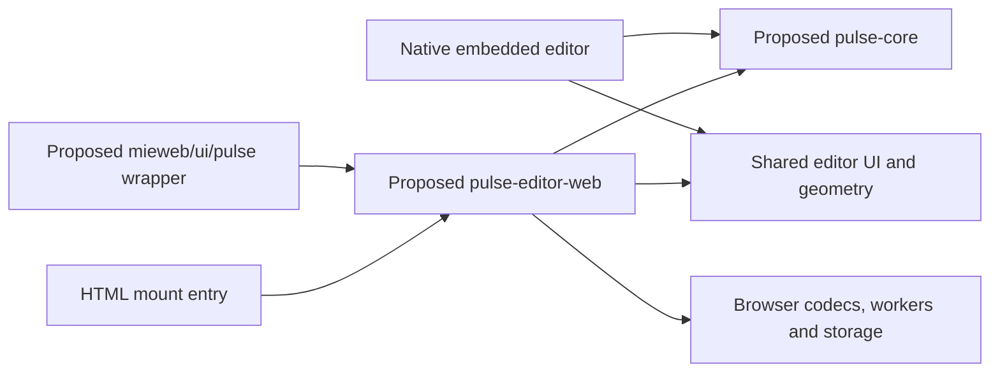

# Browser and HTML embedded Pulse editor implementation plan

Status: implementation plan only. Prepared 2026-11-12. No package publication or documentation-site deployment is part of this planning task. All package names, new paths, APIs, scripts, and story IDs below are **proposals**, unless a source is explicitly described as existing.

## Outcome and first release boundary

Deliver a reusable Pulse editor for desktop Chrome, usable as a React component and through an imperative `mountPulseEditor(element, options)` API in a page whose application is not React. Add a themed wrapper and public documentation to [mieweb/ui](https://github.com/mieweb/ui), ultimately demonstrated at [ui.mieweb.org](https://ui.mieweb.org/). A non-React host still downloads the component's React runtime; it does not have to convert the surrounding application to React.

The first supported workflow is importing local H.264/AAC SDR MP4 files, assembling multiple clips, trimming/reordering/rotating/flipping/cropping/changing speed/muting, editing existing word captions and their position, previewing the resulting timeline, saving/reopening the project, and exporting a 1080 × 1920, 30 fps H.264/AAC MP4 plus WebVTT and beat-manifest artifacts. A silent source remains silent; an unsupported audio format must not silently become a silent export. Re-encoding the complete export is acceptable initially; native-style lossless/selective joins are a later optimization.

Initial limits must be visible before expensive work starts: desktop Chrome on the tested OS/codec combinations, at most 20 clips, 2 minutes of finished timeline, and a provisional 500 MiB of source media per project. Measure these limits in milestone 1 and publish the actual validated limits. HEVC/HDR, variable-frame-rate imports, unsupported AAC configurations, damaged media, larger projects, browser camera capture, browser speech recognition, mobile Safari/WebView parity, background uploads, and PulseVault pairing are not mandatory for this first release. Reject unsupported cases with an actionable message; do not advertise the entire mobile application as browser-compatible.

**Prerequisite and current priority:** complete the [canonical Pulse persistence implementation checklist](./sqlite-pulse-implementation-plan.md) in standalone Pulse before starting browser embedding. Its milestone-3 offline database-deletion/rebuild release gate is still open. Defer browser media-engine work, shared UI extraction and UI wrapper publication until that gate passes. Then consume its tested format/recovery contract and revise estimates; do not create a competing persistence schema.

- [ ] Prerequisite: persistence release gate passed on iOS and Android; record its implementation/evidence revision before starting browser embedding milestone 1.

After that prerequisite, this track can run concurrently with [the native component plan](./native-embed-component-plan.md). They share a versioned neutral core, compatibility fixtures, and selected UI code; neither waits for the other track's final application integration. Milestone review records evidence and does not require an automatic permission wait.

The [SQLite and Pulse source of truth audit](./sqlite-pulse-source-of-truth-audit.md) adds a required persistence gate: canonical Pulse files are authoritative, while SQLite/IndexedDB are disposable projections. A successful save commits the canonical revision, not merely a database row or an older downloadable archive. Full library recovery includes app-state records and stable protected-credential references; project-only exports must state their scope. The original estimates below predate this expansion and must be revised after milestone 1 measures durable file/archive saves and rebuilds.

## Verified baseline and sources

Pulse baseline: `495b382b09f315d1bb0ac810ade000ea3ecfef8f`. UI library baseline: `7aa294d430ef0e3bbaf106c3eded8a394b60c771`, inspected from a read-only shallow clone of `mieweb/ui/main`. Recheck these files when implementing because both repositories will advance.

| Existing source                                                                                                                                                                                                                                                                             | What it establishes                                                                                                                                                                                       |
| ------------------------------------------------------------------------------------------------------------------------------------------------------------------------------------------------------------------------------------------------------------------------------------------- | --------------------------------------------------------------------------------------------------------------------------------------------------------------------------------------------------------- |
| Pulse `src/features/editor/timeline-geometry.ts`, `src/utils/segment-window.ts`                                                                                                                                                                                                             | Portable TypeScript timeline/edit arithmetic; saved edits are settings over original media.                                                                                                               |
| Pulse `src/features/editor/timeline-canvas.tsx:40`, `timeline-strip.tsx:160`                                                                                                                                                                                                                | Timeline graphics use Skia pictures; gestures and native scrolling are a separate layer. This canvas is not the main video decoder or exporter.                                                           |
| Pulse `src/features/editor/filmstrip.ts:1`, `timeline-canvas.tsx:155`, `use-waveforms.ts:51`                                                                                                                                                                                                | Thumbnail extraction and filesystem caches currently call native media and Expo filesystem APIs.                                                                                                          |
| Pulse `modules/pulse-editor/src/PulseEditor.nitro.ts`, `PulsePreview.nitro.ts`                                                                                                                                                                                                              | Useful existing media/preview contracts, including clip settings, cancellation, frame extraction, and actual clip starts.                                                                                 |
| Pulse `modules/pulse-editor/src/editor.ts:3`, `preview.tsx:23`                                                                                                                                                                                                                              | Current browser fallbacks throw rather than implement a browser media backend.                                                                                                                            |
| Pulse `modules/pulse-editor/ios/Merge/Render.swift:16`, `ios/HybridPulsePreview.swift:7`, `android/src/main/java/com/margelo/nitro/pulseeditor/HybridPulsePreview.kt:43`                                                                                                                    | Current engine is Swift/AVFoundation and Kotlin/Media3. Handwritten C++ only registers Android bindings; generated Nitro C++ is not a portable video engine.                                              |
| Installed Skia 2.6.2 `src/web/LoadSkiaWeb.tsx`, `src/views/SkiaPictureView.web.tsx`, `package.json`                                                                                                                                                                                         | A CanvasKit/WASM browser drawing backend already exists. Its React peer is `>=19`, RN peer `>=0.78`, and Reanimated peer `>=3.19.1`; compatibility must be proved in a real consumer.                     |
| [UI package manifest](https://github.com/mieweb/ui/blob/7aa294d430ef0e3bbaf106c3eded8a394b60c771/package.json)                                                                                                                                                                              | UI is pnpm 10.29.1, React/ReactDOM peers `>=18`, ESM+CJS output, optional heavy integrations, and CSS side effects.                                                                                       |
| [UI entry map](https://github.com/mieweb/ui/blob/7aa294d430ef0e3bbaf106c3eded8a394b60c771/tsup.entries.mjs), [build configuration](https://github.com/mieweb/ui/blob/7aa294d430ef0e3bbaf106c3eded8a394b60c771/tsup.config.ts)                                                               | Separate entries and external peers are established patterns; declarations are built separately.                                                                                                          |
| [Existing MediaEditor](https://github.com/mieweb/ui/blob/7aa294d430ef0e3bbaf106c3eded8a394b60c771/src/components/MediaEditor/MediaEditor.tsx), [its stories](https://github.com/mieweb/ui/blob/7aa294d430ef0e3bbaf106c3eded8a394b60c771/src/components/MediaEditor/MediaEditor.stories.tsx) | There is already a single-source, transcript-driven editor. Its timestamps are milliseconds and export is host-owned. Add selection guidance rather than replacing it.                                    |
| [UI contributor guide](https://github.com/mieweb/ui/blob/7aa294d430ef0e3bbaf106c3eded8a394b60c771/CONTRIBUTING.md), [Media family overview](https://github.com/mieweb/ui/blob/7aa294d430ef0e3bbaf106c3eded8a394b60c771/src/catalog/Media.mdx)                                               | New components need rationale, alternatives, catalog relationships, themes, accessibility, responsive evidence, and consumer docs.                                                                        |
| [Storybook configuration](https://github.com/mieweb/ui/blob/7aa294d430ef0e3bbaf106c3eded8a394b60c771/.storybook/main.ts), [accessibility runner](https://github.com/mieweb/ui/blob/7aa294d430ef0e3bbaf106c3eded8a394b60c771/.storybook/test-runner.ts)                                      | Storybook 10 uses React/Vite, static assets, catalog metadata, and axe after stories render.                                                                                                              |
| [UI release workflow](https://github.com/mieweb/ui/blob/7aa294d430ef0e3bbaf106c3eded8a394b60c771/.github/workflows/release.yml)                                                                                                                                                             | Main pushes can automatically publish npm development prereleases; tags can publish releases. CI builds `storybook-static`, but the inspected workflows do not establish how `ui.mieweb.org` is deployed. |

Browser technology references: [Skia v2 web support](https://wcandillon.github.io/react-native-skia/v2/docs/getting-started/web/), [Chrome's WebCodecs guidance](https://developer.chrome.com/docs/web-platform/best-practices/webcodecs), and the [WebCodecs specification](https://www.w3.org/TR/webcodecs/). WebCodecs handles codecs; a separately selected demuxer/muxer handles MP4 containers. Codec support must be probed on the actual browser, and frames must be explicitly released. These sources inform the proposed design, not a claim that the application has already been ported.

### Existing browser transcript editor: reuse before building

UI already has a browser editor derived from Pulseclip. `src/components/MediaEditor/MediaEditor.tsx` composes `MediaPlayer` with editable transcript tokens. `src/hooks/useTranscriptEdits.ts` owns word edits, cut/copy/paste, filler/silence removal, speed markers, undo and playback-segment derivation. `ScriptPanel.tsx` exposes the original transcript and edited state as YAML/JSON. These are concrete reuse candidates, not just documentation examples.

The [MediaEditor Live Demo source](https://github.com/mieweb/ui/blob/7aa294d430ef0e3bbaf106c3eded8a394b60c771/src/components/MediaEditor/MediaEditorLive.stories.tsx) already accepts an audio/video file, transcribes locally with a Whisper worker, and opens the editor. This story and the word-level calls in `src/components/AI/whisperTranscribe.ts` are repo-internal integration code; they are not a supported public transcription package. Keep model loading optional and explicit. Browser auto-transcription remains optional for v1; importing supplied transcripts and retaining corrections must work without downloading a model.

The reuse decision belongs in milestone 1, before implementing another transcript editor or freezing the browser renderer. For a single-source transcript-led workflow, prefer the existing `MediaEditor` and add only the required HTML mounting/integration. For the full Pulse workflow, determine which transcript controls, pure helpers and transport interfaces can be composed or shared while retaining the multi-clip timeline and media backend. Record the decision and remaining work; the current estimates cover the full multi-clip scope and are not reduced until this spike supplies evidence.

Preserve the meaning of each edit. In UI, deleting a word excludes its source media from edited sequence playback; Pulse caption corrections alone do not cut the video. UI's `EditableWord.originalIndex` refers to the silence-inserted baseline, and speed markers index the edited word list. Neither is a stable multi-clip media ID. An adapter must retain source/clip identity and distinguish caption correction from media recutting. Do not silently translate a deleted caption into a video cut, or claim arbitrary pasted/reordered word edits are representable by one contiguous trim. Recutting needs a reviewed translation into ordered clip-range commands with source identity, provenance, history and native/browser fixtures. Multiple ranges may share the same media asset; extend/version the schema only if required information cannot be represented. Transcript-driven recutting is outside the current v1 commitment.

Reuse must respect the dependency and React boundaries below. UI-level composition can remain in the UI host; shared pure logic must live in a neutral leaf module with one owner. Do not make Pulse core depend on `@mieweb/ui`, copy its hook into a second production reducer, or pass host React elements/hooks into the private runtime. If broader neutral extraction is chosen, record the package/import changes and re-run the root-only bundle gate before adoption.

## Architecture and parallel ownership



The dependency arrow means “imports.” `pulse-core` and `pulse-editor-web` must never import `@mieweb/ui`. UI may wrap the browser package; reversing that edge would create a cycle and prevent standalone use. The library wrapper supplies styling/integration and host-side actions, not a second copy of editing logic.

Default compatibility design: the browser companion ships a prebuilt editor island with its own private React 19/ReactDOM runtime, RN Web and Skia dependencies. A React 18 or 19 host's thin wrapper owns only a DOM element and calls mount/apply/destroy; its host React nodes, contexts, refs and hooks never cross into the island. Data crosses as validated documents/commands/messages and callback events. Build the private runtime into the island artifact; do not externalize it or let a consuming bundler deduplicate it onto the host's React 18. Package the browser runtime's build dependencies so its public installation has no React 19/Skia/RN peer requirements. There is one React runtime inside each island module graph and one independent host runtime; this deliberate separate-root boundary must be tested, not mistaken for accidentally mixing two React copies in one tree.

This is the concrete fallback/default because npm peer requirements are package-wide: putting code under an optional `./pulse` export alone cannot isolate a React 19 peer requirement. Milestone 1 may select a simpler direct React renderer only after packed React 18 and 19 consumers prove the entire dependency graph compatible. Do not widen the UI library's root React requirement to make the prototype compile.

| Owner                                            | Proposed responsibility                                                                                                                                        | Parallel-work rule                                                                                                                                                                                                                                                                                               |
| ------------------------------------------------ | -------------------------------------------------------------------------------------------------------------------------------------------------------------- | ---------------------------------------------------------------------------------------------------------------------------------------------------------------------------------------------------------------------------------------------------------------------------------------------------------------- |
| Native track initially                           | `packages/pulse-core/`: document codec, commands/reducer, pure edit/timeline/caption arithmetic, storage interfaces and shared fixtures                        | Extract the persistence prerequisite's tested contract and own the first package/tarball. Browser reviews contracts but does not edit these files simultaneously.                                                                                                                                                |
| Native/shared UI owner, coordinated with browser | `packages/pulse-editor-ui/`, proposed `@mieweb/pulse-editor-ui`: extract platform-neutral editor UI/view-model from current `src/features/editor/`             | Native owns initial mechanical extraction and early interface artifact; browser submits coordinated `.web` input/font changes. No imports of Expo filesystem, SQLite, app router, secure store, camera or Nitro from shared UI. One production timeline renderer; input/media/cache adapters differ by platform. |
| Browser track                                    | `packages/pulse-editor-web/`: browser package, CanvasKit bootstrap, web input, media workers, storage, mount lifecycle, browser fixtures and consumer examples | After the persistence gate, start with agreed fixture documents and a type-only contract stub, then replace that stub with a pinned core tarball. Do not copy core reducers/math into the browser package.                                                                                                       |
| Browser/UI integrator                            | Separate `mieweb/ui` branch: optional wrapper, story/catalog docs, package entries and consumer checks                                                         | Consume a packed browser package, not a relative import into a Pulse checkout. No changes to native app screens required.                                                                                                                                                                                        |

Do not add a second workspace/package manager at the Pulse root merely to get started. Each proposed package can initially have its own `package.json`, lockfile, tests, and `npm --prefix` scripts. Coordinate any later root workspace/CI changes as a small shared integration change; UI remains pnpm-managed.

### Shared contract to freeze in milestone 1

The native plan is the matching extraction-owner specification; the new core package must preserve the persistence prerequisite's tested format/recovery contract. Reconcile the proposed shape below with that implementation before freezing the package API; it is not an invitation for two tracks to maintain separate interfaces:

Current persistence uses `PulseDocument` format version 2 with exact legacy row collections and opaque transcript JSON. The neutral `ProjectDocument`/millisecond word model below is proposed extraction work, with a separate schema version. Introduce it through a lossless codec/migration that retains the library/app state and original legacy payloads; do not treat the current v2 document as already implementing these neutral types.

- `ProjectDocument`: `schemaVersion: 1`, `id`, `name: string | null`, monotonic integer `revision`, integer epoch `createdAtMs`/`updatedAtMs`, `lastClipNumber`, `assets`, ordered `clips`, and `captions: { positionY }`. Rename is a core command; preserve the name through native SQLite migration, browser persistence and JSON round trips.
- Preserve the nonnegative integer `lastClipNumber` from the current draft schema. Adding a clip advances it atomically; deleting/reordering clips never decrements it. Include a delete → JSON save/reload → add fixture assertion so a storage adapter cannot reuse a previously minted clip badge by recomputing the counter from only the remaining clips.
- Asset descriptor: stable opaque `id`, `mimeType`, `byteLength`, `contentHash`; validate canonical archive assets against byte counts/hashes. Clip: stable `id`, pristine-source logical `mediaId`, `label`, `sourceDurationMs`, nullable `edit` containing source `startMs`/`endMs`, `rotationQuarterTurnsCCW` 0–3, `flipped`, normalized `crop`, `muted`, and `speed`, plus nullable `legacyBaked: { mediaId, durationMs }`. No device paths or Blob URLs in project JSON.
- Preserve both original and legacy baked assets during migration. While `legacyBaked` is selected, preview/export its full span with identity transforms, matching current `clipRender`; do not apply old edit settings again. Re-editing switches to the original and clears the legacy selection before applying new settings. Reset clears both edit settings and legacy selection and restores the original. Reference-aware cleanup happens after commit. Test this reset path after a JSON round trip so a migration cannot preserve only the baked file and lose the pristine original.
- Each clip's captions retain source `mediaId`/model identity, `generatedWords`, and `correctionWords`, preserving additional accepted transcript metadata/model outputs during migration. `correctionWords: null` means use generated words; `[]` means the person deliberately removed every word. Base words on UI's `text`, source `startMs`/`endMs`, optional speaker/confidence/type metadata, adding stable word IDs and optional `sentenceStart`. Retain supplied speaker/segment metadata and provenance in the complete transcript record. Corrected text/timing/deletion and sentence grouping must survive serialization, reorder, trim, speed and mute. Position is normalized `positionY` in 0–1; `null` chooses the default.
- Units: source trim boundaries use integer milliseconds. Preserve accepted finite source duration/word timestamps in milliseconds, including fractional values; UI's numeric transcript fields do not require integers. Convert legacy Pulse `t0`/`t1` centiseconds exactly by multiplying by 10 and map sentence markers once in the core migration codec. A legacy centisecond engine projection must not round/overwrite the canonical source words. Compute effective timeline positions without rounding each clip prefix; apply one documented rounding rule at frame/encoder/output boundaries. Browser codec timestamps use integer microseconds through an explicit conversion helper. Never interpret the same number as seconds in one adapter and milliseconds in another.
- Engine layout is explicit: core defines `TimelineLayout { clipStartsMs: number[]; totalMs: number }` in milliseconds. Shared composition/beat/caption functions accept the media backend's measured layout for the current project revision and media configuration. Sum-of-trims is a provisional layout until that backend reports. An untrimmed native iOS clip ends at its video track's end while Android can use the container end; audio-tail mismatch is an existing source of drift. Preserve backend-authoritative boundaries and use the same reported layout in preview, captions and export manifests. Do not promise one universal exact end time across all backends or reuse stale layout from an older revision.
- `ProjectChangeSet` contains domain commands; one core reducer validates/applies them. `DraftStore` has async `load`, `list`, `create`, `apply(id, changes, { expectedRevision })`, `remove(id, { expectedRevision })`, and `subscribe(id, listener)`. An apply is atomic compare-and-swap: success returns the committed immutable snapshot and increments revision once. A conflicting apply/remove rejects with a typed `REVISION_CONFLICT` error containing `currentRevision` and `currentSnapshot`; it performs no partial write and emits no commit notification. Subscribers see committed immutable snapshots only, in revision order; `subscribe` returns an unsubscribe function. Prevent stale async callbacks from applying after disposal.
- `MediaAssetStore` has async import/resolve/read/remove. Resolve returns a platform handle with explicit release semantics; native files and browser Blob URLs are implementation details. Deleting a project and deleting media are separate operations; adapters check references before deleting a shared asset. Never serialize tokens, authentication headers, API keys, signed upload links, or host application secrets into the document or sample JSON.
- Schema migration: parse/validate before rendering, reject a future unsupported schema with a recoverable message, and migrate old snapshots into a new object while preserving the original. Exported JSON includes schema version and logical media references; it is not a self-contained video bundle. Missing media produces a relink state with a validation check, not a new asset silently assigned to the old ID.

Use the same fixture IDs in both plans: `empty-v1`, `one-clip-v1`, `edited-three-clips-v1`, `captions-corrected-v1`, `reordered-v1`, `missing-media-v1`, `revision-conflict-v1`, `legacy-caption-position-v0`, and `audio-tail-mismatch-v1`. Include a legacy baked-edited clip, non-zero trim, speed, mute, rotation/crop, corrected sentence boundaries, intentionally empty corrections and non-default caption position across that set. The audio-tail fixture contains explicit backend layouts and exact expected caption/beat placement for each layout; compare integer core JSON fields exactly and only apply media tolerances to measured decoded output.

Initial core handoff: `artifacts/core/mieweb-pulse-core-0.1.0-dev.1.tgz`, SHA-256, source commit, generated API declarations, fixture expected outputs and migration notes. The native track produces it; the browser track records the exact tarball/hash it consumes. A changed document contract requires an explicit fixture/version update in both tracks before either continues against the new version.

Shared UI handoff: the native owner supplies an early milestone-1 interface fixture/reviewed extraction commit, then a pinned `@mieweb/pulse-editor-ui` tarball during native milestone 2. Browser renderer work starts from that reviewed commit or a coordinated cherry-pick in its own branch; it does not wait for native milestone 2 or create a second production renderer. Record UI artifact/hash alongside the core artifact.

### Public browser API and resource ownership

Propose a React `PulseEditor` wrapper with `project`, `draftStore`, `mediaAssetStore`, `onProjectChange`, `onExport`, `onCancel`, `onError`, locale/messages and theme/palette. The wrapper owns an element and bridges to the island. Host React toolbar/actions may surround the element, but React children/slots never cross the island boundary. Use data/action descriptors if inner customization is needed. Storage adapters and callbacks are explicit JavaScript services, not host React contexts/hooks.

Choose one primary v1 state mode: a store-backed session initialized from the supplied snapshot. Updates enter through `apply` with expected revision; a new initial-prop identity must not reset the active session. `onProjectChange` reports committed snapshots and change origin so a host can persist externally without creating a feedback loop. A future controlled mode requires a separate documented protocol.

Propose `mountPulseEditor(element, options): Promise<PulseEditorHandle>` from a separate DOM entry. The handle provides `getProject(): Promise<ProjectDocument>`, `apply(changes, { expectedRevision }): Promise<ProjectDocument>`, `updateOptions(patch): Promise<void>`, `export(options)`, `cancelExport()`, and `destroy(): Promise<void>`. Mount resolves when the editor can accept commands or rejects with a typed load/capability error. Establish one active session per instance and one mount owner per element; mounting twice into the same element returns a clear error. Distinct elements/instances use separate IDs, workers, caches and event targets. Only a focused editor handles editing shortcuts; never register an unconditional document-wide Space/Delete handler.

`updateOptions` updates locale/messages, theme/palette and callback subscriptions without replacing the project or recording a project edit. The React wrapper calls it when those props change. Project changes always use `apply`; changing the project ID, storage adapters or asset base requires awaited destroy/remount in v1. Reject unsupported option changes with a typed error rather than silently losing the active draft. This keeps theme switching and host rerenders from resetting an editing session.

`onExport` receives a result containing the MP4 `Blob`, optional WebVTT/manifest artifacts, MIME/byte length/`durationMs`, measured `layout: TimelineLayout`, `projectRevision` and the exported immutable project snapshot. Sidecars use that exact revision/layout. These immutable Blobs are owned by the host after handoff. The editor does not revoke URLs that the host created from them and does not implicitly upload or delete them. Internal preview/download URLs belong to the editor and are revoked after the consumer is detached. Export a captured immutable revision; later edits do not silently change an export already running. Report the revision in the result.

`destroy()` is idempotent and awaited: cancel pending work, abort downloads/reads/exports, close video/audio frames/codecs, release audio nodes, terminate workers after acknowledgement or bounded timeout, release internal URLs, remove listeners/subscriptions and unmount React. Suppress late success/error callbacks after disposal. A typed cancellation may be reported once for an explicit cancel, but it is not an export failure. Cancel does not erase the saved project.

## Milestone 1 — contract and real-media feasibility

Goal: prove a portable timeline and actual browser video/audio processing before completing the interface. Planning allowance: 1–2 weeks with a browser engineer and assistance from the native/core owner; this is an estimate, not measured implementation time.

### Setup and ownership checklist

- [ ] Create separate implementation branches/worktrees for browser package, core/native work, and UI integration. Keep this Pulse planning branch free of generated applications and dependency lockfile churn. Read each repository's current contributor instructions before editing it.
- [ ] In Pulse, select Node 24 without changing the user's default Node, run `git submodule update --init --recursive`, fetch the small Git LFS fixtures, then `npm ci`. Confirm `git status --short` is clean before coding. Never use destructive reset/clean on somebody else's work.
- [ ] Create `packages/pulse-editor-web/package.json` as a private development package initially; define `build`, `typecheck`, `lint`, `test`, `test:e2e`, and `test:perf` scripts. Use TypeScript strict mode and a browser build tool that emits workers/assets predictably. Put a small development page in `examples/browser-sandbox/`; it must consume the public browser entry.
- [ ] Agree core contract fields/commands, time conversions, revision conflicts, caption migration and media ownership with the core owner. Place browser-only interface stubs in `tests/contract-stub/` with no implementation; remove them when the core tarball arrives. Production code must fail its build if the real core is absent.
- [ ] Create `docs/architecture.md` and `docs/browser-support.md` inside the package. Record selected package versions/licenses, media support probes, tested Chrome versions/OS/hardware, and which source modules are extracted rather than copied. State the core/shared UI owner and exact integration commit.
- [ ] Consume the persistence prerequisite's complete project/library format, recovery fixtures and measured native save behavior. Prototype the browser canonical-file adapter against that contract, benchmark metadata-only saves with large/shared media, and record the supported user-granted filesystem/OPFS strategy. The literal ZIP guarantee requires that file to be current before save success; a stale download beside authoritative IndexedDB does not qualify. Native recovery success does not prove browser filesystem atomicity. Re-estimate after the spike.

### Existing UI editor reuse checklist

- [ ] Read `MediaEditor.tsx`, `MediaEditor.stories.tsx`, `MediaEditorLive.stories.tsx`, `ScriptPanel.tsx`, `useTranscriptEdits.ts` and its tests, `TranscriptView/transcript.ts`, `MediaPlayer` and `useMediaTransport`. Run the existing editor and live-transcription stories with a redistributable local audio/video fixture. Record actual behavior and any environment/model-loading failures; a source inspection alone is not a successful runtime demo.
- [ ] Write `docs/existing-media-editor-reuse.md` with a table for transcript editing, script editing, AI transcription, playback, multi-clip composition, transforms, project persistence and MP4 export. For each row identify the existing source/API, whether it is public, whether to reuse/extend/build, the owner and the remaining gap. Compare extending the DOM editor with the shared Skia route before selecting the browser presentation; do not assume another transcript editor is necessary.
- [ ] Build a small integration spike using the existing public `MediaEditor` and its persistence/speed callbacks. Prove file + supplied transcript → correction → save/reopen and edited sequence playback in a packed React consumer; separately demonstrate how a non-React HTML page mounts and destroys that existing workflow. Keep this spike out of the production Pulse reducer and label it as a single-source feasibility result.
- [ ] For the full Pulse reuse option, prototype a controlled transcript pane and transport interface extracted from the existing UI component. Today `MediaEditor` owns its `MediaPlayer` and local edit history; callbacks alone do not make it a controlled Pulse view. Preserve its current API/default behavior for existing consumers. Let the extracted pane accept time/selection plus seek/play/edit/history actions from an adapter, with the Pulse store as the authority for the integrated workflow. Keep the pane in the UI host's React tree and bridge plain commands/events to the editor island. Verify one user edit creates one undo step and that seek/play uses the intended transport; do not run a hidden second player/history in the integrated mode. Adopt this only if the spike proves compatible caption semantics and packaging.
- [ ] If the controlled pane is selected, extend the public imperative handle/bridge with typed seek/play/pause actions and playback-time/selection subscriptions. The current proposed handle below does not yet expose transport. Unsubscribe on destroy, test both HTML and React wrappers, and keep transient playback/selection out of project revisions and undo history.
- [ ] Specify and test the data boundary: shared/UI source milliseconds, exact legacy centiseconds ×10 on read, stable source/clip/word IDs, null versus intentionally empty corrections, silence-baseline indices, pasted words and speed-marker indices. Include fractional-millisecond words in `captions-corrected-v1` and preserve them through JSON/storage/restore. If a legacy engine requires 10 ms quantization, retain the original canonical values separately. Test a caption correction without changing media duration. Document which transcript recuts can map to split/repeated clip ranges and which need additional metadata; keep unsupported actions disabled in the caption-only integration rather than flattening away their meaning. Core/native and browser owners review the same mapping before extraction.
- [ ] Evaluate the existing Whisper worker as an optional adapter, retaining host-supplied transcripts as the baseline. Document its current internal imports/global configuration, model/asset URLs, download progress, cancellation and worker/model lifetime before offering a public API. Exercise worker support and inference separately from timeline rendering/encoding; do not infer that Whisper's WASM makes the native video engine portable.
- [ ] Record the chosen reuse approach, package/React boundaries, accessibility/localization gaps and revised work estimate in the decision document. Link it from the UI issue and obtain implementation review from the shared-core/UI owners. Keep one authoritative edit model per workflow; do not import UI into core or hide a second reducer behind the wrapper.

### Fixtures a junior engineer can run

- [ ] Create `packages/pulse-editor-web/tests/fixtures/manifest.json` recording paths, checksums, attribution, codec/profile, time base, dimensions, duration and expected frame/audio markers. Reuse the committed Pulse dev/import/sync clips where suitable; copy only redistributable trimmed test assets, not the 400 MiB regeneration master or user media.
- [ ] Include: a 10-second portrait H.264/AAC source, landscape source requiring fit/rotation, silent source, source with non-zero audio offset, three clips with visual frame/time markers and audible pulses, 20 clips totaling 120 seconds, corrupted file and deliberately unsupported codec. Keep large benchmarks opt-in and deterministic.
- [ ] Add a fixture script to create the 20-clip project from existing small files without duplicating all file bytes. Pair JSON fixtures with the core's expected output timeline/caption/beat values. Keep measurements separate from correctness assertions.
- [ ] Import the nine agreed core document fixtures and validate JSON round trips. Check name/rename, manual caption changes, all-deleted captions, non-default caption position, reordered/muted/sped clips and legacy baked-media/reset-to-original behavior. Use `audio-tail-mismatch-v1` with engine-reported layout and assert exact layout-driven caption/beat mapping. A browser document must produce the same expected core values as the native fixture runner when given the same measured layout.

### Timeline and compatibility spike

- [ ] Trace and extract `timeline-geometry.ts`, the edit model in `segment-window.ts`, and applicable caption/history arithmetic into the core/shared layer with the owner. Replace DB-specific structural types with neutral DTOs. Do not import the original screen into a browser bundle.
- [ ] Prototype the existing `TimelineCanvas` rendering through CanvasKit. Add async `LoadSkiaWeb` bootstrap before any Skia module evaluates; serve versioned `.wasm` and explicitly registered fonts from a configurable asset base. Test a non-root deployment URL and an application with a strict self-hosted asset policy.
- [ ] Move `File.bytesSync()`, native `frames()`, thumbnail caches and PCM extraction behind injected adapters. Use actual decoded thumbnails/waveforms in the spike rather than colored placeholders. Extract reusable frame-grid/cache scheduling once; the browser adapter supplies bytes/handles.
- [ ] Add web pointer drag, wheel/trackpad scroll, keyboard trim/seek, explicit zoom controls, and correct browser page-scroll containment. Preserve shared geometry and rendering, with web input variants. Keep the DOM control/selection layer separate from canvas pixels for accessibility.
- [ ] Prove the default private-React-19 island in packed external React 18, React 19 and plain HTML consumers. Add exact `react-native` → `react-native-web` resolution and transpilation to the island build, bundle its private React/ReactDOM, and inspect output to confirm the host cannot replace that runtime. Use one private runtime shared by multiple island instances rather than rebundling one per instance. Test host hooks/context still work and no host React element/context/ref enters the island.
- [ ] Put Skia/RN/Reanimated/private React dependencies in the browser package build toolchain and bundled runtime artifact; do not expose their React 19 peers through published runtime dependencies. Inspect installed consumer dependency trees and fail the gate on invalid peers or accidental host-React deduplication. A direct React variant is allowed only with equivalent React 18/19 consumer proof; record the chosen design in `docs/architecture.md` before implementation expands.
- [ ] Record that Skia 2.6.2 requires React 19; do not loosen `@mieweb/ui` root React 18 support or add mandatory RN/Skia peers to the UI root. If the Skia dependency/build cost cannot meet the packed-consumer gate even with the island, coordinate a browser Canvas2D renderer adapter through the `packages/pulse-editor-ui` owner and its renderer interface, then validate it against the same fixtures. This is an agreed rendering variant, not an independently forked production timeline or second editing reducer.
- [ ] Inspect the browser bundle graph for Expo, Nitro, VisionCamera, whisper.rn and native build artifacts: none may enter it. Avoid SharedArrayBuffer and threaded-WASM requirements in v1; use transferable messages and asynchronous IndexedDB/OPFS. The observed public UI site does not provide COOP/COEP headers, so a Storybook editor must work without cross-origin isolation. If an optional optimization needs those headers, the default must remain functional without it.

### Media and export spike

- [ ] Create `src/media/capabilities.ts`: probe secure context, worker support, required decoder/encoder configurations, canvas backend and audio capability. Probe video and AAC audio independently with actual profile/width/height/sample-rate configurations. Return structured supported/unsupported reasons rather than relying on the user agent string.
- [ ] Compare maintained demux/mux options against the actual MP4 fixture set and license requirements. Record the chosen library/version and why in `docs/architecture.md`. Wrap it in `src/media/container.ts` so callers do not depend on library-specific track/sample types. WebCodecs alone is not an MP4 implementation.
- [ ] Implement a narrow worker proof in `src/media/workers/codec-worker.ts`: demux one local file, decode bounded batches, crop/rotate one segment, retime frames, encode H.264, encode/mux audible AAC and create a playable MP4 Blob. Handle H.264 codec descriptions/configuration records and AAC metadata correctly.
- [ ] Export the three-clip fixture with a trim, reorder, mute, rotation/crop and 0.5×/2× speed. Prove natural-pitch audio at non-1× speed using a selected time-stretch implementation or a measured explicit first-release limitation; do not substitute pitch-shifted audio without changing the advertised feature gate.
- [ ] Use bounded decoder/encoder queues and backpressure. Transfer buffers/frames to workers where supported; close each `VideoFrame`/`AudioData` after its last use in `finally` blocks. Cancel in the middle of demux, decode, encode and mux; a partial export must never be emitted as complete.
- [ ] Play the output in desktop Chrome and in the existing native app/player or platform player. Check media dimensions/rotation, audio presence, exact order, duration, clip-boundary timing and sync markers. Add a test-only probe/report script instead of judging correctness only by how the preview looks.

### Milestone 1 acceptance gate and demonstration

- [ ] The existing MediaEditor/Live Demo reuse decision and integration-spike results are recorded. The team can demonstrate the reusable transcript workflow and explain which multi-clip/export work remains, including the difference between a caption correction and a media cut.
- [ ] Core fixtures and migration/revision behavior agree with native expectations; browser imports the first pinned core tarball and deletes the temporary interface stub.
- [ ] A real-media 20-clip timeline scrolls/zooms/trims and shows frames/waveforms; the three-clip edited result exports to a replayable MP4 with audible audio. No native media dependency appears in the browser bundle.
- [ ] On a recorded 60 Hz reference desktop, run five warm and one cold trial. Provisional targets: first visible preview frame ≤2 seconds warm/≤5 seconds cold for the small local fixture; sustained timeline interaction ≥55 fps with p95 frame interval ≤20 ms; warm cached settled seek p95 ≤100 ms and cold exact settled seek p95 ≤250 ms; no >1 second UI stall during export. Report frame intervals >33 ms, dropped frames and >50 ms long tasks as well as averages. Store raw measurements, browser/hardware, fixture checksum and trace in `test-results/perf/`. These are proposed budgets, not existing results or a guarantee on all hardware. If the reference device misses them, optimize or record a renderer/scope decision before treating the milestone as passed.
- [ ] Verify exported sync markers differ by at most one 30 fps video frame (33.4 ms), total duration differs by at most one output frame, and no silent-audio regression occurs. Reject a scope/codec that cannot meet these correctness budgets instead of silently widening tolerance.
- [ ] Capture browser heap/worker/frame-queue counts before/after five load/export/destroy cycles. Queue counts return to zero and memory does not grow monotonically after release/collection. Record peak memory and choose bounded cache/queue sizes before accepting the provisional 500 MiB input limit.
- [ ] Demonstrate import → timeline edits → preview → export → cancel/reopen to the team and attach a short recording plus performance report. This check-in is evidence collection and a chance to adjust the next milestone; it is not a request to pause for a new permission grant.

Create the proposed scripts before using this repeatable milestone command set:

```bash
# Pulse checkout; package has its own lockfile after initial setup.
npm ci --prefix packages/pulse-editor-web
npm run typecheck --prefix packages/pulse-editor-web
npm test --prefix packages/pulse-editor-web
npm run test:e2e --prefix packages/pulse-editor-web
npm run test:perf --prefix packages/pulse-editor-web
npm run build --prefix packages/pulse-editor-web
```

## Milestone 2 — complete browser editor, persistence and HTML mounting

Goal: a usable package with reliable lifecycle and project recovery, independent of Storybook or the Pulse mobile app. Planning allowance: 3–5 additional weeks; media/audio parity and lifecycle tests are the largest uncertainty.

### Package structure and shared UI checklist

- [ ] Organize browser-owned files under `src/editor/`, `src/media/`, `src/storage/`, `src/dom/`, `src/styles/`, and `src/compat/`. Export types from `src/index.ts`; expose imperative mounting from `src/dom/index.ts`. Do not re-export workers or implementation-only library types.
- [ ] Consume the agreed shared editor UI module for timeline rendering/view-model/history. Add `*.web.tsx` input/accessibility variants where needed. If shared UI extraction is still underway, integrate the reviewed shared extraction commit; do not freeze a copied production timeline under the browser package.
- [ ] Implement edit commands for trim, reorder, crop, rotate, flip, speed, mute and reset through core commands. Implement undo/redo using the same shared history policy, including the existing delete behavior unless deliberately changed and documented. Fix the rotation convention at one adapter boundary: project quarter-turns CCW → renderer/export clockwise angles.
- [ ] Implement existing-caption text/timing/correction editing, sentence split/merge, source/timeline mapping and position using the milestone 1 reuse decision. Reuse the existing transcript controls/helpers where that decision proves compatible; document remaining custom work. Shared arithmetic handles edits through trim/speed/mute/reorder. Auto-transcription is optional; its absence must not hide or discard preexisting captions. Caption deletion alone must not cut media.
- [ ] Handle empty/loading/importing/ready/exporting/cancelled/unsupported/error/relink states. Expose retries for recoverable media errors. Preserve the current saved revision when a media load fails. Display error text safe for end users while emitting typed diagnostics without source file contents or credentials.

### Browser media pipeline checklist

- [ ] Add `src/media/BrowserMediaEngine.ts` implementing the chosen media contract: metadata, batches of frames, audio PCM, composition preview and export. Maintain a single edit/timing specification across browser preview and export.
- [ ] Add `src/media/BrowserPreview.tsx`/transport implementing play, pause, latest-target-wins seek, scrubbing mode, actual clip starts and time reports. Separate wall-clock animation from media time; use the audio clock as the playback authority when sound is present. Pause/recover correctly when a tab is hidden, audio is suspended or a decoder is reclaimed.
- [ ] Prefer actual browser decoding/GPU drawing for supported media. Keep CanvasKit for the timeline unless the milestone 1 decision selects the same-contract alternative. Do not introduce FFmpeg/WASM for every export simply because the existing editor uses a canvas; WASM drawing and video encoding are separate concerns.
- [ ] Decode from a suitable keyframe and discard up to the requested source time for exact seeks. Approximate seeks during drag must settle to an exact frame on release. Coalesce pending seeks and release replaced frames. Reuse source thumbnails across trim/speed/reorder changes.
- [ ] Render crop/rotation/flip/letterbox identically in preview, filmstrip and export. Test color/range and SDR assumptions. Use integer codec timestamps and an explicit frame scheduler; export is not a real-time `canvas.captureStream()` recording.
- [ ] Add audio trim/resample/channel conversion, natural-pitch speed, silence gaps and mute handling. Compute timestamps from the same project timeline as video; handle AAC encoder delay/padding and sample counts so repeated joins do not accumulate drift. Do not assume one source's audio duration equals its picture duration.
- [ ] Generate MP4, WebVTT with corrected word timings/position, beat manifest and thumbnail from one captured project revision. Validate clip ranges are contiguous and final beat end equals the output duration under the documented rounding rule. Captions remain a sidecar in v1 unless burn-in is separately implemented and documented.
- [ ] Implement progress as monotonic 0–1 across stages and cancellation through AbortSignal/job IDs. Exports in different instances must not replace each other's outputs. Limit concurrent resource-heavy operations and report quota/codec exhaustion rather than letting the page hang.
- [ ] Support stream/file-backed output where available and a bounded Blob fallback; verify available memory/storage before accepting large work. Do not read the complete set of 500 MiB inputs into several parallel ArrayBuffer copies. Publish the measured fallback size cap.

### Draft and asset storage checklist

- [ ] Implement a canonical-file `DraftStore` coordinator with async `IndexedDbDraftStore.ts` as a projection and `BrowserMediaAssetStore.ts` resolving canonical assets. Keep complete revisioned Pulse packages/files authoritative using the milestone 1 filesystem strategy; IndexedDB may index metadata and cache derivatives. Support an explicitly volatile memory adapter for tests/hosts that supply their own persistence.
- [ ] Enforce expected revision and cross-tab serialization at the canonical authority, then update the index transactionally. Verify file locking/atomic recovery for the chosen browser storage strategy; an IndexedDB transaction alone cannot commit an external file. Test two tabs editing the same draft and two instances in one page; conflict is recoverable and cannot lose the other writer's snapshot. Use BroadcastChannel or a documented equivalent to notify other sessions only after canonical commit.
- [ ] Keep migration/validation in core, not a second browser schema. Add migrations for future storage layout changes independently from project schema. Verify JSON export/import and reload preserve name/rename, corrected captions, baked media, ordering, speed/mute and caption position.
- [ ] Maintain logical media IDs across reloads. Resolve to short-lived object URLs only while a preview needs them. Reference-count resolver handles, revoke internal URLs on release, and test relinking an asset matches its expected metadata/hash. Never persist `blob:` URLs.
- [ ] Handle quota denial, private/incognito limitations, interrupted writes, and missing browser storage. Show a recovery/export-project option. Do not mark a project saved until its commit succeeds.
- [ ] Delete an asset only when no remaining project/active export references it. Separate abandoned-cache cleanup from user media deletion. Test save → reload → export while offline after assets are cached.
- [ ] Clear/corrupt IndexedDB in an isolated sandbox while retaining canonical files, rebuild offline and compare the audit's project/app-state fixtures and original/legacy media hashes. Inject interruption between canonical save and index update; recover the committed revision. Verify tombstones, no silent skipped assets, no original-media normalization during restore, and recovery before side effects. A browser project-only mount has no standalone device preferences to restore, but must preserve every field it accepts.

### React and non-React integration checklist

- [ ] Implement the documented callbacks/handle with typed errors, stable IDs and bounded event frequency. Report committed document changes, export revision and terminal lifecycle events once. Do not invoke host callbacks during React render. Test `updateOptions` for theme/locale/callback changes during playback and export: it must preserve project revision, media workers and selection. Test that project/store replacement requires the documented destroy/remount path.
- [ ] Implement `mountPulseEditor` with `createRoot` in its own element and asynchronous initialization. A host supplies storage/media adapters or selects the documented browser defaults. It must work in an existing Bootstrap/server-rendered page without rewriting its navigation.
- [ ] Implement `destroy()` using a shared disposal registry. Add a bounded worker shutdown timeout and a forced termination fallback, then always revoke worker/object URLs and remove listeners. Await disposal before a same-element remount succeeds.
- [ ] Add `examples/plain-html/index.html` with an ESM bundle import, a local file picker, draft change output, export download, cancel and destroy/remount controls. Build the example from the package's public API; do not use repository-private source imports or injected globals.
- [ ] Add a documented standalone island distribution for plain pages with versioned JS/CSS/WASM/worker assets. Include its private React 19/ReactDOM runtime once in that artifact and isolate it from host React 18/19; do not externalize/deduplicate it onto host React. Host adapters and documents cross a JavaScript bridge, never a React-node boundary. Configurable `assetBaseUrl` must work below a subdirectory and with CSP that allows the documented worker strategy.
- [ ] Add a React example using the packed package, plus a host-owned DraftStore example. Document browser-only initialization/SSR boundaries and avoid reading `window`, creating workers or decoding media at package import time.

### Milestone 2 acceptance gate and demonstration

- [ ] Run end-to-end import → rename → all required edits → undo/redo → save → destroy → remount → reload → export for the agreed fixtures. Compare resulting document, corrected captions, beat manifest and audio/video marker checks with expected core values. Check `onExport.layout`, exported snapshot and `projectRevision` match the completed media job and all sidecars, including audio-tail mismatch.
- [ ] Verify cancellation during every asynchronous stage; double destroy, failed mount, destroy during import/export, missing WASM/font/worker, denied storage, unsupported decoder/encoder, stale revision, browser refresh and two active instances. Zero callbacks or leaked listeners/workers after destroy.
- [ ] Keep milestone 1 performance/correctness budgets; include a 2-minute export plus five lifecycle cycles. Report export elapsed time and peak memory rather than promising native build/export speed. First-release target is export ≤2× source duration on the recorded reference desktop; if unmet, optimize/adjust a documented validated size limit before release.
- [ ] Manual keyboard test: reach all controls, seek/trim by frame, reorder without dragging, change crop via numeric inputs, edit caption words/position, cancel/export and recover from errors. Visible focus and focus restoration work. Editing text never triggers global playback/delete shortcuts.
- [ ] Demonstrate both a React host and plain HTML host, including two side-by-side instances with different drafts. Show saved-project JSON and an exported file surviving component disposal. Record limitations explicitly.

## Milestone 3 — mieweb/ui integration, distribution and documentation release readiness

Goal: a clean optional UI-library entry, discoverable Storybook guidance and verified external installation. Planning allowance: 1–2 additional weeks. Actual publication/deployment happens only through the repository's established release process when that implementation is ready; completing this plan does not publish anything.

### Optional entry and dependency checklist in mieweb/ui

- [ ] Start from current `mieweb/ui/main` and read `CONTRIBUTING.md`, existing MediaEditor guidance, `src/components/MediaPlayer/MAINTAINERS.md`, and packaging rules. Use Node 24 and pnpm 10.29.1 (or the current pinned version), initialize submodules/LFS and install the frozen lockfile.
- [ ] Create proposed `src/pulse.ts` and `src/components/PulseEditor/{PulseEditor.tsx,index.ts,PulseEditor.stories.tsx,PulseEditor.test.tsx,MAINTAINERS.md}`. `PulseEditor` uses host React 18-compatible hooks to own an element and call the browser companion's mount/apply/destroy API; it maps UI tokens/messages and exports agreed types. Keep the browser package usable without the UI library.
- [ ] Add explicit `./pulse` ESM/CJS/type exports in `package.json`, a `pulse: 'src/pulse.ts'` entry in `tsup.entries.mjs`, and any required declaration-batch entry in `scripts/build-dts.mjs`. Do **not** re-export PulseEditor from `src/index.ts`; do not accidentally expose it through a broad `components/*` entry that pulls media into the default barrel.
- [ ] Add `@mieweb/pulse-editor-web` as an optional peer plus a pinned development dependency for stories only after its packed manifest proves it does not impose React 19 peers. Externalize it and its subpaths in the UI `tsup.config.ts`; keep the UI wrapper's host React/ReactDOM external. The separately prebuilt island bundles its private runtime internally. Do not externalize that private runtime inside the companion build.
- [ ] Document package-wide peer resolution and the host/island boundary. Keep UI's current React 18+ root contract. Verify root-only React 18, optional-entry React 18, optional-entry React 19 and plain HTML installs/builds all pass without invalid peers or mixed hook contexts. If that cannot be proved, retain the standalone companion and do not merge the optional UI wrapper until its peer contract is fixed; never silently bump the UI root to React 19.
- [ ] Keep CSS component-scoped. Expose an explicit stylesheet/asset setup path if needed; update `package.json` CSS exports and copy/build steps rather than relying on local Storybook files. Preserve `sideEffects: ['**/*.css']` behavior.
- [ ] Build a root-only consumer that imports an ordinary Button and a separate consumer that imports `@mieweb/ui/pulse`. Inspect bundle metadata: root-only must contain no pulse-core, browser editor, RN Web, Skia, CanvasKit, worker code, codecs or media fixtures. Importing the optional entry must not create a worker or fetch WASM until an editor actually mounts.

### Theming, accessibility and responsive checklist

- [ ] Read existing semantic CSS variables from `src/styles/base.css` and brand files. Map `--mieweb-background`, foreground, card, muted, border, ring, primary and destructive colors into a renderer palette, including canvas graphics. Recompute when the host's theme/brand changes; do not hard-code Pulse mobile colors.
- [ ] Use the UI library's Button/Select/dialog controls in host-side wrapper composition where appropriate; communicate with the island through commands/events. Inside the island, use the shared UI controls and mapped palette/messages. Do not pass host React controls as inner slots or import UI controls back into shared core/rendering modules.
- [ ] Add a semantic DOM timeline/clip list and labelled numeric alternatives for canvas-only gestures. Use native buttons and labelled inputs; use appropriate sliders with `aria-valuetext` for playhead/trim. Offer keyboard reordering and explicit crop/speed controls. Announce selection, saves, exports, cancellations and errors without announcing every frame.
- [ ] Keep focus inside an editor-owned modal only while it is open, restore it on close, and allow Escape to leave the modal before cancelling the editor. Preserve browser text shortcuts and host-page scrolling outside the editor. Respect reduced motion and 200% text zoom.
- [ ] Test container widths 360, 768, 1024 and 1440 px; a compact layout may stack panes, but controls cannot disappear or require page-wide horizontal scrolling. The timeline may scroll within its own region. Verify nested dialogs/fullscreen layouts and high-DPI rendering.
- [ ] Externalize messages and format times consistently. Test long translated strings, RTL layout and mixed-script captions. Keep chronological timeline direction explicitly documented rather than accidentally reversing media chronology with text direction. Register fonts needed by the tested caption languages in the browser renderer.

### Storybook and selection guidance checklist

- [ ] Use proposed stable story ID `media-pulseeditor`, title `Modules/Media/PulseEditor`, tags `autodocs`, `scope:general-purpose`, and an honest initial maturity such as `maturity:experimental`. Set `parameters.catalog.entry` to `@mieweb/ui/pulse` and explain the optional companion plus private-React-19 island; list the verified host React versions.
- [ ] Provide stories for ready multi-clip editing, empty/import, captions/corrections, narrow container, light/dark, brand switching, unsupported codec, missing asset/relink, export progress/cancel, plain HTML mount, two independent instances, host persistence and teardown/remount. Use fixture files and local worker/WASM/fonts; no patient/user media or credentials.
- [ ] Follow existing `MediaEditor.stories.tsx` documentation structure: what it does, when to use it, when to choose alternatives, minimal example, lifecycle/storage/asset setup, keyboard use, limits and host responsibilities. Make the exact initial support matrix visible.
- [ ] Link the existing `media-mediaeditor-live-demo` and explain its local AI transcription and Script panel. Document which public editor APIs are reused, how host transcripts enter, and whether an optional transcriber has actually been packaged; do not advertise internal story helpers as published APIs.
- [ ] Add reciprocal `alternative to` catalog relationships between PulseEditor and existing `media-mediaeditor`, explaining multi-clip timeline/export versus single-source transcript-led editing. Link to `media-mediaplayer` and `media-transcriptview` for playback/read-only captions. Do not claim PulseEditor supersedes them.
- [ ] Update `src/catalog/Media.mdx` comparison table and relevant existing story guidance to make the choice discoverable from both directions. Run the catalog checker; do not rename existing stable IDs or bypass taxonomy limits.
- [ ] Add `.storybook/main.ts` alias/static asset settings only as required by the packaged distribution. A story that succeeds only through monorepo aliases is insufficient. Exercise the actual worker/WASM URL behavior in a static Storybook build at a non-root path.
- [ ] Add Storybook interaction checks and axe coverage without disabling accessibility for the entire editor. Add `tests/visual/pulse-editor.spec.ts` for default, light/dark/brand, compact, RTL/text expansion, selection, and export/error states. Update screenshots only after inspecting the rendered differences.

### Distribution and published-site readiness checklist

- [ ] Pack core, shared UI if packaged, browser editor and UI wrapper into versioned tarballs; inspect package contents for declarations, CSS, workers, WASM/font license files and asset paths. Exclude fixtures/benchmarks/source media/secrets from production packages unless intentionally part of a separately named demo asset package.
- [ ] Install tarballs in clean external React 18/Vite, React 19/Vite and plain HTML examples with no repository links. Validate root-only React 18 UI consumer separately. Prove host hooks/context and multiple islands remain isolated. Test ESM and CJS declaration/import behavior where advertised; document browser entry limitations instead of promising an unsupported CJS browser runtime.
- [ ] Build and run all required UI checks. Existing commands at the inspected baseline are shown below; fix new failures and distinguish unrelated baseline failures with evidence.

```bash
# In the separate mieweb/ui checkout, after package/lockfile changes are prepared.
pnpm install --frozen-lockfile
pnpm typecheck
pnpm lint
pnpm format
pnpm rtl:scan
pnpm catalog:check
pnpm test
pnpm build
pnpm build-storybook
pnpm test:visual

# Separate terminal: serve the built docs before running the Storybook runner.
pnpm exec http-server storybook-static --port 6006 --silent
# Then, in another terminal:
pnpm test:storybook
```

- [ ] Record the specific maintainer-owned deployment procedure for `ui.mieweb.org`. The inspected CI uploads `storybook-static`; it does not contain a verified docs hosting/deploy command. Confirm the current source branch, asset base, cache policy, CSP and worker/WASM MIME behavior with that deployment before planning a release. Check the current header behavior; v1 must function without SharedArrayBuffer/COOP/COEP rather than requiring a new hosting setup. Do not invent a GitHub Pages push step.
- [ ] Prepare reviewable package/docs artifacts and release notes. Remember `mieweb/ui` main pushes can trigger an npm dev prerelease; keep work on a branch until the existing release process intentionally advances it. Do not run `npm publish`, create release tags, merge to trigger publication, or deploy documentation during this planning task.
- [ ] When the implementation is later released through the established process, verify the published UI story/docs link, `index.json` story ID, package version and WASM/worker/fonts over HTTPS. From the public site, import the fixture, perform edits, export/download, destroy/remount and inspect network failures. Record the deployed commit/version and attach that evidence; a successful local build alone is not a published-site acceptance result.

### Milestone 3 acceptance gate and demonstration

- [ ] Both public entry modes work from packed external consumers and are documented. Multiple instances, host CSS/React version isolation, disposal, storage recovery and worker/asset loading pass the same tests as the standalone browser package.
- [ ] Root UI consumers remain free of heavy Pulse dependencies; React 18 regression consumer still works. React 18 and 19 optional-entry hosts and plain HTML consumers pass peer/runtime checks. A private island has exactly one private React runtime in its module graph and cannot share hook/context/node objects with the host runtime.
- [ ] Required core round trips, media correctness/performance budgets, keyboard flows, axe, visual/theme/RTL/translation checks and consumer packaging tests pass. Include raw measurements/known limits in the review evidence.
- [ ] Demonstrate the final local/static Storybook page and both consumer examples. Deliver tarballs, changelog, public API reference, media support matrix, source/license attribution, fixture instructions and deploy handoff. Mark public deployment verification pending until the established release actually occurs.

## Estimate, dependencies and completion record

The allowance above totals roughly 5–9 weeks for a browser engineer with native/core collaboration and some junior implementation support. It is an engineering estimate for the scoped first release, not a promise; milestone 1 replaces uncertainty with measured evidence. A timeline-only HTML demonstration can arrive during milestone 1. A complete reliable export/storage/lifecycle component is the larger deliverable. Native host embedding can proceed in parallel and does not depend on the browser engine.

Record each milestone's completion commit, core tarball/hash, package versions, fixture hashes, test commands/results, hardware/browser, performance figures, unresolved limitations and a demonstration link in `packages/pulse-editor-web/docs/implementation-status.md` once that package exists. Keep this plan's checkboxes truthful. A rendered prototype, successful unit tests, or an unpublished Storybook build do not by themselves establish a working published editor.
